<div align="center">

<picture>
  <source media="(prefers-color-scheme: dark)" srcset="assets/logo-dark.png">
  
</picture>

**Respaldos cifrados y deduplicados para Windows y Linux: servidor, agentes y dashboard web en un solo proyecto en Go.**

[](https://github.com/hooperits/hitstor/releases/latest)
[](https://github.com/hooperits/hitstor/actions/workflows/release.yml)
[](go.mod)
[](https://hooperits.github.io/hitstor/es/)
[](LICENSE)

[Documentación](https://hooperits.github.io/hitstor/es/) ·
[Descargas](https://github.com/hooperits/hitstor/releases/latest) ·
[Inicio rápido](#inicio-rápido) ·
[Capturas](#capturas) ·
[Cambios](CHANGELOG.md)

[English](README.md) | **Español**

</div>

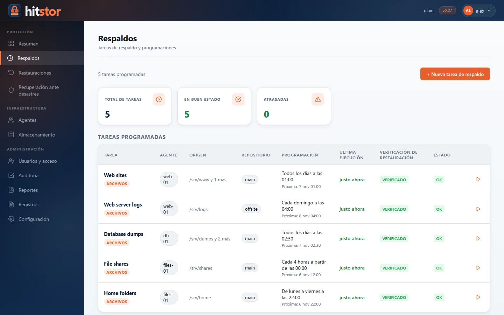

## ¿Qué es HitStor?

HitStor respalda archivos y aplicaciones de sus equipos Windows y Linux en un
repositorio que usted controla: un disco local o cualquier bucket compatible
con S3. Un **servidor** central programa el trabajo, los **agentes** de cada
equipo hacen los respaldos y las restauraciones, y un **dashboard web** le
permite a su equipo operarlo todo desde el navegador, con cuentas, roles y
verificación en dos pasos.

Los datos se dividen en fragmentos de tamaño variable, se deduplican entre
todos los equipos y respaldos, se comprimen con Zstd y se cifran con
AES-256-GCM antes de escribirse, de modo que el almacenamiento solo guarda
datos cifrados.

## Características

| | |
|---|---|
| **Motor de almacenamiento** | Fragmentación por contenido (FastCDC, 256 KiB–4 MiB), deduplicación entre equipos, compresión Zstd y cifrado AES-256-GCM con claves derivadas con scrypt. Repositorios locales y compatibles con S3; varios repositorios por servidor. |
| **Servidor y agentes** | `hitstor serve` ejecuta el servicio gRPC (TLS, una clave de API por agente) y el dashboard. `hitstor-agent` corre en Linux (amd64, arm64) y Windows (amd64) como servicio, fragmenta y comprime en el equipo y solo envía datos nuevos. |
| **Respaldos** | Incrementales por defecto con reescaneos completos periódicos, programación cron con zonas horarias, instantáneas consistentes (VSS en Windows, LVM y btrfs en Linux), patrones de exclusión, progreso en vivo y una **verificación de restauración** automática después de cada respaldo. |
| **Restauraciones** | Explore cualquier instantánea como un árbol de archivos, elija archivos o carpetas y restaure en su ubicación original, en otra ruta o en otro agente. Un asistente de **recuperación ante desastres** reconstruye un equipo completo; los medios de recuperación bare-metal para Linux (vista previa) se generan con ReaR. |
| **Aplicaciones** | **Plugins de carga de trabajo** firmados e instalables (`.hpk`, ed25519) por agente. El plugin de **SQL Server** transmite respaldos nativos completos, diferenciales y de log mediante VDI, con restauración a un punto en el tiempo y un plan de respaldo por tipo. |
| **Control de acceso** | Cuentas de usuario con roles (administrador, operador de respaldos, operador de restauraciones, consulta) por agente, verificación en dos pasos obligatoria (TOTP y códigos de recuperación) y un **registro de auditoría** a prueba de alteraciones. |
| **Reportes y alertas** | **Reportes PDF** programados (resumen de protección, estado diario) enviados por correo mediante SMTP o Microsoft 365, notificadores por webhook y plugins, y métricas de Prometheus en `/metrics`. |
| **Operación** | Binarios estáticos únicos (`CGO_ENABLED=0`), instaladores de Windows que registran servicios, paquetes `.deb`/`.rpm` e instaladores autoextraíbles para Linux, una imagen de Docker y un dashboard en inglés y español. |

## Capturas

<table>
  <tr>
    <td width="50%"><a href="docs/assets/screenshots/es/backup-wizard-selection.webp">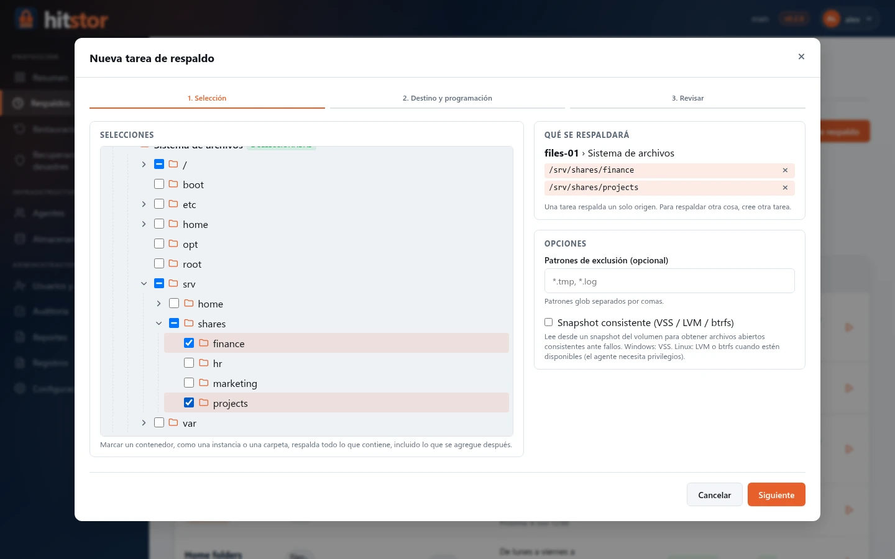</a><br><sub><b>Nueva tarea de respaldo</b>: elija qué proteger en un solo árbol de equipos, sistemas de archivos y objetos de aplicaciones.</sub></td>
    <td width="50%"><a href="docs/assets/screenshots/es/restore.webp">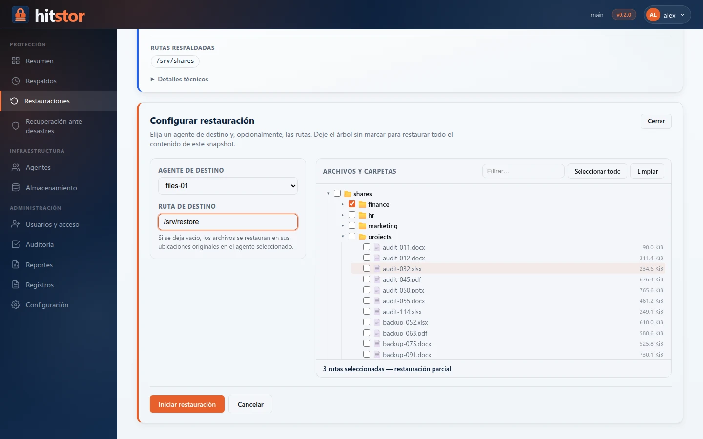</a><br><sub><b>Restauración</b>: explore una instantánea, elija los archivos y su destino.</sub></td>
  </tr>
  <tr>
    <td><a href="docs/assets/screenshots/es/users.webp">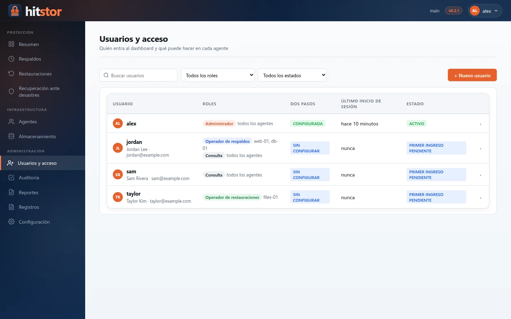</a><br><sub><b>Usuarios y acceso</b>: roles por agente y verificación en dos pasos para todos.</sub></td>
    <td><a href="docs/assets/screenshots/es/report-pdf.webp">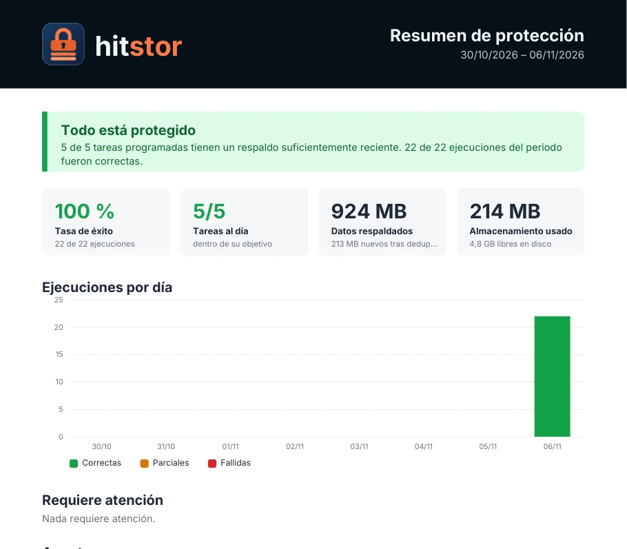</a><br><sub><b>Reportes PDF</b>: un resumen de protección o el estado diario, enviados por correo según una programación.</sub></td>
  </tr>
</table>

<details>
<summary>Más capturas</summary>

| | |
|---|---|
|  | 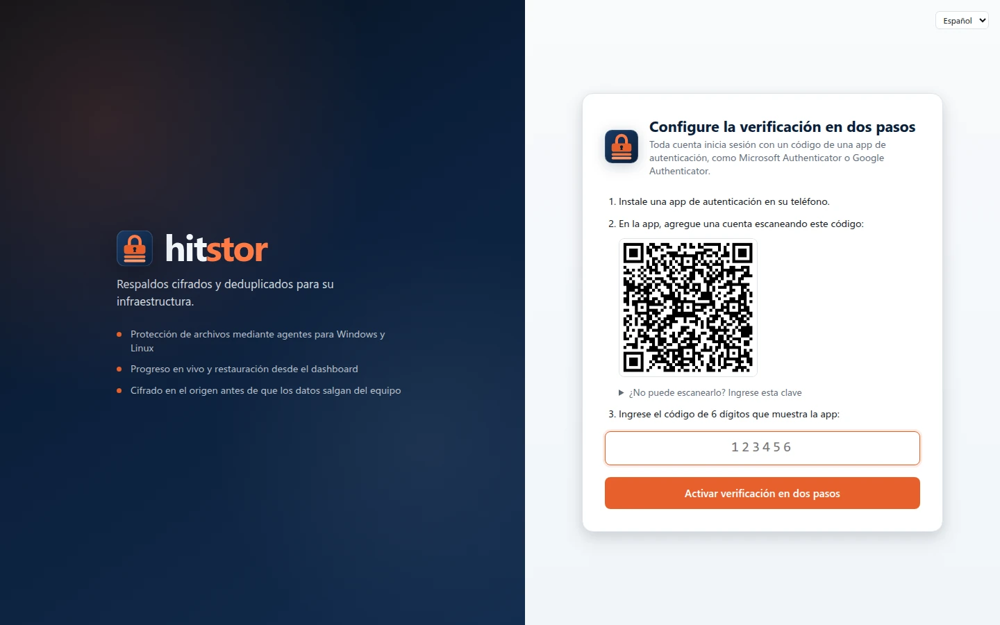 |
| 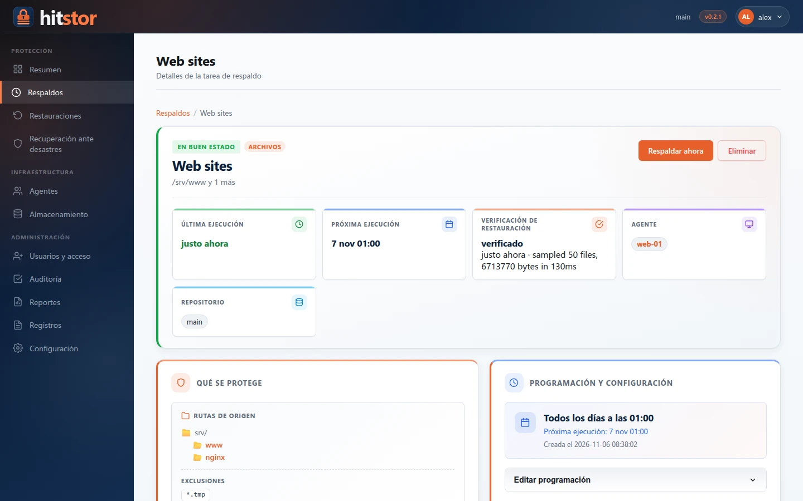 | 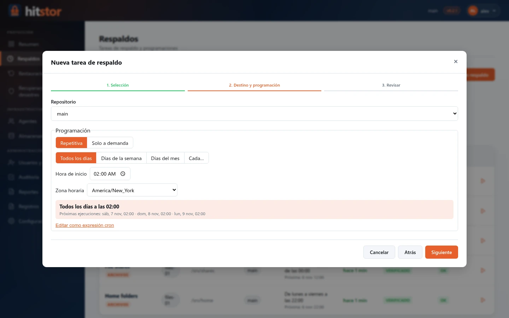 |
| 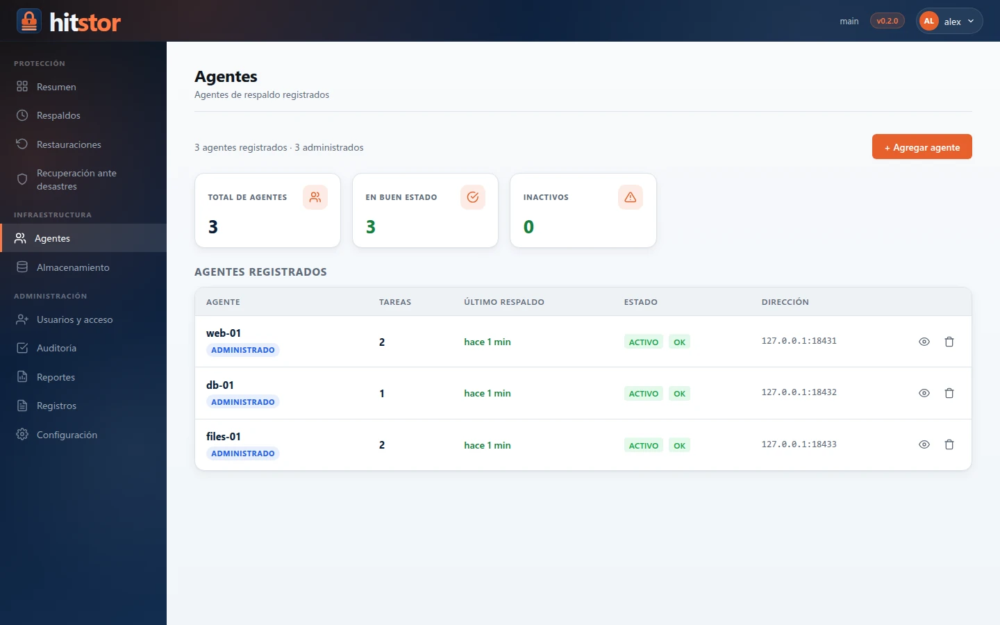 | 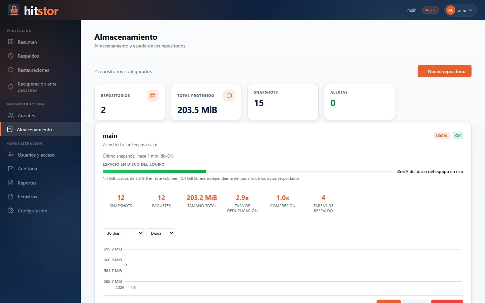 |
| 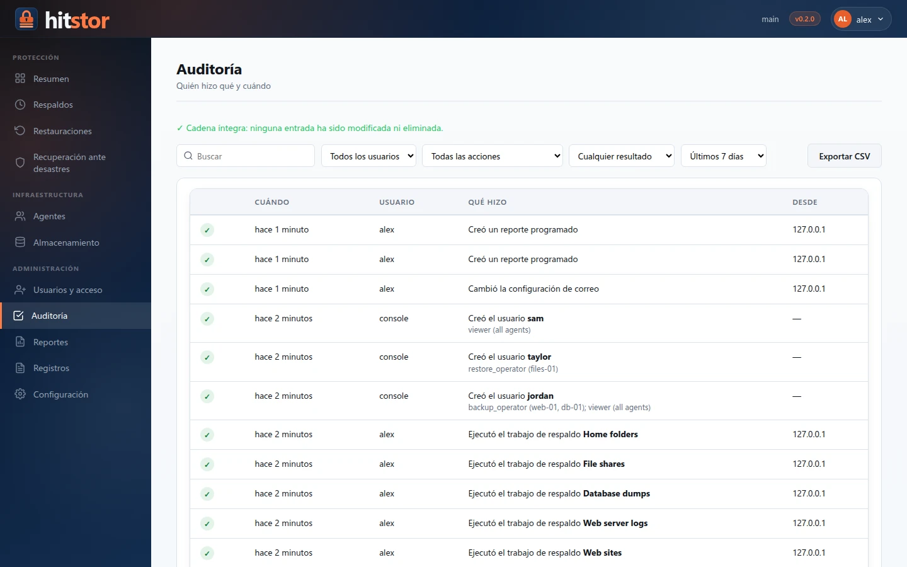 | 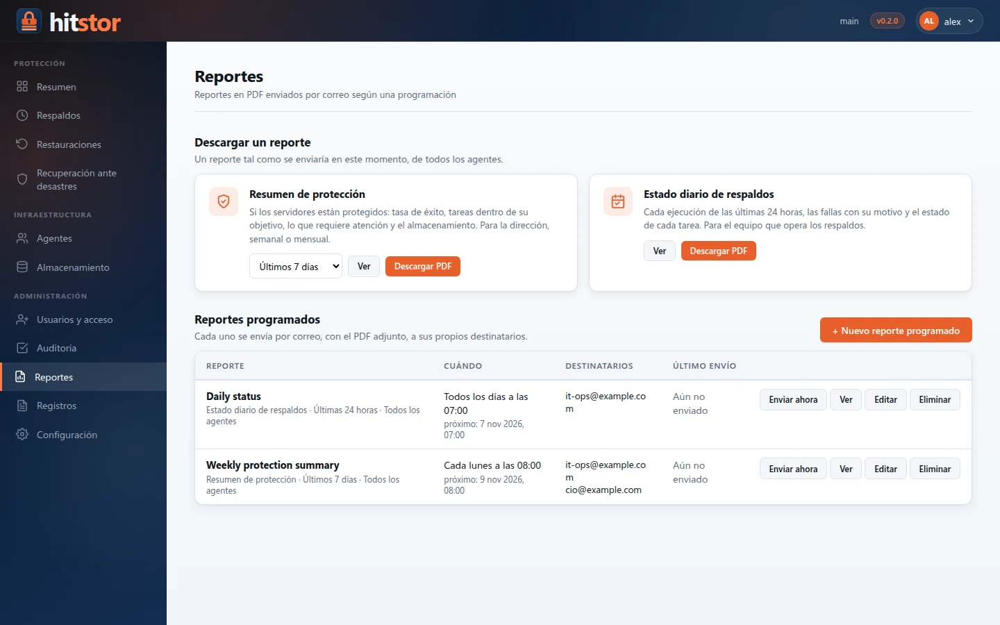 |
| 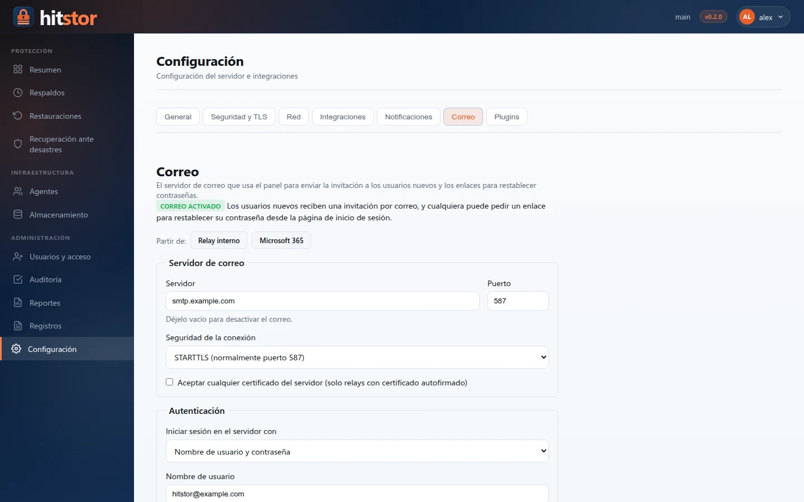 | 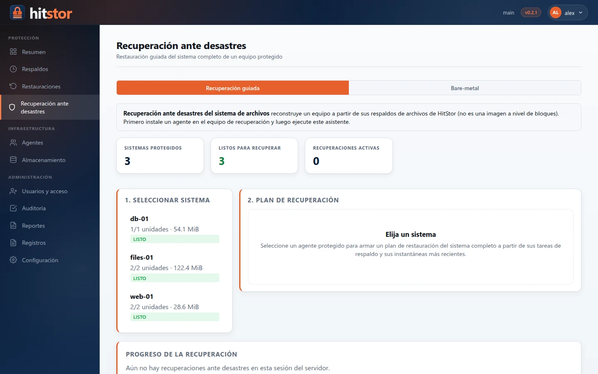 |

</details>

## Cómo funciona

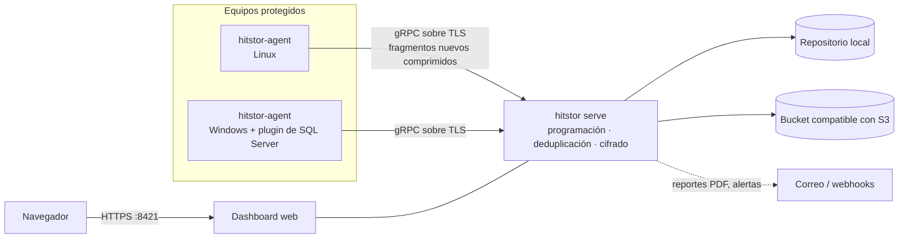

Los agentes escanean, fragmentan, calculan los identificadores y comprimen en
el propio equipo, y solo suben los fragmentos que el repositorio aún no tiene.
El servidor verifica la deduplicación, cifra, empaqueta e indexa los datos,
registra la instantánea y luego comprueba que se pueda restaurar. La línea de
comandos `hitstor` también puede respaldar y restaurar por sí sola, sin
servidor, cifrando en el mismo equipo.

## Inicio rápido

> Guías completas: [Inicio rápido](https://hooperits.github.io/hitstor/es/installation/quickstart/) ·
> [Servidor Windows](https://hooperits.github.io/hitstor/es/installation/windows-server/) ·
> [Instalador de Linux](https://hooperits.github.io/hitstor/es/installation/linux-installer/) ·
> [Docker](https://hooperits.github.io/hitstor/es/installation/docker/)

**1. Ejecute el servidor.** Elija una opción:

```bash
# Docker (Linux, macOS o Windows con Docker Desktop)
git clone https://github.com/hooperits/hitstor.git && cd hitstor
cp .env.example .env            # defina HITSTOR_PASSWORD (cifra el repositorio)
docker compose -f docker-compose.quickstart.yml up -d
```

```bash
# VM Linux: instalador interactivo que configura un servicio de systemd
VERSION=0.2.1
curl -LO https://github.com/hooperits/hitstor/releases/download/v$VERSION/hitstor-server-$VERSION-linux-amd64.run
chmod +x hitstor-server-$VERSION-linux-amd64.run
sudo ./hitstor-server-$VERSION-linux-amd64.run
```

```powershell
# Windows Server: instala e inicia el servicio HitStor (PowerShell elevado)
.\hitstor-0.2.1-windows-amd64-setup.exe /S
```

**2. Cree el primer administrador.** Abra `https://<servidor>:8421`. Un
servidor nuevo pide la *contraseña del dashboard* —la que usted definió
(`HITSTOR_DASHBOARD_PASSWORD` o el asistente del instalador de Linux) o la que
generó y escribió una sola vez en su registro—, luego su nombre de usuario y
contraseña, y le guía para configurar la verificación en dos pasos con una app
de autenticación.

El instalador de Windows inicia el servidor sin repositorio: abra
`http://<servidor>:8421`, inicie sesión con la contraseña del dashboard, cree
un repositorio en **Almacenamiento**, ejecute `Restart-Service HitStor` y
continúe como arriba. [Detalles](https://hooperits.github.io/hitstor/es/installation/quickstart/).

**3. Agregue agentes.** Instale `hitstor-agent` en cada equipo
([Linux](https://hooperits.github.io/hitstor/es/installation/linux-installer/),
[Windows](https://hooperits.github.io/hitstor/es/installation/windows-agent/)),
ejecute `hitstor-agent show-id` para obtener su token y agréguelo en
**Agentes → Agregar agente**. Luego cree una tarea en
**Respaldos → Nueva tarea de respaldo**.

## Descargas

Cada [versión](https://github.com/hooperits/hitstor/releases/latest) publica:

| Plataforma | Servidor | Agente |
|---|---|---|
| Windows (amd64) | `hitstor-<versión>-windows-amd64-setup.exe` | `hitstor-agent-<versión>-windows-amd64-setup.exe` |
| Linux, cualquier distribución (amd64, arm64) | `hitstor-server-<versión>-linux-<arq>.run` | `hitstor-agent-<versión>-linux-<arq>.run` |
| Debian / Ubuntu (amd64) | `hitstor_<versión>_amd64.deb` | `hitstor-agent_<versión>_amd64.deb` |
| RHEL / Rocky / Fedora (x86_64) | `hitstor-<versión>-1.x86_64.rpm` | `hitstor-agent-<versión>-1.x86_64.rpm` |
| Docker (amd64, arm64) | `ghcr.io/hooperits/hitstor:<versión>` | — |

Cada versión incluye además los paquetes firmados de plugins de carga de
trabajo (`*.hpk`) y un archivo `SHA256SUMS`. Verifique las descargas con
`sha256sum -c SHA256SUMS --ignore-missing`.

## Documentación

| | |
|---|---|
| [Instalación](https://hooperits.github.io/hitstor/es/installation/) | Docker, paquetes e instaladores de Linux, servidor y agente de Windows, actualizaciones |
| [Guía del usuario](https://hooperits.github.io/hitstor/es/user-guide/) | Respaldos, restauraciones, instantáneas, retención, plugins, SQL Server, recuperación ante desastres |
| [Administración](https://hooperits.github.io/hitstor/es/admin-guide/) | Puesta en marcha, TLS, usuarios y acceso, tareas, programación, reportes, monitoreo, seguridad |
| [Referencia](https://hooperits.github.io/hitstor/es/reference/) | Todos los comandos, claves de configuración, variables de entorno, APIs gRPC y HTTP |
| [Guía de desarrollo](https://hooperits.github.io/hitstor/es/dev-guide/) | Organización del código, arquitectura de plugins, compilación y empaquetado, pruebas, versiones |

La documentación también está disponible [en inglés](https://hooperits.github.io/hitstor/).

## Compilar desde el código fuente

Requiere Go 1.26 o posterior.

```bash
make build            # bin/hitstor
make agent            # bin/hitstor-agent
make test             # go test ./...
make release-assets VERSION=0.2.1   # paquetes e instaladores (requiere nfpm y NSIS)
```

Consulte [Compilación y empaquetado](https://hooperits.github.io/hitstor/es/dev-guide/build-and-packaging/)
para compilación cruzada, los instaladores de Windows y los paquetes de plugins.

## Contribuir

Los reportes de problemas y los pull requests son bienvenidos: consulte
[CONTRIBUTING.es.md](CONTRIBUTING.es.md). Reporte los problemas de seguridad de
forma privada, como se describe en [SECURITY.es.md](SECURITY.es.md).

## Licencia

HitStor es software libre bajo la [Licencia Pública General Affero de GNU v3.0](LICENSE).
