<div align="center">

<picture>
  <source media="(prefers-color-scheme: dark)" srcset="assets/logo-dark.png">
  
</picture>

**Encrypted, deduplicated backups for Windows and Linux — server, agents and web dashboard in one Go project.**

[](https://github.com/hooperits/hitstor/releases/latest)
[](https://github.com/hooperits/hitstor/actions/workflows/release.yml)
[](go.mod)
[](https://hooperits.github.io/hitstor/)
[](LICENSE)

[Documentation](https://hooperits.github.io/hitstor/) ·
[Download](https://github.com/hooperits/hitstor/releases/latest) ·
[Quick start](#quick-start) ·
[Screenshots](#screenshots) ·
[Changelog](CHANGELOG.md)

**English** | [Español](README.es.md)

</div>

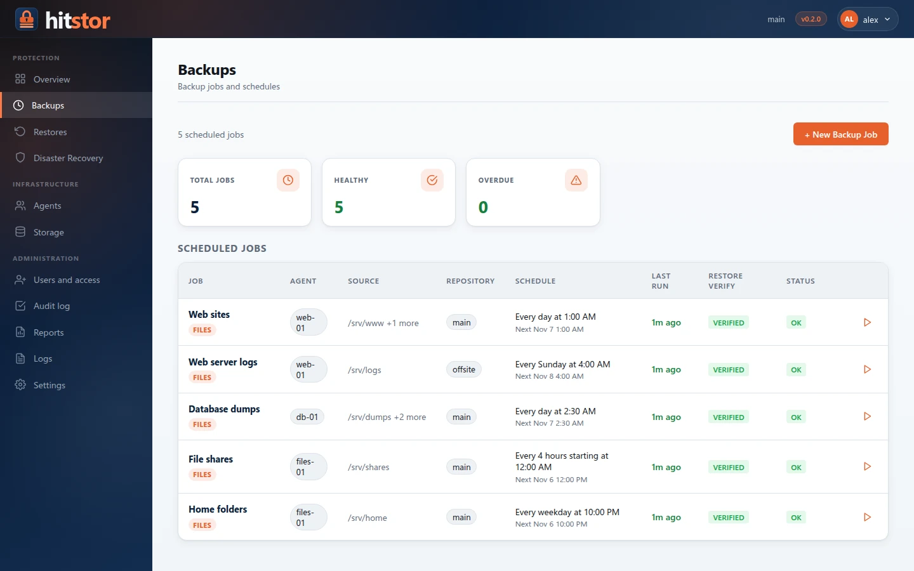

## What is HitStor?

HitStor backs up files and applications on your Windows and Linux machines to a
repository you control — a local disk or any S3-compatible bucket. A central
**server** schedules the work, **agents** on each machine do the backups and
restores, and a **web dashboard** lets your team run everything from a browser,
with accounts, roles and two-step verification.

Data is split into variable-size chunks, deduplicated across every machine and
backup, compressed with Zstd and encrypted with AES-256-GCM before it is
written, so the storage only ever holds ciphertext.

## Highlights

| | |
|---|---|
| **Storage engine** | Content-defined chunking (FastCDC, 256 KiB–4 MiB), cross-host deduplication, Zstd compression, AES-256-GCM encryption with scrypt-derived keys. Local and S3-compatible repositories; several repositories per server. |
| **Server and agents** | `hitstor serve` runs the gRPC service (TLS, one API key per agent) and the dashboard. `hitstor-agent` runs on Linux (amd64, arm64) and Windows (amd64) as a service, chunks and compresses locally, and only sends new data. |
| **Backups** | Incremental by default with periodic full rescans, cron schedules with time zones, consistent snapshots (VSS on Windows, LVM and btrfs on Linux), exclude patterns, live progress, and an automatic **restore check** after each backup. |
| **Restores** | Browse any snapshot as a file tree, pick files or folders, restore to the original place or to another path or agent. A guided **disaster recovery** wizard rebuilds a whole host; bare-metal recovery media for Linux (preview) is built with ReaR. |
| **Applications** | Signed, installable **workload plugins** (`.hpk`, ed25519) per agent. The **SQL Server** plugin streams native full, differential and log backups through VDI, with point-in-time restore and a backup plan per kind. |
| **Access control** | User accounts with roles (administrator, backup operator, restore operator, viewer) scoped per agent, mandatory two-step verification (TOTP and recovery codes), and a tamper-evident **audit log**. |
| **Reports and alerts** | Scheduled **PDF reports** (protection summary, daily status) emailed through SMTP or Microsoft 365, webhook and plugin notifiers, Prometheus metrics at `/metrics`. |
| **Operations** | Single static binaries (`CGO_ENABLED=0`), Windows installers that register services, Linux `.deb`/`.rpm` packages and self-extracting installers, a Docker image, and a dashboard in English and Spanish. |

## Screenshots

<table>
  <tr>
    <td width="50%"><a href="docs/assets/screenshots/en/backup-wizard-selection.webp">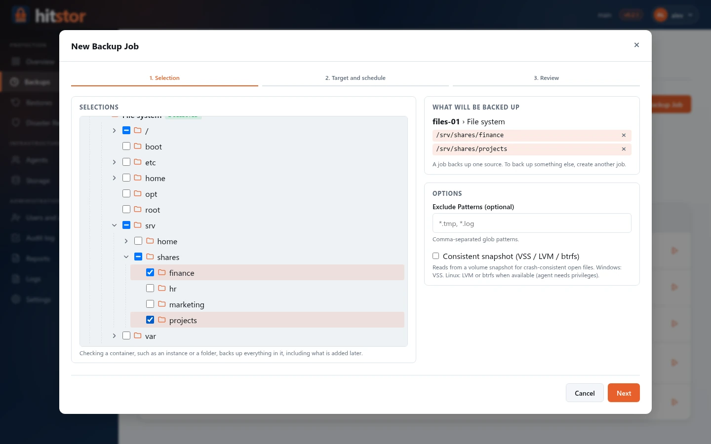</a><br><sub><b>New backup job</b> — pick what to protect from one tree of machines, file systems and application objects.</sub></td>
    <td width="50%"><a href="docs/assets/screenshots/en/restore.webp">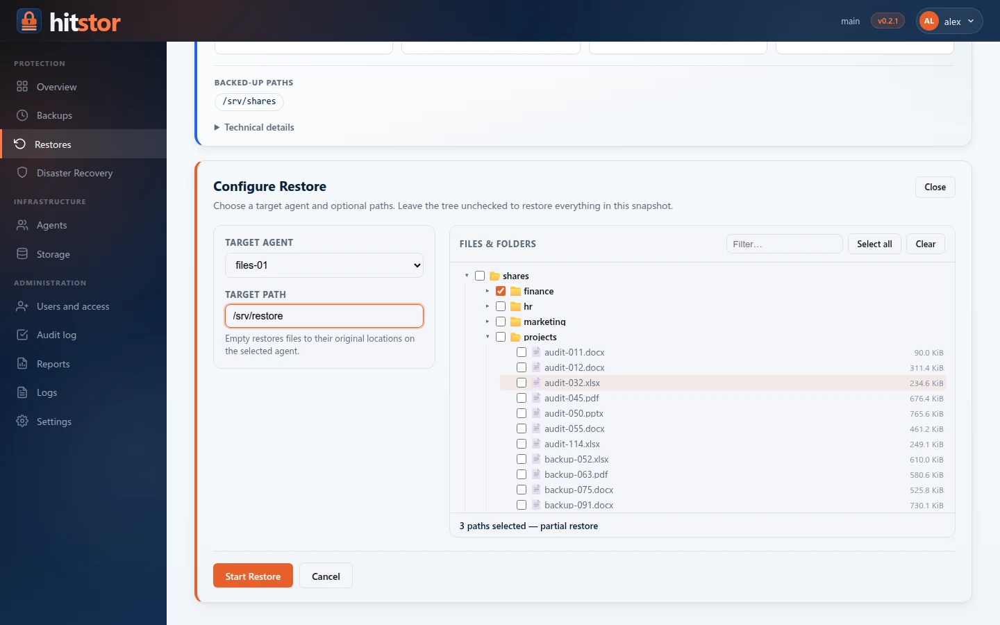</a><br><sub><b>Restore</b> — browse a snapshot, choose files and where they go.</sub></td>
  </tr>
  <tr>
    <td><a href="docs/assets/screenshots/en/users.webp">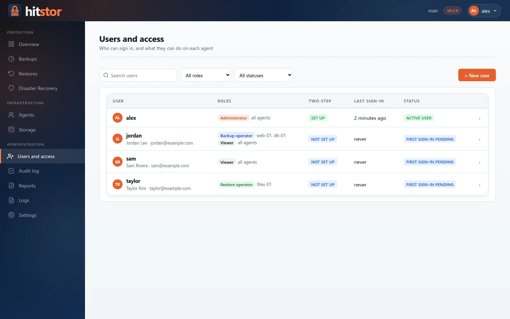</a><br><sub><b>Users and access</b> — roles per agent, two-step verification for everyone.</sub></td>
    <td><a href="docs/assets/screenshots/en/report-pdf.webp">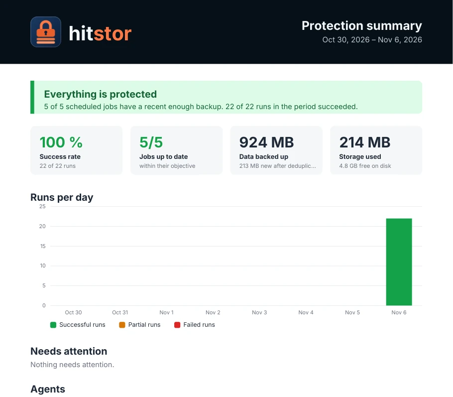</a><br><sub><b>PDF reports</b> — a protection summary or daily status, emailed on a schedule.</sub></td>
  </tr>
</table>

<details>
<summary>More screenshots</summary>

| | |
|---|---|
|  | 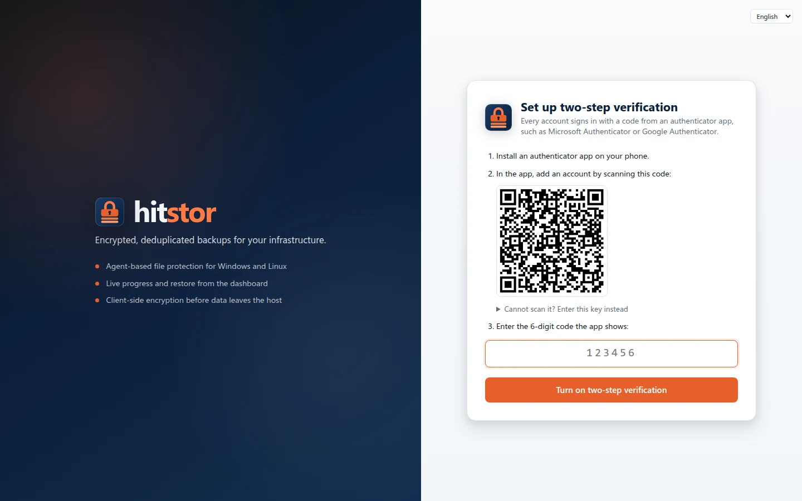 |
| 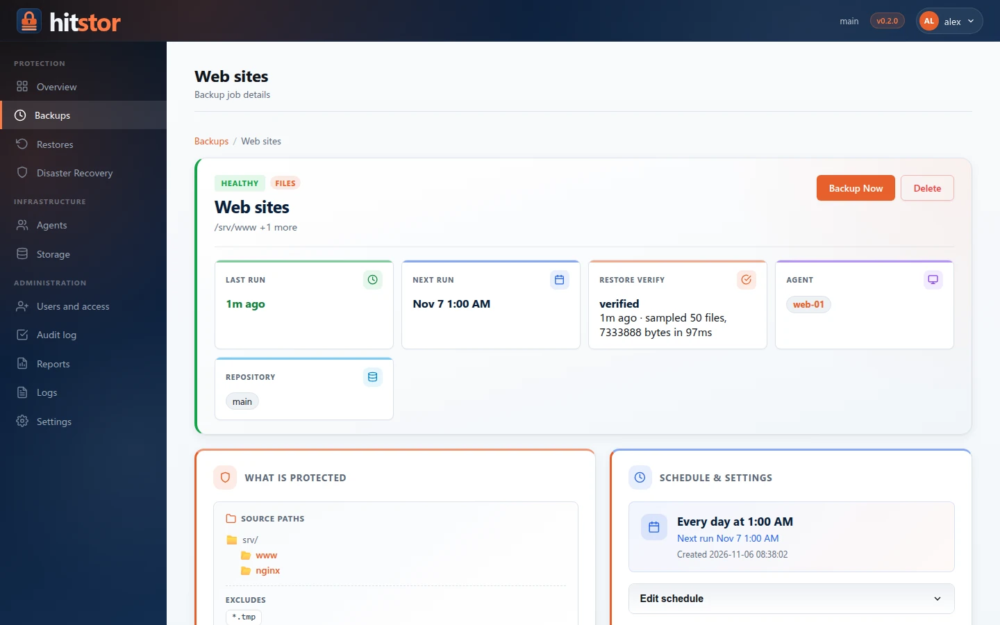 | 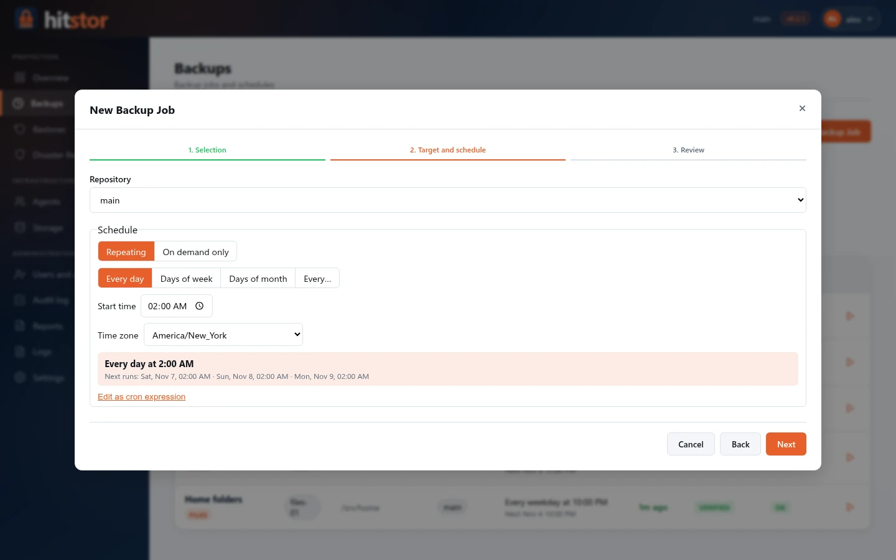 |
| 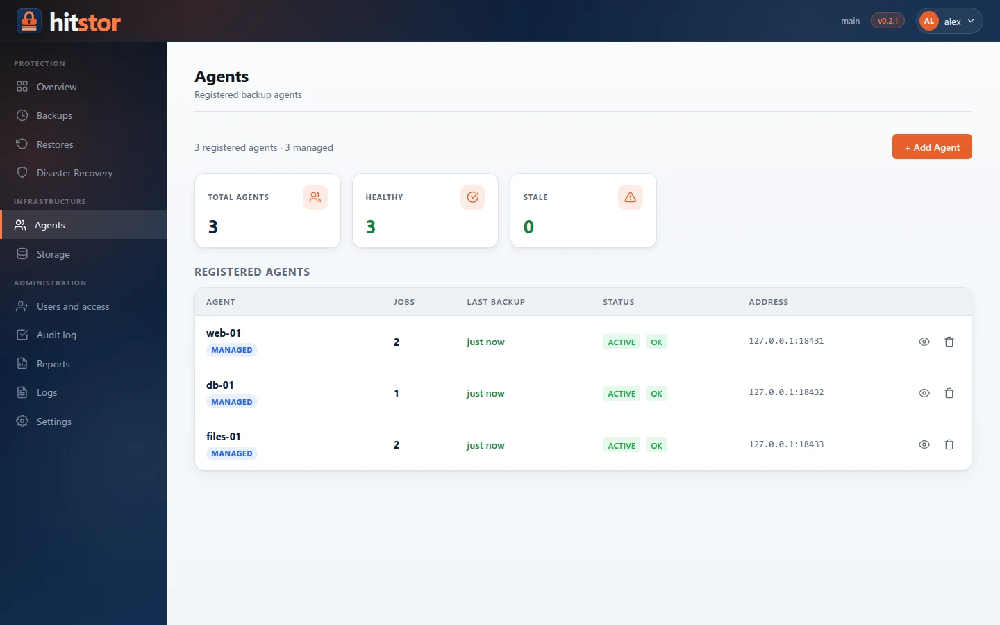 | 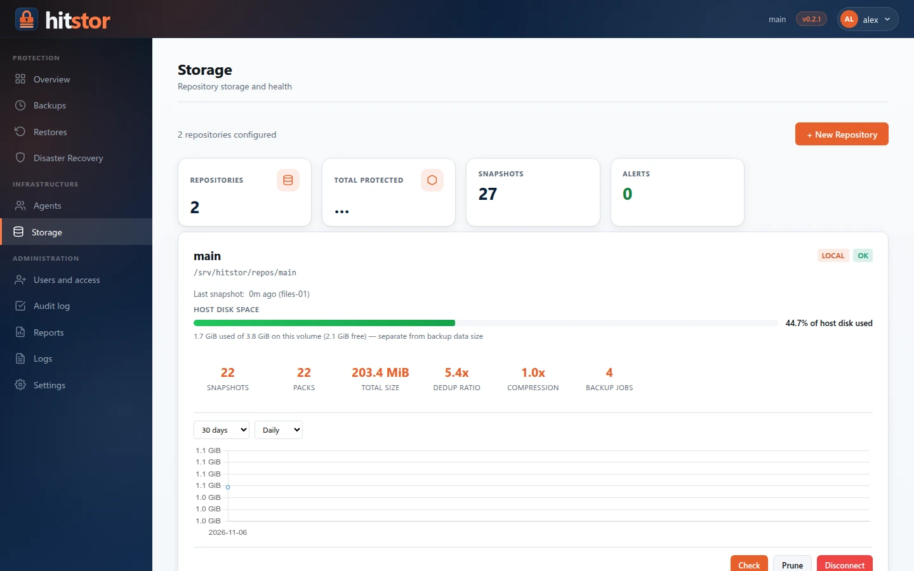 |
| 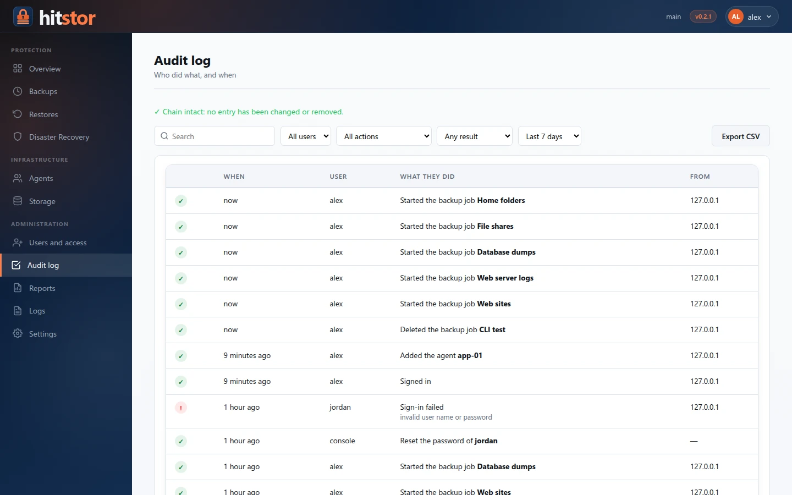 | 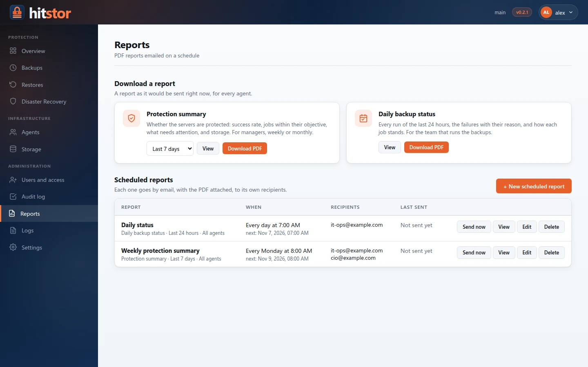 |
| 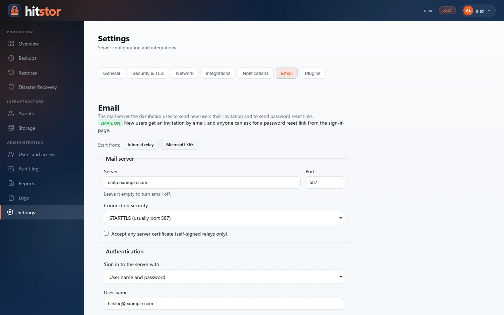 | 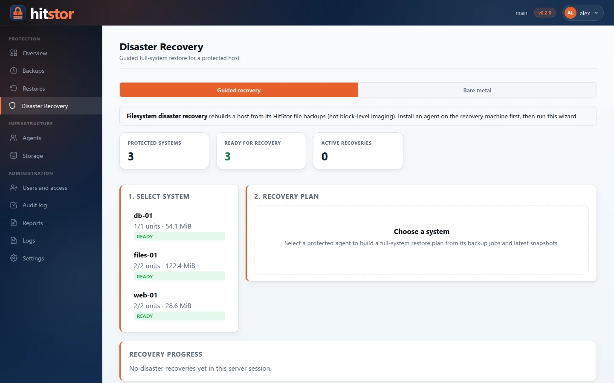 |

</details>

## How it works

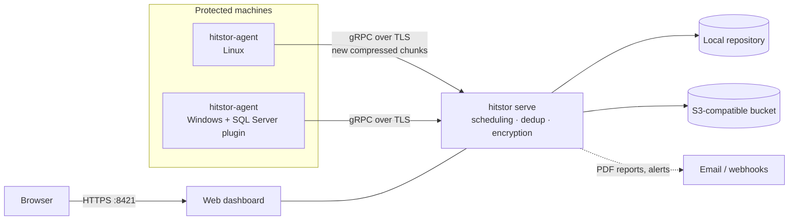

Agents scan, chunk, hash and compress on the host and upload only the chunks
the repository does not have yet. The server checks deduplication, encrypts,
packs and indexes the data, records the snapshot, and then checks that it can be
restored. The `hitstor` command line can also back up and restore on its own,
without a server, encrypting on the machine itself.

## Quick start

> Full guides: [Quick start](https://hooperits.github.io/hitstor/installation/quickstart/) ·
> [Windows server](https://hooperits.github.io/hitstor/installation/windows-server/) ·
> [Linux installer](https://hooperits.github.io/hitstor/installation/linux-installer/) ·
> [Docker](https://hooperits.github.io/hitstor/installation/docker/)

**1. Run the server.** Pick one:

```bash
# Docker (Linux, macOS, or Windows with Docker Desktop)
git clone https://github.com/hooperits/hitstor.git && cd hitstor
cp .env.example .env            # set HITSTOR_PASSWORD (encrypts the repository)
docker compose -f docker-compose.quickstart.yml up -d
```

```bash
# Linux VM: interactive installer that sets up a systemd service
VERSION=0.2.1
curl -LO https://github.com/hooperits/hitstor/releases/download/v$VERSION/hitstor-server-$VERSION-linux-amd64.run
chmod +x hitstor-server-$VERSION-linux-amd64.run
sudo ./hitstor-server-$VERSION-linux-amd64.run
```

```powershell
# Windows Server: installs and starts the HitStor service (elevated PowerShell)
.\hitstor-0.2.1-windows-amd64-setup.exe /S
```

**2. Create the first administrator.** Open `https://<server>:8421`. A new
server asks for the *dashboard password* — the one you set
(`HITSTOR_DASHBOARD_PASSWORD` or the Linux installer wizard) or the one it
generated and wrote once to its log — then for your user name and password, and
has you set up two-step verification with an authenticator app.

The Windows installer starts the server without a repository: open
`http://<server>:8421`, sign in with the dashboard password, create a
repository under **Storage**, run `Restart-Service HitStor`, and continue as
above. [Details](https://hooperits.github.io/hitstor/installation/quickstart/).

**3. Add agents.** Install `hitstor-agent` on each machine
([Linux](https://hooperits.github.io/hitstor/installation/linux-installer/),
[Windows](https://hooperits.github.io/hitstor/installation/windows-agent/)),
run `hitstor-agent show-id` to get its token, and add it under
**Agents → Add Agent**. Then create a job under **Backups → New Backup Job**.

## Downloads

Every [release](https://github.com/hooperits/hitstor/releases/latest) publishes:

| Platform | Server | Agent |
|---|---|---|
| Windows (amd64) | `hitstor-<version>-windows-amd64-setup.exe` | `hitstor-agent-<version>-windows-amd64-setup.exe` |
| Linux, any distribution (amd64, arm64) | `hitstor-server-<version>-linux-<arch>.run` | `hitstor-agent-<version>-linux-<arch>.run` |
| Debian / Ubuntu (amd64) | `hitstor_<version>_amd64.deb` | `hitstor-agent_<version>_amd64.deb` |
| RHEL / Rocky / Fedora (x86_64) | `hitstor-<version>-1.x86_64.rpm` | `hitstor-agent-<version>-1.x86_64.rpm` |
| Docker (amd64, arm64) | `ghcr.io/hooperits/hitstor:<version>` | — |

Signed workload plugin packages (`*.hpk`) and a `SHA256SUMS` file come with
each release. Check downloads with `sha256sum -c SHA256SUMS --ignore-missing`.

## Documentation

| | |
|---|---|
| [Installation](https://hooperits.github.io/hitstor/installation/) | Docker, Linux packages and installers, Windows server and agent, upgrades |
| [User guide](https://hooperits.github.io/hitstor/user-guide/) | Backups, restores, snapshots, retention, plugins, SQL Server, disaster recovery |
| [Administration](https://hooperits.github.io/hitstor/admin-guide/) | Server setup, TLS, users and access, jobs, scheduling, reports, monitoring, security |
| [Reference](https://hooperits.github.io/hitstor/reference/) | Every command, configuration keys, environment variables, gRPC and HTTP APIs |
| [Developer guide](https://hooperits.github.io/hitstor/dev-guide/) | Code layout, plugin architecture, build and packaging, testing, releases |

The documentation is also available [in Spanish](https://hooperits.github.io/hitstor/es/).

## Build from source

Requires Go 1.26 or later.

```bash
make build            # bin/hitstor
make agent            # bin/hitstor-agent
make test             # go test ./...
make release-assets VERSION=0.2.1   # packages and installers (needs nfpm and NSIS)
```

See [Build and packaging](https://hooperits.github.io/hitstor/dev-guide/build-and-packaging/)
for cross-compiling, the Windows installers and plugin packages.

## Contributing

Issues and pull requests are welcome — see [CONTRIBUTING.md](CONTRIBUTING.md).
Please report security problems privately, as described in [SECURITY.md](SECURITY.md).

## License

HitStor is free software under the [GNU Affero General Public License v3.0](LICENSE).
