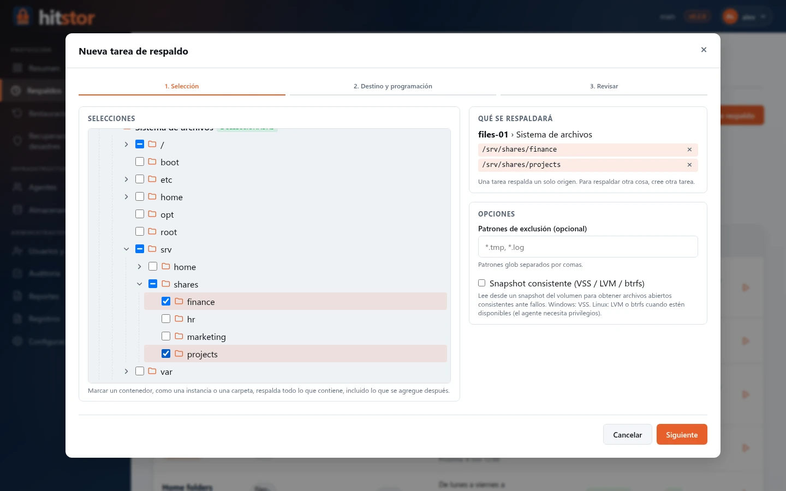
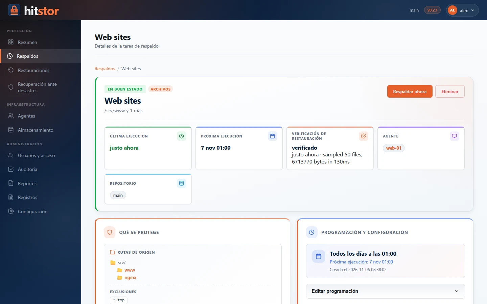
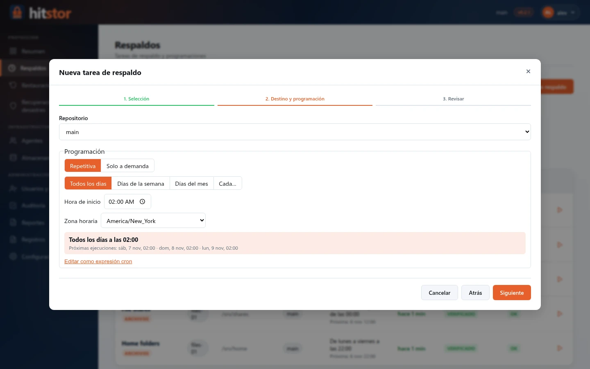

# Tareas de respaldo

La página **Respaldos** del dashboard (`/backups`) es el lugar central para definir qué se respalda y cuándo. Cada tarea de respaldo respalda **un origen de una máquina** y tiene un `job_type` que determina cómo se recopilan los datos. **+ Nueva tarea de respaldo** abre el asistente descrito en [Dashboard → Respaldos](dashboard.md#backups).

{ .screenshot }

## Tipos de tarea { #job-types }

| Tipo | Recolector | Se ejecuta en |
|------|-----------|---------|
| `files` | Escaneo del sistema de archivos del agente mediante el plugin integrado (hitstor-scanner-builtin, incluido con el agente) o un plugin de escáner personalizado (`fs_scanner_plugin`) | Agente remoto |
| `workload` | Un [plugin de carga de trabajo](../user-guide/plugins.md) instalado, por ejemplo [SQL Server](../user-guide/sql-server.md) | Agente remoto (en el host de la aplicación) |

Los tipos de tarea SaaS, de bases de datos incorporadas y de VM en la nube se eliminaron
antes de la primera versión pública (v0.1.0); consulte la [Hoja de ruta](roadmap.md#permanently-removed).
Las tareas heredadas de esos tipos se cargan, pero su programación se deshabilita al iniciar.

## Tareas de sistema de archivos { #filesystem-jobs }

Es el tipo de tarea predeterminado. El servidor asigna rutas y programación a un agente; el agente escanea, divide en fragmentos (chunks) y sube los datos nuevos.

{ .screenshot }

- Elija las carpetas en el árbol de selección del asistente; en la página de la tarea, **Editar selección** las cambia
- Habilite **Snapshot consistente** para leer desde una instantánea (snapshot) del volumen (VSS en Windows, LVM o btrfs en Linux)
- Defina **Reescaneo completo cada** N días para protegerse contra corrupción silenciosa (0 lo desactiva)
- **Respaldar ahora** pregunta si se fuerza un reescaneo completo o se ejecuta un respaldo incremental

## Tareas de carga de trabajo y planes de respaldo { #backup-plans }

Una tarea de carga de trabajo respalda los objetos marcados en el árbol de selección (en SQL Server, una instancia o algunas de sus bases de datos) con un **plan de respaldo**: cada tipo de respaldo que ofrece el plugin tiene su propia programación, y los respaldos diferenciales y de log se basan en los respaldos completos de la propia tarea. El asistente propone:

| Tipo | Programación predeterminada |
|------|-----------------------------|
| Completo | Domingos a las 01:00, activado |
| Diferencial | De lunes a sábado a las 01:00, activado |
| Log | Cada 15 minutos, desactivado |

Cada tipo se puede desactivar (solo a demanda). El servidor entrega al agente el tipo que corresponde a continuación; cuando un completo y un diferencial coinciden, se ejecuta el completo, que cubre al diferencial. En la página de la tarea, **Editar plan** cambia el plan, la fila de cada tipo tiene su propio **Ejecutar ahora** y **Respaldar ahora** pregunta qué tipo ejecutar.

### Resultados por objeto { #results-per-object }

Cada ejecución informa sobre cada objeto de la selección. La página de la tarea muestra, por tipo de respaldo, los objetos que quedaron fuera o fallaron y el motivo; una ejecución que guardó algunos objetos y falló en otros se marca como **parcial**. En SQL Server la página muestra además la **cadena de respaldos** de cada base de datos y ofrece **Ejecutar respaldo completo ahora** cuando un respaldo diferencial o de log necesita un completo nuevo. Consulte [SQL Server](../user-guide/sql-server.md#back-up).

## Programación { #scheduling }

Las programaciones son expresiones cron con una zona horaria IANA, armadas con el selector de programación (todos los días, días de la semana o del mes, cada N minutos u horas) o escritas como expresión de 5 campos. Las tareas creadas antes del selector pueden seguir ejecutándose cada N horas después de su último respaldo; al guardar una programación nueva, se reemplaza por una expresión cron. Consulte [Programación](scheduling.md).

{ .screenshot }

El daemon del agente consulta `GetSchedule` cada 5 minutos (valor predeterminado, `--poll-interval`). "Respaldar ahora" envía además un RPC `WakeUp` a los agentes administrados desde el dashboard para que la tarea se tome de inmediato.

## Retención { #retention }

Las tareas no eliminan instantáneas antiguas. Aplique una política de retención con `hitstor forget --keep-*` (agregue `--prune` para recuperar el espacio); en las instantáneas de carga de trabajo, la política conserva cadenas de respaldo completas. Consulte [Retención](../user-guide/retention.md).

## Cancelar respaldos en ejecución { #cancel-running-backups }

`POST /api/backups/{id}/cancel` aborta una sesión activa. Las sesiones sin actividad durante 10 minutos o más muestran la insignia **detenido** en el dashboard.

## API { #api }

Consulte [API HTTP del dashboard: tareas de respaldo](../reference/dashboard-api.md#backup-jobs).
