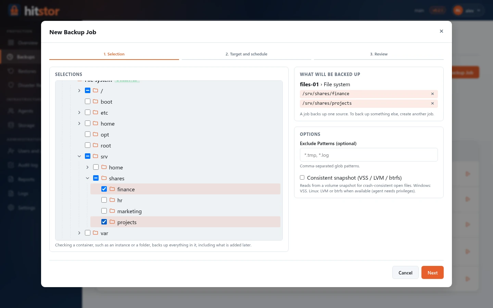
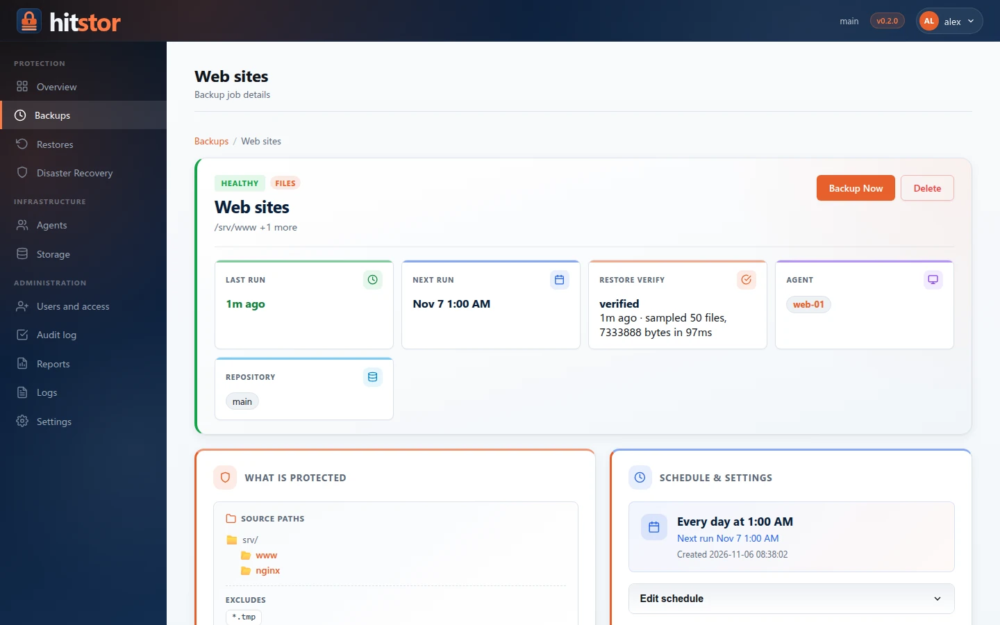
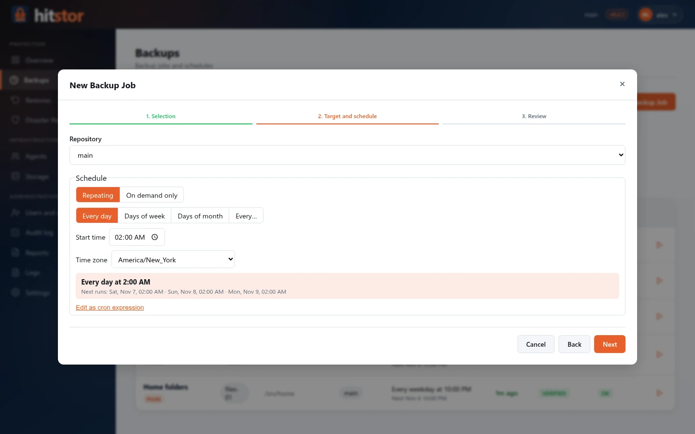

# Backup Jobs

The dashboard **Backups** page (`/backups`) is the central place to define what gets backed up and when. Each backup job backs up **one source of one machine** and has a `job_type` that determines how data is collected. **+ New Backup Job** opens the wizard described in [Dashboard → Backups](dashboard.md#backups).

{ .screenshot }

## Job Types

| Type | Collector | Runs on |
|------|-----------|---------|
| `files` | Agent filesystem scan via built-in plugin (hitstor-scanner-builtin, shipped with agent) or a custom scanner plugin (`fs_scanner_plugin`) | Remote agent |
| `workload` | An installed [workload plugin](../user-guide/plugins.md), for example [SQL Server](../user-guide/sql-server.md) | Remote agent (on the application host) |

SaaS, built-in database, and cloud-VM job types were removed before the first
public release (v0.1.0) — see the [Roadmap](roadmap.md#permanently-removed).
Legacy jobs of those types are loaded, but their schedules are disabled on startup.

## Filesystem Jobs

The default job type. The server assigns paths and schedule to an agent; the agent scans, chunks, and uploads new data.

{ .screenshot }

- Choose the folders in the wizard's selection tree; on the job page, **Edit selection** changes them
- Enable **Consistent snapshot** to read from a volume snapshot (VSS on Windows, LVM or btrfs on Linux)
- Set **Full re-scan every** N days to guard against silent corruption (0 disables it)
- **Backup Now** asks whether to force a full re-scan or run an incremental backup

## Workload Jobs and Backup Plans { #backup-plans }

A workload job backs up the objects checked in the selection tree (for SQL Server, an instance or some of its databases) with a **backup plan**: each backup kind the plugin offers has its own schedule, and differential and log backups build on the job's own fulls. The wizard proposes:

| Kind | Default schedule |
|------|------------------|
| Full | Sundays at 01:00, on |
| Differential | Monday to Saturday at 01:00, on |
| Log | Every 15 minutes, off |

Each kind can be switched off (on demand only). The server hands the agent the kind that is due next; when a full and a differential fall at the same time, the full runs and covers the differential. On the job page, **Edit plan** changes the plan, each kind's row has its own **Run now**, and **Backup Now** asks which kind to run.

### Results per object { #results-per-object }

Each run reports on every object of the selection. The job page shows, per backup kind, the objects that were left out or failed and why; a run that stored some objects and failed others is marked **partial**. For SQL Server the page also shows each database's **backup chain**, and offers **Run full backup now** when a differential or log backup needs a new full. See [SQL Server](../user-guide/sql-server.md#back-up).

## Scheduling

Schedules are cron expressions with an IANA time zone, built with the schedule picker (every day, days of the week or month, every N minutes or hours) or typed as a 5-field expression. Jobs created before the picker may still run every N hours after their last backup; saving a new schedule replaces that with a cron expression. See [Scheduling](scheduling.md).

{ .screenshot }

The agent daemon polls `GetSchedule` every 5 minutes (default, `--poll-interval`). "Backup Now" also sends a `WakeUp` RPC to dashboard-managed agents for immediate pickup.

## Retention { #retention }

Jobs do not delete old snapshots. Apply a retention policy with `hitstor forget --keep-*` (add `--prune` to reclaim the space); for workload snapshots the policy keeps whole backup chains. See [Retention](../user-guide/retention.md).

## Cancel Running Backups

`POST /api/backups/{id}/cancel` aborts an active session. Sessions with no activity for 10+ minutes show a **stalled** badge on the dashboard.

## API

See [Dashboard HTTP API — Backup Jobs](../reference/dashboard-api.md#backup-jobs).
