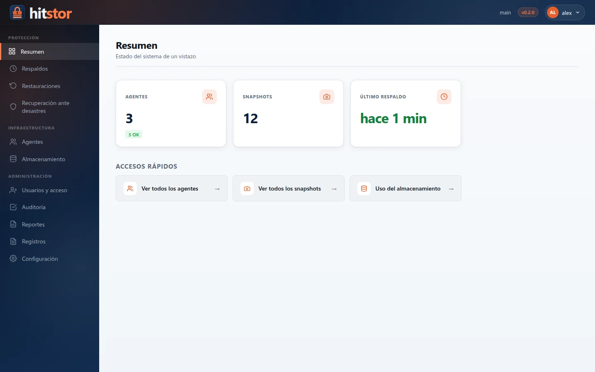
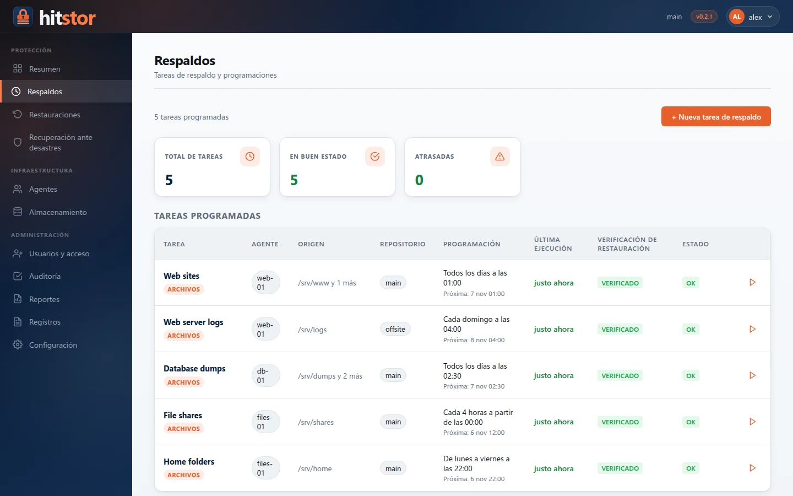
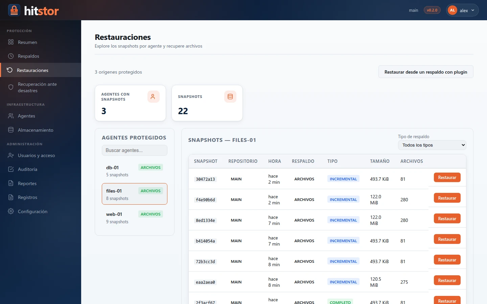
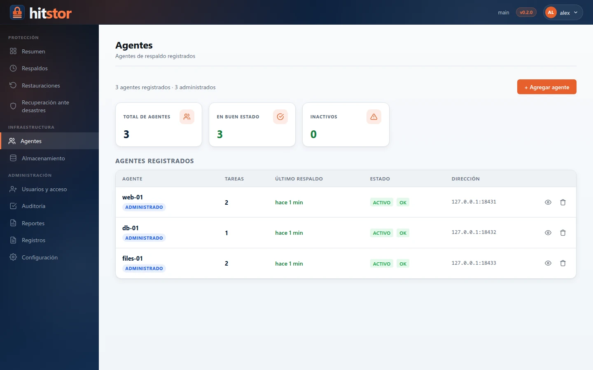
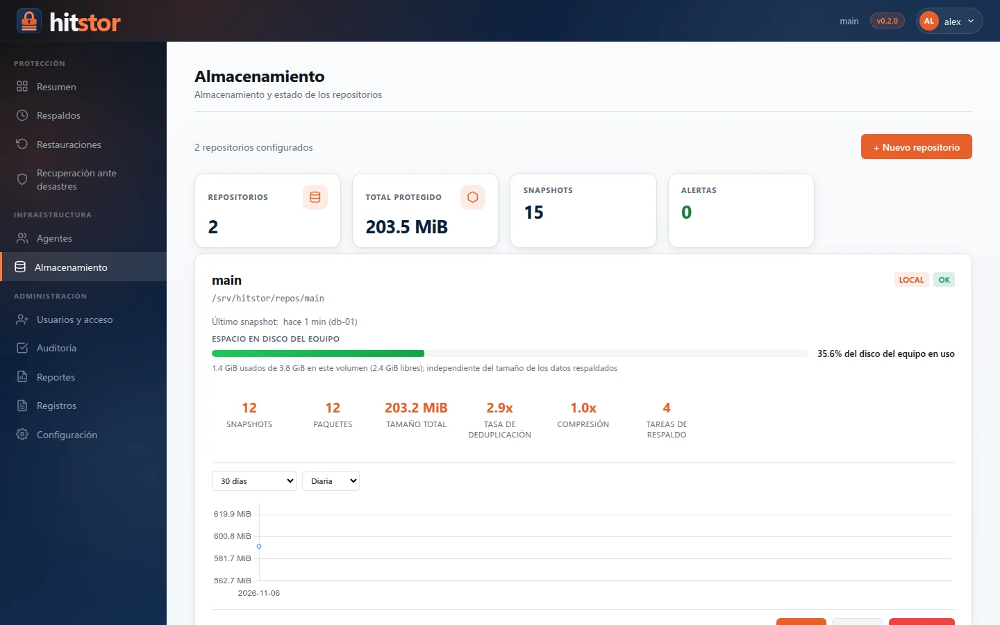

# Dashboard web

HitStor incluye un dashboard web integrado para monitorear la infraestructura de respaldo, administrar agentes y tareas de respaldo, restaurar datos y configurar el servidor. El dashboard lo sirve el mismo proceso `hitstor serve` que atiende las conexiones gRPC.

## Acceso al dashboard { #accessing-the-dashboard }

El dashboard está disponible en:

```
https://SERVER_IP:8421
```

Reemplace `SERVER_IP` por el nombre de host o la dirección IP del servidor HitStor. El puerto predeterminado del dashboard es `8421` y se puede cambiar con `--dashboard-port`.

Cuando el servidor ya tiene un repositorio, el dashboard usa HTTPS con el mismo certificado que el puerto gRPC (consulte [Certificados TLS](tls-certificates.md)); con el certificado autofirmado predeterminado, el navegador muestra una advertencia hasta que usted lo acepte. Las peticiones HTTP sin cifrar al mismo puerto se redirigen a HTTPS, de modo que `http://<servidor>:8421` también funciona. Mientras no exista ningún repositorio, el servidor está en modo de configuración inicial y sirve el dashboard por HTTP sin cifrar.

## Inicio de sesión { #signing-in }

Cada persona inicia sesión con una cuenta personal: usuario, contraseña y un código de una app de autenticación. Los roles deciden qué páginas, agentes y acciones tiene cada uno. Consulte [Usuarios y acceso](users.md).

En un servidor nuevo, o al actualizar desde una versión con una única contraseña de dashboard, el dashboard pide primero crear el administrador confirmando la contraseña compartida del dashboard. Esa contraseña proviene de la clave de configuración `serve_dashboard_password`; si no hay ninguna, `hitstor serve` genera una al iniciar, guarda su hash en el archivo de configuración e imprime el texto plano una sola vez en el registro del servidor (busque `no dashboard password configured`). Una vez que existe el primer administrador, la contraseña compartida ya no permite iniciar sesión.

Las cookies de sesión son `HttpOnly` y `SameSite=Lax`, y los cambios se rechazan cuando el navegador indica que la solicitud viene de otro sitio.

## Notificaciones de actualización { #update-notifications }

Cuando `update_check: true` está definido en la configuración (o **Buscar actualizaciones automáticamente** está habilitado en **Configuración → General**), el servidor busca nuevas versiones mediante la API de GitHub Releases (o `update_url`) al iniciar y cada 24 horas. Las comprobaciones están desactivadas mientras no se habiliten. Si hay una versión más reciente, aparece un banner de notificación en la parte superior de cada página del dashboard:

> **HitStor v1.1.0 está disponible (actual: v1.0.0).** [Ver versión](#)

El banner enlaza a la página de la versión en GitHub. También puede comprobarlo manualmente desde la CLI con `hitstor version --check`.

## Diseño { #layout }

El dashboard usa una barra de encabezado fija, una barra lateral con navegación por íconos y un área de contenido principal. El encabezado muestra el nombre del repositorio, la versión y, a la derecha, el menú del usuario: **Mi cuenta**, el idioma y **Cerrar sesión**.

La barra lateral agrupa las páginas según lo que se hace con ellas y muestra solo lo que su rol permite:

- **Protección**: Resumen, Respaldos, Restauraciones, Recuperación ante desastres
- **Infraestructura**: Agentes, Almacenamiento
- **Administración**: Usuarios y acceso, Auditoría, Reportes, Registros, Configuración

Los botones de acciones que su rol no permite (por ejemplo, eliminar un agente o ejecutar una tarea en un agente que no opera) no se muestran.

## Páginas del dashboard { #dashboard-pages }

### Resumen { #overview }

{ .screenshot }

La página principal muestra un resumen de la infraestructura de respaldo:

- Número de agentes e instantáneas (snapshots), respaldos en ejecución, hora del último respaldo y uso del almacenamiento
- Desglose del estado de los agentes (OK, inactivo, nunca respaldado)
- Alertas activas de Ransomware Sentinel, con **Resolver y reactivar**
- Accesos rápidos a las páginas Agentes y Almacenamiento

### Respaldos { #backups }

{ .screenshot }

Lista las tareas de respaldo con su agente, última ejecución, verificación de
restauración y estado. **+ Nueva tarea de respaldo** abre un asistente de tres
pasos inspirado en las tareas de las herramientas de respaldo empresariales:

1. **Selección.** Un árbol muestra cada máquina registrada con su estado y su
   sistema operativo. Al expandir una máquina aparecen sus orígenes: el
   **Sistema de archivos** y cada plugin instalado (por ejemplo **Microsoft
   SQL Server**, con sus instancias y bases de datos). Marque lo que desea
   respaldar; marcar un contenedor (una carpeta, una instancia) respalda todo
   lo que contiene, incluido lo que se agregue después. Una tarea respalda
   **un solo origen de una máquina**: al marcar algo, los demás orígenes se
   bloquean hasta vaciar la selección. El panel lateral muestra la selección
   y las opciones del origen: patrones de exclusión e instantáneas
   consistentes para un sistema de archivos, las opciones del plugin para un
   plugin.
2. **Destino y programación.** El repositorio y cuándo se ejecuta. Un
   sistema de archivos recibe una sola programación, cada noche a las 02:00
   de forma predeterminada. Un origen de plugin recibe un **plan de
   respaldo** con una programación por tipo de respaldo: completos semanales
   y diferenciales diarios activados, respaldos de log cada 15 minutos
   desactivados (consulte [Tareas de respaldo](backup-jobs.md#backup-plans)).
3. **Revisar.** Un resumen de la tarea, con la programación en palabras y su
   próxima ejecución, y un nombre sugerido.

Una tarea programada aparece como **Atrasada** cuando su último respaldo es
más antiguo de lo que permite su programación: el mayor intervalo entre dos
ejecuciones más la mitad de ese intervalo (para una tarea semanal, unos 10½
días). Los reportes usan la misma regla.

Las máquinas sin conexión o suspendidas aparecen en el árbol pero no se pueden
expandir. En la página de una tarea, **Editar selección** abre el mismo árbol
para la máquina y el origen de esa tarea, con la selección actual marcada; ahí
también se cambian las opciones del origen. **Editar programación** (archivos)
o **Editar plan** (plugins) cambia cuándo se ejecuta. Para respaldar otro
origen, cree otra tarea.

### Restauraciones { #restores }

Restaura archivos desde las instantáneas de un agente protegido, en el mismo agente o en otro, y restaura respaldos de plugins (por ejemplo, una base de datos de SQL Server a un punto en el tiempo) con **Restaurar desde un respaldo con plugin**. Las restauraciones activas muestran su progreso. Consulte [Restauración](../user-guide/restore.md).

{ .screenshot }

### Recuperación ante desastres { #disaster-recovery }

Recuperación guiada del sistema completo de un agente protegido en un host reconstruido y, en **Bare-metal**, medios de recuperación y tokens de recuperación de un solo uso para hosts Linux. Consulte [Recuperación ante desastres](../user-guide/disaster-recovery.md) y [Restauración bare-metal](../user-guide/bare-metal-restore.md).

### Agentes { #agents }

Lista todos los agentes registrados con su estado actual, tipo (administrado o CLI), número de tareas y hora del último respaldo. Haga clic en el nombre de un agente para ver su página de detalle.

{ .screenshot }

**Agregar un agente desde el dashboard** (administradores):

1. Haga clic en **+ Agregar agente** y use **Escaneo de red** para escanear una subred local, o **Entrada manual** para conectarse a un agente por su dirección IP
2. En **Registrar agente**, ingrese el nombre del agente y el token (`hitstor-agent show-id` en la máquina del agente)
3. Haga clic en **Registrar agente**

El servidor se conecta al agente mediante AgentService (puerto 8422), verifica el token y envía la clave de API y la dirección del servidor. Consulte [Gestión de agentes](agent-management.md) y [Descubrimiento de agentes](agent-discovery.md).

### Detalle del agente { #agent-detail }

Muestra información detallada de un agente:

- Estado, tipo, dirección, último respaldo, número de tareas y de tareas en buen estado
- **Suspender agente** / **Reactivar agente**, **+ Nueva tarea de respaldo**, **Eliminar** y **Volver a registrar**, según lo que permita su rol
- **Estado en vivo** (agentes administrados): nombre de host, sistema operativo, versión y otra información consultada al agente
- **Plugins** (agentes administrados): plugins de carga de trabajo instalados, instalación de un paquete de plugin y configuración de las credenciales del plugin
- **Tareas de respaldo**: las tareas del agente con su programación, repositorio, última ejecución y estado

Lo que respalda una tarea (carpetas, bases de datos) se elige en el árbol de selección de la tarea, no en la página del agente.

### Almacenamiento { #storage }

{ .screenshot }

La página Almacenamiento ofrece administración completa de repositorios:

- **Lista de repositorios**: muestra todos los repositorios configurados (locales y S3) con insignias de estado, barras de uso de disco, cantidad de instantáneas y estadísticas de paquetes e índices
- **Crear repositorio**: inicializa un nuevo repositorio local o compatible con S3 directamente desde el dashboard. Los repositorios locales muestran el espacio en disco disponible y detectan repositorios existentes en la ruta indicada
- **Conectar repositorio existente**: si ya existe un repositorio en una ruta (por ejemplo, después de reinstalar), el dashboard lo detecta y se conecta a él en lugar de reinicializarlo
- **Desconectar repositorio**: quita un repositorio de la configuración (no borra los datos en disco)
- **Verificación de integridad**: ejecuta `hitstor check` sobre un repositorio con progreso en tiempo real mediante Server-Sent Events. Los resultados muestran si pasó o falló y los errores encontrados
- **Depurar (prune)**: libera espacio eliminando datos no referenciados, con un diálogo de confirmación y progreso en vivo. Muestra los paquetes eliminados, los bytes liberados y los índices reescritos
- **Gráfico de crecimiento**: visualiza el crecimiento del almacenamiento a lo largo del tiempo con un rango de fechas configurable (30 días, 90 días, 6 meses, 1 año, todo) y granularidad (diaria, semanal)
- **Instantáneas**: la página de cada repositorio lista sus instantáneas; la página de una instantánea permite explorar su contenido y restaurar archivos individuales o rutas completas. Consulte [Restauración](../user-guide/restore.md). (`/snapshots` redirige aquí).

### Usuarios y acceso, Auditoría { #users-and-access-audit-log }

Cuentas, roles, sesiones y el registro de auditoría a prueba de manipulaciones (administradores). Consulte [Usuarios y acceso](users.md).

### Reportes { #reports }

Reportes PDF programados y descargas a pedido (administradores). Consulte [Reportes](reports.md).

### Registros { #logs }

Entradas de registro del servidor y de los agentes, con filtros y exportación. La retención del registro en memoria y del archivo de registro rotativo opcional se define en **Configuración → General**.

### Configuración { #settings }

Punto central de la configuración del servidor (administradores): rendimiento general, TLS, puertos de red, **Integraciones** (Gemini), notificaciones, correo y paquetes de plugins. Consulte [Configuración del servidor](settings.md).

### Mi cuenta { #my-account }

El perfil de cada usuario, su contraseña, la verificación en dos pasos, los códigos de recuperación, el idioma y las sesiones abiertas. Consulte [Usuarios y acceso](users.md#two-step-verification).

## Administración de programaciones { #schedule-management }

Las programaciones pertenecen a las tareas de respaldo, no a los agentes. Las definen los usuarios con el rol de operador de respaldos (o los administradores):

- En el asistente **Nueva tarea de respaldo** (paso 2)
- En la página de una tarea, con **Editar programación** (tareas de sistema de archivos) o **Editar plan** (tareas de carga de trabajo)

Los agentes que se ejecutan en modo daemon (`hitstor-agent daemon`) consultan al servidor si hay cambios en la programación y ejecutan los respaldos en consecuencia. Consulte [Programación](scheduling.md).

## API JSON { #json-api }

El dashboard expone una API JSON para acceso programático. Todos los endpoints devuelven respuestas JSON. La tabla siguiente lista los endpoints de agentes y almacenamiento; consulte la referencia de la [API HTTP del dashboard](../reference/dashboard-api.md) para tareas, restauraciones, configuración y el resto.

### Endpoints { #endpoints }

| Método | Ruta | Descripción |
|--------|------|-------------|
| `GET` | `/api/agents` | Lista todos los agentes registrados con su estado |
| `POST` | `/api/agents` | Agrega un agente administrado desde el dashboard (nombre, dirección del agente, token) |
| `DELETE` | `/api/agents/{name}` | Elimina un agente (`?keep_jobs=true` conserva sus tareas) |
| `POST` | `/api/agents/{name}/suspend` | Suspende un agente |
| `POST` | `/api/agents/{name}/unsuspend` | Reactiva un agente suspendido |
| `POST` | `/api/agents/{name}/schedule` | Programación heredada por intervalo a nivel de agente (las tareas tienen su propia programación) |
| `POST` | `/api/agents/{name}/repo` | Repositorio de destino heredado a nivel de agente (las tareas tienen su propio repositorio) |
| `POST` | `/api/agents/{name}/browse` | Explora el sistema de archivos del agente (agentes administrados) |
| `POST` | `/api/agents/{name}/configure` | Configura las rutas de respaldo del agente (agentes administrados) |
| `GET` | `/api/agents/{name}/info` | Consulta la información del agente (agentes administrados) |
| `GET` | `/api/snapshots` | Lista todas las instantáneas (admite el filtro `?agent=NAME`) |
| `GET` | `/api/stats` | Estadísticas del repositorio (almacenamiento, deduplicación, conteos) |
| `GET` | `/api/repos` | Lista todos los repositorios configurados |
| `POST` | `/api/repos` | Crea un nuevo repositorio (local o S3) |
| `DELETE` | `/api/repos/{name}` | Desconecta un repositorio |
| `POST` | `/api/repos/test-s3` | Prueba la conectividad con un endpoint S3 |
| `POST` | `/api/repos/detect` | Detecta un repositorio existente en una ruta |
| `GET` | `/api/repos/{name}/growth` | Datos de crecimiento del almacenamiento para gráficos |
| `GET` | `/api/repos/{name}/sessions` | Sesiones de respaldo activas de un repositorio |
| `POST` | `/api/repos/{name}/check` | Inicia una verificación de integridad (devuelve el ID de la operación) |
| `POST` | `/api/repos/{name}/prune` | Inicia una operación de depuración (devuelve el ID de la operación) |
| `GET` | `/api/operations/{id}/events` | Flujo SSE con el progreso de la operación |
| `GET` | `/api/disk-space` | Espacio en disco disponible en una ruta dada |

La API usa la misma sesión que el navegador: una solicitud necesita la cookie de sesión (`hitstor_session`) de un usuario que completó la verificación en dos pasos, y solo puede hacer lo que permite el rol de ese usuario. Sin sesión la API responde `401`. En los ejemplos siguientes, `SESSION` es el valor de esa cookie y `-k` acepta el certificado autofirmado predeterminado.

### Ejemplo: agregar un agente { #example-add-an-agent }

```bash
curl -k -X POST https://localhost:8421/api/agents \
  -b "hitstor_session=SESSION" \
  -H 'Content-Type: application/json' \
  -d '{"name":"web-01","agent_addr":"192.168.1.50:8422","token":"a3f8c1d9e4b7..."}'
```

### Ejemplo: explorar el sistema de archivos del agente { #example-browse-agent-filesystem }

```bash
curl -k -X POST https://localhost:8421/api/agents/web-01/browse \
  -b "hitstor_session=SESSION" \
  -H 'Content-Type: application/json' \
  -d '{"path":"/home"}'
```

### Ejemplo: listar agentes { #example-list-agents }

```bash
curl -sk -b "hitstor_session=SESSION" https://localhost:8421/api/agents | jq .
```

## Métricas de Prometheus { #prometheus-metrics }

El dashboard expone un endpoint de métricas compatible con Prometheus cuando el servidor ya tiene un repositorio:

```
https://SERVER_IP:8421/metrics
```

Este endpoint **no requiere autenticación** (es accesible sin iniciar sesión) para que Prometheus pueda recolectar métricas sin gestionar credenciales. Si esto le preocupa, restrinja el acceso a nivel de red.

Consulte [Monitoreo](monitoring.md) para ver la lista completa de métricas y la configuración de Prometheus.

## Próximos pasos { #next-steps }

- [Gestión de agentes](agent-management.md): registrar y administrar agentes
- [Tareas de respaldo](backup-jobs.md): tareas de sistema de archivos y de carga de trabajo, planes de respaldo
- [Monitoreo](monitoring.md): configurar la recolección de Prometheus y las alertas
- [Programación](scheduling.md): opciones detalladas de configuración de la programación
- [Seguridad](security.md): autenticación y endurecimiento del dashboard
