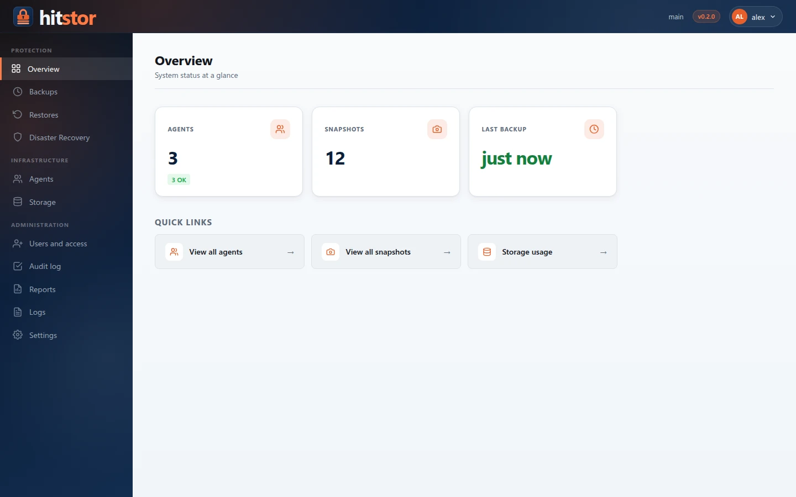
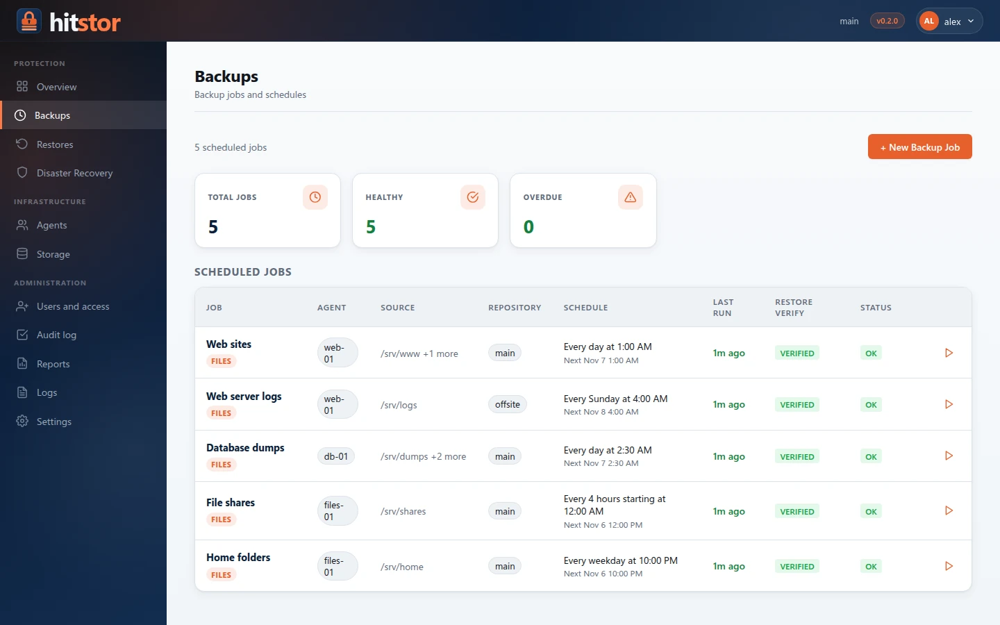
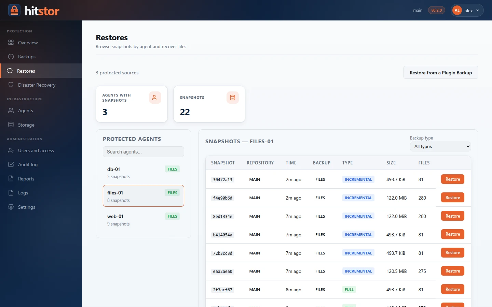
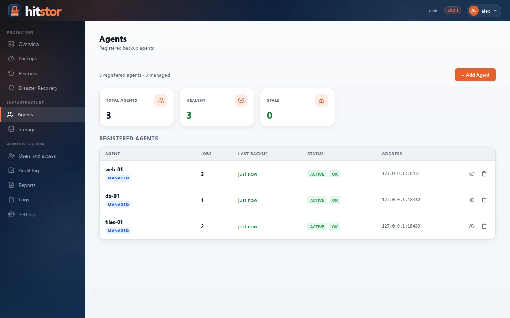
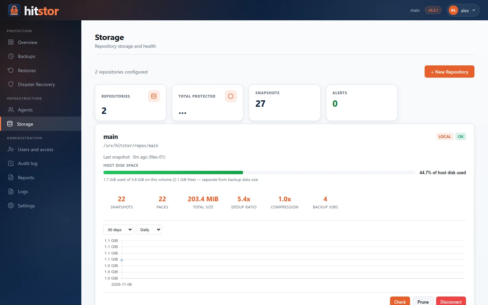

# Web Dashboard

HitStor includes a built-in web dashboard for monitoring backup infrastructure, managing agents and backup jobs, restoring data, and configuring the server. The dashboard is served by the same `hitstor serve` process that handles gRPC connections.

## Accessing the Dashboard

The dashboard is available at:

```
https://SERVER_IP:8421
```

Replace `SERVER_IP` with the hostname or IP address of the HitStor server. The default dashboard port is `8421`, configurable with `--dashboard-port`.

Once the server has a repository, the dashboard uses HTTPS with the same certificate as the gRPC port (see [TLS Certificates](tls-certificates.md)); with the default self-signed certificate the browser shows a warning until you trust it. Plain-HTTP requests to the same port are redirected to HTTPS, so `http://<server>:8421` also works. Before any repository exists, the server is in setup mode and serves the dashboard over plain HTTP.

## Signing In

Everyone signs in with a personal account: user name, password and a code from an authenticator app. Roles decide which pages, agents and actions each person gets. See [Users and Access](users.md).

On a new server, or after upgrading from a version with a single dashboard password, the dashboard first asks to create the administrator, confirming the shared dashboard password. That password comes from the `serve_dashboard_password` configuration key; if none is configured, `hitstor serve` generates one at startup, stores its hash in the config file and prints the plaintext once in the server log (look for `no dashboard password configured`). Once the first administrator exists, the shared password no longer signs in.

Session cookies are `HttpOnly` and `SameSite=Lax`, and changes are refused when the browser reports a request from another site.

## Update Notifications

When `update_check: true` is set in the configuration (or **Check for updates automatically** is enabled under **Settings → General**), the server checks for new releases via the GitHub Releases API (or `update_url`) at startup and every 24 hours. Checks are off unless enabled. If a newer version is available, a notification banner appears at the top of every dashboard page:

> **HitStor v1.1.0 is available (current: v1.0.0).** [View release](#)

The banner links to the release page on GitHub. You can also check manually from the CLI with `hitstor version --check`.

## Layout

The dashboard uses a fixed header bar, a sidebar with icon navigation, and a main content area. The header shows the repository name, the version and, on the right, the user menu: **My account**, the language and **Sign out**.

The sidebar groups pages by what you do with them, and shows only what your role allows:

- **Protection** — Overview, Backups, Restores, Disaster Recovery
- **Infrastructure** — Agents, Storage
- **Administration** — Users and access, Audit log, Reports, Logs, Settings

Buttons for actions your role does not allow (for example removing an agent, or running a job on an agent you do not operate) are not shown.

## Dashboard Pages

### Overview

{ .screenshot }

The main page displays a summary of the backup infrastructure:

- Number of agents and snapshots, backups running, last backup time, and storage usage
- Agent health breakdown (OK, stale, never backed up)
- Active Ransomware Sentinel alerts, with **Resolve & Unsuspend**
- Quick links to the Agents and Storage pages

### Backups { #backups }

{ .screenshot }

Lists the backup jobs with their agent, last run, restore verification, and
status. **+ New Backup Job** opens a three-step wizard modeled on the backup
jobs of enterprise backup tools:

1. **Selection.** A tree shows every registered machine with its status and
   operating system. Expanding a machine lists its sources: the **File
   system** and each installed plugin (for example **Microsoft SQL Server**,
   then its instances and databases). Check what to back up; checking a
   container (a folder, an instance) backs up everything in it, including
   what is added later. A job backs up **one source of one machine**: once
   something is checked, the other sources lock until the selection is
   cleared. The side panel lists the selection and the source's options:
   exclude patterns and consistent snapshots for a file system, the
   plugin's options for a plugin.
2. **Target and schedule.** The repository and when to run. A file system
   gets one schedule, nightly at 02:00 by default. A plugin source gets a
   **backup plan** with one schedule per backup kind: weekly fulls and daily
   differentials on, log backups every 15 minutes off (see
   [Backup Jobs](backup-jobs.md#backup-plans)).
3. **Review.** A summary of the job, with the schedule in words and its next
   run, and a suggested name.

A scheduled job shows **Overdue** when its latest backup is older than its
schedule allows: the longest gap between two runs of its schedule plus half
of it (for a weekly job, about 10½ days). Reports use the same rule.

Machines that are offline or suspended appear in the tree but cannot be
expanded. On a job's page, **Edit selection** opens the same tree for that
job's machine and source, with the current selection checked; the source
options can change there too. **Edit schedule** (files) or **Edit plan**
(plugins) changes when it runs. To back up another source, create another job.

### Restores

Restores files from the snapshots of a protected agent, to the same or another agent, and restores plugin backups (for example a SQL Server database to a point in time) with **Restore from a Plugin Backup**. Active restores show their progress. See [Restore](../user-guide/restore.md).

{ .screenshot }

### Disaster Recovery

Guided full-system recovery of a protected agent onto a rebuilt host, and, under **Bare metal**, recovery media and single-use recovery tokens for Linux hosts. See [Disaster Recovery](../user-guide/disaster-recovery.md) and [Bare-metal restore](../user-guide/bare-metal-restore.md).

### Agents

Lists all registered agents with their current status, type (managed or CLI), number of jobs, and last backup time. Click an agent name to view its detail page.

{ .screenshot }

**Adding an agent from the dashboard** (administrators):

1. Click **+ Add Agent**, then use **Network Scan** to scan a local subnet, or **Manual Entry** to connect to an agent by IP address
2. In **Register Agent**, enter the agent name and the token (`hitstor-agent show-id` on the agent machine)
3. Click **Register Agent**

The server connects to the agent over AgentService (port 8422), verifies the token, and sends API key + server address. See [Agent Management](agent-management.md) and [Agent Discovery](agent-discovery.md).

### Agent Detail

Shows detailed information for a single agent:

- Status, type, address, last backup, number of jobs and healthy jobs
- **Suspend Agent** / **Unsuspend Agent**, **+ New Backup Job**, **Remove** and **Re-register**, as your role allows
- **Live Status** (managed agents) — host name, OS, version and other information queried from the agent
- **Plugins** (managed agents) — installed workload plugins, installing a plugin package and configuring plugin credentials
- **Backup Jobs** — the agent's jobs with their schedule, repository, last run and status

What a job backs up (folders, databases) is chosen in the job's selection tree, not on the agent page.

### Storage

{ .screenshot }

The Storage page provides full repository management:

- **Repository list** — view all configured repositories (local and S3) with status badges, disk usage bars, snapshot counts, and pack/index statistics
- **Create repository** — initialize a new local or S3-compatible repository directly from the dashboard. Local repositories show available disk space and detect existing repos at the given path
- **Connect existing repository** — if a repository already exists at a path (for example, after reinstalling), the dashboard detects it and connects instead of reinitializing
- **Disconnect repository** — remove a repository from the configuration (does not delete data on disk)
- **Integrity check** — run `hitstor check` on a repository with real-time progress via Server-Sent Events. Results show pass/fail status and any errors found
- **Prune** — free space by removing unreferenced data, with confirmation dialog and live progress. Shows packs deleted, bytes freed, and indexes rewritten
- **Growth chart** — visualize storage growth over time with configurable date range (30 days, 90 days, 6 months, 1 year, all) and granularity (daily, weekly)
- **Snapshots** — each repository's page lists its snapshots; a snapshot's page browses its contents and restores individual files or whole paths. See [Restore](../user-guide/restore.md). (`/snapshots` redirects here.)

### Users and access, Audit log

Accounts, roles, sessions and the tamper-evident audit log (administrators). See [Users and Access](users.md).

### Reports

Scheduled PDF reports and on-demand downloads (administrators). See [Reports](reports.md).

### Logs

Server and agent log entries, filterable and exportable. Retention of the in-memory log and the optional rotating log file is set under **Settings → General**.

### Settings

Central hub for server configuration (administrators): general performance, TLS, network ports, **Integrations** (Gemini), notifications, email, and plugin packages. See [Server Settings](settings.md).

### My account

Each user's profile, password, two-step verification, recovery codes, language, and open sessions. See [Users and Access](users.md#two-step-verification).

## Schedule Management

Schedules belong to backup jobs, not to agents. Users with the backup operator role (or administrators) set them:

- In the **New Backup Job** wizard (step 2)
- On a job's page, with **Edit schedule** (filesystem jobs) or **Edit plan** (workload jobs)

Agents running in daemon mode (`hitstor-agent daemon`) poll the server for schedule updates and execute backups accordingly. See [Scheduling](scheduling.md).

## JSON API

The dashboard exposes a JSON API for programmatic access. All endpoints return JSON responses. The table below lists the agent and storage endpoints; see the [Dashboard HTTP API](../reference/dashboard-api.md) reference for jobs, restores, settings and the rest.

### Endpoints

| Method | Path | Description |
|--------|------|-------------|
| `GET` | `/api/agents` | List all registered agents with status |
| `POST` | `/api/agents` | Add a dashboard-managed agent (name, agent address, token) |
| `DELETE` | `/api/agents/{name}` | Remove an agent (`?keep_jobs=true` keeps its jobs) |
| `POST` | `/api/agents/{name}/suspend` | Suspend an agent |
| `POST` | `/api/agents/{name}/unsuspend` | Resume a suspended agent |
| `POST` | `/api/agents/{name}/schedule` | Legacy per-agent interval schedule (jobs carry their own schedules) |
| `POST` | `/api/agents/{name}/repo` | Legacy per-agent target repository (jobs carry their own repository) |
| `POST` | `/api/agents/{name}/browse` | Browse agent filesystem (managed agents) |
| `POST` | `/api/agents/{name}/configure` | Configure agent backup paths (managed agents) |
| `GET` | `/api/agents/{name}/info` | Query agent info (managed agents) |
| `GET` | `/api/snapshots` | List all snapshots (supports `?agent=NAME` filter) |
| `GET` | `/api/stats` | Repository statistics (storage, deduplication, counts) |
| `GET` | `/api/repos` | List all configured repositories |
| `POST` | `/api/repos` | Create a new repository (local or S3) |
| `DELETE` | `/api/repos/{name}` | Disconnect a repository |
| `POST` | `/api/repos/test-s3` | Test S3 endpoint connectivity |
| `POST` | `/api/repos/detect` | Detect existing repository at a path |
| `GET` | `/api/repos/{name}/growth` | Storage growth data for charting |
| `GET` | `/api/repos/{name}/sessions` | Active backup sessions for a repository |
| `POST` | `/api/repos/{name}/check` | Start integrity check (returns operation ID) |
| `POST` | `/api/repos/{name}/prune` | Start prune operation (returns operation ID) |
| `GET` | `/api/operations/{id}/events` | SSE stream for operation progress |
| `GET` | `/api/disk-space` | Available disk space at a given path |

The API uses the same session as the browser, so a request needs the session cookie (`hitstor_session`) of a user who completed two-step verification, and it can do only what that user's role allows. Without a session the API answers `401`. In the examples below, `SESSION` is that cookie's value, and `-k` accepts the default self-signed certificate.

### Example: Add an Agent

```bash
curl -k -X POST https://localhost:8421/api/agents \
  -b "hitstor_session=SESSION" \
  -H 'Content-Type: application/json' \
  -d '{"name":"web-01","agent_addr":"192.168.1.50:8422","token":"a3f8c1d9e4b7..."}'
```

### Example: Browse Agent Filesystem

```bash
curl -k -X POST https://localhost:8421/api/agents/web-01/browse \
  -b "hitstor_session=SESSION" \
  -H 'Content-Type: application/json' \
  -d '{"path":"/home"}'
```

### Example: List Agents

```bash
curl -sk -b "hitstor_session=SESSION" https://localhost:8421/api/agents | jq .
```

## Prometheus Metrics

The dashboard exposes a Prometheus-compatible metrics endpoint once the server has a repository:

```
https://SERVER_IP:8421/metrics
```

This endpoint is **unauthenticated** (accessible without signing in) to allow Prometheus to scrape metrics without credential management. If this is a concern, restrict access at the network level.

See [Monitoring](monitoring.md) for the full list of metrics and Prometheus configuration.

## Next Steps

- [Agent Management](agent-management.md) — register and manage agents
- [Backup Jobs](backup-jobs.md) — filesystem and workload jobs, backup plans
- [Monitoring](monitoring.md) — configure Prometheus scraping and alerting
- [Scheduling](scheduling.md) — detailed scheduling configuration options
- [Security](security.md) — dashboard authentication and hardening
