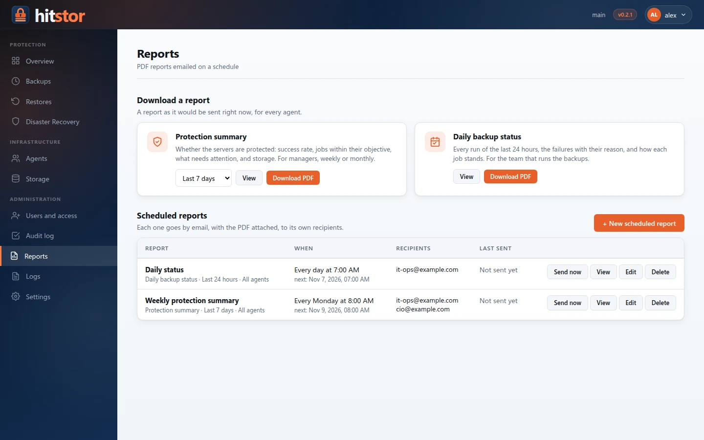
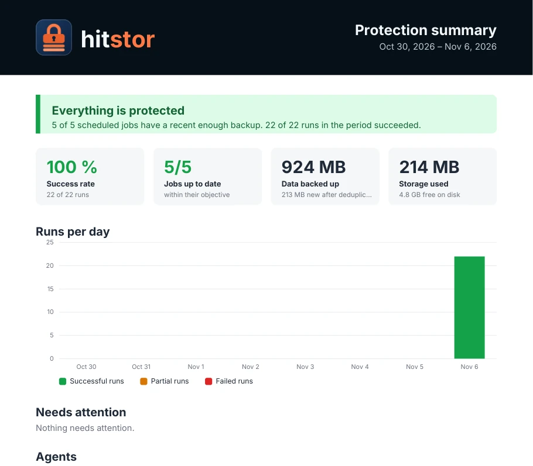

# Reports

HitStor emails PDF reports on a schedule, and any of them can be downloaded at any time. Administrators manage them under **Administration → Reports**. Sending needs [email](users.md#email) set up; downloading does not.

{ .screenshot }

## Types { #types }

{ .screenshot }

| Report | Covers | For |
|--------|--------|-----|
| **Protection summary** | The last 7 or 30 days | Managers: are the servers protected? |
| **Daily backup status** | The last 24 hours | The team that runs the backups: what ran, what failed and why |

Both start with a verdict, **Everything is protected**, **Protected, with warnings** or **Action needed**, and the reason in one sentence, followed by the figures and a list of what needs attention.

The **protection summary** shows the success rate, how many jobs are up to date, the data backed up, the storage used, a chart of the runs per day (successful, partial, failed), what needs attention, each agent and job, and each repository's use and free space.

The **daily status** shows the runs of the last 24 hours, the failures with their reason (the same failure repeated, such as hourly log backups failing all night, is one row with its count and time span), how each job stands, and every run with its duration and size.

## When a job is up to date { #objective }

Each backup kind of a job (the files of a file job; the full, differential and log backups of a database plan) has an objective taken from its schedule: the longest wait between two scheduled runs, and half again. A kind backed up every day must have a good backup from the last 36 hours; an hourly log backup, from the last 90 minutes. One missed run already shows; a slow run does not.

| Status | Meaning |
|--------|---------|
| **Protected** | The latest good backup is within the objective |
| **Warning** | Within the objective, but the latest run failed, left objects out, or its test restore failed |
| **Late** | The latest good backup is older than the objective |
| **Never backed up** | Scheduled, but no good backup yet |
| **On demand** | Not scheduled, so no objective |

A report also flags active ransomware alerts and repository disks with less than 10 % free.

## Run history { #history }

Jobs remember only their latest outcome, so the server keeps a history of every run (successful, partial or failed) for reports: one file per month next to the agent registry, encrypted with the repository key, kept for 13 months. Successful runs from before the history existed are read from the snapshots; failures are known only from when it started, and reports say so.

## Scheduled reports { #scheduled }

**New scheduled report** asks for:

- **Type** and, for the protection summary, the **period** it covers (last 7 or 30 days).
- **Recipients**: one address per line, up to 50. Each scheduled report has its own, so the daily status can go to the backup team and the weekly summary to management.
- **When to send it**: the same schedule picker as backup jobs, with its time zone.
- **Agents**: some, or none ticked to cover every agent, including later ones.
- **Language** of the report and its email.

The email says the verdict in its subject and body, and carries the PDF. **Send now** sends it at once; **View** opens the PDF as it would be sent now. If the server was down when a report was due, it is sent on start if less than six hours late; older slots are skipped, and the list shows why a report was not sent.

Reports are kept in the server's `config.yaml` under `reports:` (see the [configuration reference](../reference/config-reference.md#reports-reports)).
