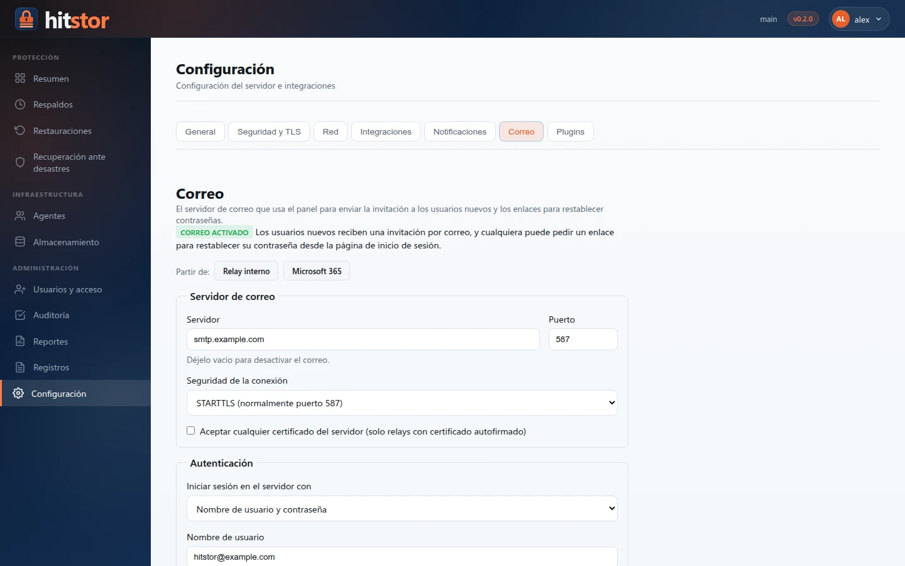

# Configuración del servidor

La página **Configuración** (`/settings`, solo para administradores) centraliza la configuración del servidor que antes estaba repartida entre variables de entorno, archivos YAML y comandos de la CLI. Sigue los mismos patrones que las consolas de respaldo empresariales: secciones agrupadas, secretos enmascarados, probar antes de guardar y un aviso de reinicio cuando los cambios de red o TLS lo requieren.

## Acceso { #access }

Abra **Administración → Configuración** en la barra lateral del dashboard, o use un enlace directo (`/settings?tab=integrations`).

## Secciones { #sections }

| Pestaña | Qué se configura |
|-----|-------------------|
| **General** | Búsqueda de actualizaciones y URL de actualización, workers en paralelo, escrituras sincrónicas, reserva mínima de espacio libre en disco, retención de la página **Registros** (entradas en memoria, archivo de registro rotativo opcional) |
| **Seguridad y TLS** | Enlace a **Usuarios y acceso**, contraseña compartida del dashboard, carga del certificado TLS, estado del certificado |
| **Red** | Puerto gRPC, puerto HTTPS del dashboard, dirección anunciada a los agentes |
| **Integraciones** | Clave de API de Gemini (Sentinel) |
| **Notificaciones** | Webhook de alertas, umbral de agente inactivo, plugins notificadores |
| **Correo** | Servidor de correo saliente para invitaciones, enlaces para restablecer la contraseña y [reportes](reports.md) |
| **Plugins** | Paquetes de plugins de carga de trabajo (`.hpk`) disponibles para instalar en los agentes |

## Integraciones { #integrations }

Configure las integraciones desde **Configuración → Integraciones**:

1. **Clave de API de Gemini**: se guarda cifrada en `config.yaml`; la usa [Ransomware Sentinel](sentinel.md) cuando `HITSTOR_SENTINEL_API_KEY` no está definida
2. **Modelo de Gemini**: el valor predeterminado es `gemini-1.5-pro` (o el predeterminado de Sentinel si no se define)

Gemini es la única integración. Las integraciones con SaaS y proveedores de nube
se eliminaron antes de la primera versión pública (v0.1.0) junto con las cargas de trabajo a las que servían.

Abra la tarjeta de Gemini con **Configurar** y use **Probar conexión** antes de guardar. Si ya tiene un valor en una variable de
entorno, haga clic en **Importar desde el entorno** para migrarlo al YAML cifrado.

## Contraseña del dashboard { #dashboard-password }

Las personas inician sesión con cuentas personales (consulte [Usuarios y acceso](users.md)). El campo **Contraseña del dashboard** cambia la contraseña compartida `serve_dashboard_password`, que solo se usa para crear el primer administrador o para iniciar sesión mientras el servidor aún no tiene repositorio. Se aplica al reiniciar.

## Certificados TLS { #tls-certificates }

Cargue un certificado PEM y su clave privada desde **Seguridad y TLS**. Los archivos se guardan en `/etc/hitstor/tls/` (Linux) y sus rutas se escriben en `serve_tls_cert` y `serve_tls_key` en el archivo de configuración.

**Se requiere reiniciar** después de la carga: TLS se carga al iniciar el servidor.

La tarjeta de estado muestra el origen (personalizado, generado automáticamente por el repositorio o autofirmado), el sujeto, el emisor, el vencimiento y los SAN.

## Notificaciones { #notifications }

`alert_webhook_url`, `alert_stale_threshold` (25 horas de forma predeterminada, de 1 a 8760) y `alert_notifier_plugins` controlan las [alertas por webhook](monitoring.md#webhook-alerting). **Probar webhook** envía un evento de prueba. Configúrelos desde **Configuración → Notificaciones**; los cambios se aplican tras reiniciar.

## Correo { #email }

El servidor de correo que se usa para los correos de las cuentas y los reportes: un relay interno, un servidor con usuario y contraseña, o Microsoft 365 con OAuth 2.0. Consulte [Usuarios y acceso → Correo](users.md#email).

{ .screenshot }

## Plugins { #plugins }

Cargue aquí los paquetes firmados de plugins de carga de trabajo (`.hpk`); luego aparecen en la página de cada agente, en **Plugins**, listos para instalar. Los agentes verifican la firma de cada paquete antes de instalarlo. Consulte [Plugins](../user-guide/plugins.md).

## API { #api }

Consulte [API HTTP del dashboard: Configuración](../reference/dashboard-api.md#settings).

## Relacionado { #related }

- [Sentinel](sentinel.md)
- [Certificados TLS](tls-certificates.md)
- [Referencia de configuración](../reference/config-reference.md)
