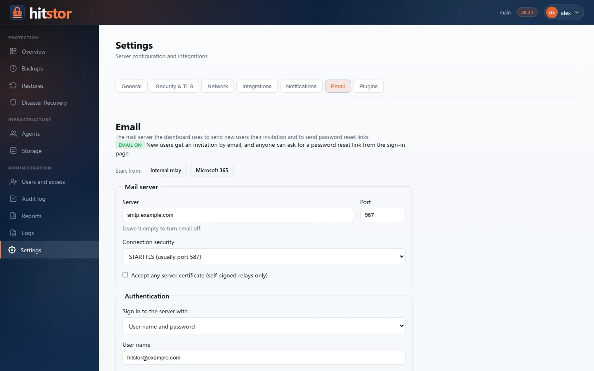

# Server Settings

The **Settings** page (`/settings`, administrators only) centralizes server configuration that was previously split across environment variables, YAML files, and CLI commands. It follows the same patterns as enterprise backup consoles: grouped sections, masked secrets, test-before-save, and a restart banner when network or TLS changes require it.

## Access

Open **Administration → Settings** in the dashboard sidebar, or use a deep link (`/settings?tab=integrations`).

## Sections

| Tab | What you configure |
|-----|-------------------|
| **General** | Update checks and update URL, parallel workers, sync writes, minimum free disk reserve, retention of the **Logs** page (in-memory entries, optional rotating log file) |
| **Security & TLS** | Link to **Users and access**, shared dashboard password, TLS certificate upload, certificate status |
| **Network** | gRPC port, dashboard HTTPS port, advertise address for agents |
| **Integrations** | Gemini API key (Sentinel) |
| **Notifications** | Alert webhook, stale-agent threshold, notifier plugins |
| **Email** | Outgoing mail server for invitations, password-reset links and [reports](reports.md) |
| **Plugins** | Workload plugin packages (`.hpk`) available to install on agents |

## Integrations

Configure integrations from **Settings → Integrations**:

1. **Gemini API key** — encrypted at rest in `config.yaml`; used by [Ransomware Sentinel](sentinel.md) when `HITSTOR_SENTINEL_API_KEY` is not set
2. **Gemini model** — defaults to `gemini-1.5-pro` (or Sentinel default when unset)

Gemini is the only integration. SaaS and cloud-provider integrations were
removed before the first public release (v0.1.0) along with the workloads they served.

Open the Gemini card with **Configure** and use **Test connection** before saving. If you already have a value in an environment
variable, click **Import from environment** to migrate it into encrypted YAML.

## Dashboard password

People sign in with personal accounts (see [Users and Access](users.md)). The **Dashboard password** field changes the shared `serve_dashboard_password`, which is used only to create the first administrator, or to sign in while the server has no repository yet. A restart applies it.

## TLS certificates

Upload a PEM certificate and private key from **Security & TLS**. Files are stored under `/etc/hitstor/tls/` (Linux) or `%ProgramData%\HitStor\tls\` (Windows) and paths are written to `serve_tls_cert` and `serve_tls_key` in the config file.

**Restart required** after upload — TLS is loaded at server startup.

The status card shows source (custom, repository auto-generated, or self-signed), subject, issuer, expiry, and SANs.

## Notifications

`alert_webhook_url`, `alert_stale_threshold` (default 25 hours, 1 to 8760) and `alert_notifier_plugins` control [webhook alerts](monitoring.md#webhook-alerting). **Test webhook** sends a test event. Configure from **Settings → Notifications**; changes apply after a restart.

## Email

The mail server used for account emails and reports: an internal relay, a server with user name and password, or Microsoft 365 with OAuth 2.0. See [Users and Access → Email](users.md#email).

{ .screenshot }

## Plugins

Upload signed workload plugin packages (`.hpk`) here; they then appear on each agent's page under **Plugins**, ready to install. Agents verify each package's signature before installing it. See [Plugins](../user-guide/plugins.md).

## API

See [Dashboard HTTP API — Settings](../reference/dashboard-api.md#settings).

## Related

- [Sentinel](sentinel.md)
- [TLS Certificates](tls-certificates.md)
- [Configuration Reference](../reference/config-reference.md)