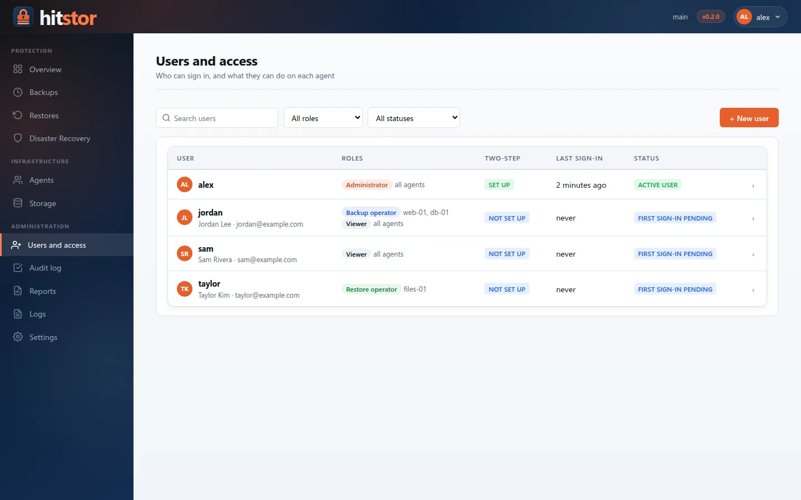
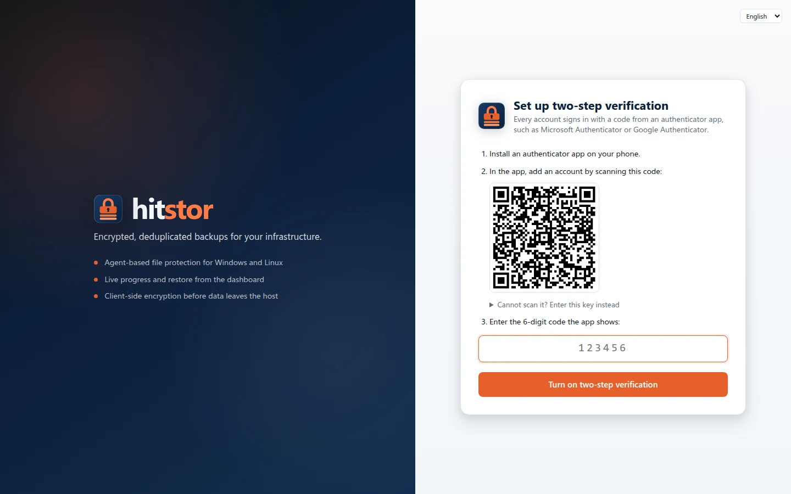
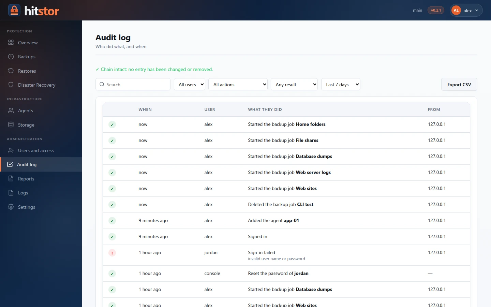

# Users and Access

The dashboard uses personal accounts. Each person signs in with their own user name, password and a code from an authenticator app, and only sees and changes what their role allows.

{ .screenshot }

## Roles { #roles }

| Role | Can do |
|------|--------|
| **Administrator** | Everything, on every agent: users, storage, settings, reports, deleting snapshots, disaster recovery. |
| **Backup operator** | Create, edit, schedule, run and cancel backup jobs; suspend and resume agents. Cannot restore. |
| **Restore operator** | Browse snapshots and restore them. Cannot change jobs. |
| **Viewer** | Read jobs, results and logs. Changes nothing. |

Backup and restore are separate roles on purpose: a person who restores can read any data that was backed up, so give that role only to those who need it.

Every role except Administrator is given either on **all agents** or on a list of agents. A backup operator for `web01` sees only `web01`, its jobs and their results; pages that span every agent (Overview, Storage, Disaster recovery, Logs) need the role on all agents. A user can hold several roles, for example backup operator on two agents and viewer on all.

## Two-step verification { #two-step-verification }

{ .screenshot }

Two-step verification is mandatory for every account. At the first sign-in each user:

1. Installs an authenticator app (Microsoft Authenticator, Google Authenticator, 1Password, Bitwarden...).
2. Scans the QR code the dashboard shows, or types the key under it.
3. Enters the 6-digit code to confirm, and saves the 10 **recovery codes** shown next. Each recovery code signs in once when the phone is not at hand.

From then on, signing in asks for the password and then a code. A code can be used only once. Under **My account** a user can generate new recovery codes (the old ones stop working) or move the authenticator to a new phone.

If a user loses both the phone and the recovery codes, an administrator resets their two-step verification (**Users → Manage → Reset two-step verification**) and the user sets it up again at the next sign-in.

## Passwords { #passwords }

- At least 12 characters and at most 128. A phrase of several words is easy to remember and hard to guess.
- Commonly used passwords and passwords containing the user name are refused.
- There are no composition rules and no periodic expiry, as NIST SP 800-63B recommends; change a password when there is a reason to.
- Passwords are stored as argon2id hashes.

Administrators never choose a user's password. With [email](#email) set up, a new user receives an invitation link and chooses their password themselves. Without it, creating a user or resetting a password gives a **temporary password**: hand it over in person or by another channel. It works once: at the next sign-in the user chooses their own password and, for a new user, sets up the authenticator.

## Email { #email }

With an outgoing mail server set up under **Settings → Email**, the dashboard sends two kinds of account email (it also sends the scheduled [reports](reports.md)):

- **Invitation.** Creating a user with an email address sends them a link to choose their password; it works once and expires after 72 hours. Nobody, not even the administrator, ever sees a temporary password. If the email cannot be sent, the dashboard says why and shows a temporary password instead.
- **Password reset.** **Forgot your password?** on the sign-in page takes a user name or email address and sends a link to choose a new password, valid for one hour. The page answers the same whether or not the account exists. An administrator can also send the link (or a new invitation, for a user who never signed in) from the user's page with **Password → Reset**.

The links are safe to lose in a mailbox: each works once, a newer link replaces older ones, and changing the password, the email address or disabling the account cancels them. A user who has set up two-step verification must also enter a code from the authenticator (or a recovery code) to choose a new password, so reading their email is not enough to take over the account. A new reset link cannot be requested for the same account within two minutes, and requests from one address are rate-limited.

The address in **Dashboard address in the links** starts every link; the dashboard never builds it from the request, so a forged `Host` header cannot redirect links elsewhere. Use the name people type to reach the dashboard, for example `https://backup.example.com:8421`.

Each user's address is set by an administrator, on the user's page or with `hitstor serve user add --email`; users see it under **My account**. Two users cannot share an address.

**Send test** sends an email with the settings in the form, before or after saving them, and shows the server's answer when it refuses.

### An internal relay { #email-relay }

A relay on the local network that accepts mail from known hosts needs no credentials. Choose **Start from: Internal relay**, enter the relay's name or address and the sender address, and allow the HitStor server's address on the relay. Connection security **None** sends without encryption: use it only on a network you trust. Use **STARTTLS** if the relay offers it; with a self-signed certificate, tick **Accept any server certificate**.

### Microsoft 365 (Exchange Online) { #email-microsoft-365 }

Exchange Online no longer accepts passwords for SMTP, so HitStor signs in as a registered app with OAuth 2.0 (client credentials) and sends as one mailbox. A shared mailbox is a good sender: it needs no license and has no password of its own.

1. In the Microsoft Entra admin center, under **App registrations → New registration**, register an app for your organization only. Note its **Application (client) ID** and **Directory (tenant) ID**.
2. Under **API permissions → Add a permission → APIs my organization uses → Office 365 Exchange Online → Application permissions**, add `SMTP.SendAsApp`, then **Grant admin consent**.
3. Under **Certificates & secrets**, create a client secret and copy its value (it is shown once). Note when it expires and renew it before.
4. In Exchange Online PowerShell, register the app's service principal and let it use the sender mailbox. The object ID is the one of the app under **Enterprise applications**, not under App registrations:

    ```powershell
    Connect-ExchangeOnline
    New-ServicePrincipal -AppId <client-id> -ObjectId <enterprise-app-object-id> -DisplayName "HitStor"
    Add-MailboxPermission -Identity hitstor@example.com -User <enterprise-app-object-id> -AccessRights FullAccess
    # Only if SMTP AUTH is turned off for the organization or the mailbox:
    Set-CASMailbox -Identity hitstor@example.com -SmtpClientAuthenticationDisabled $false
    ```

5. In HitStor, choose **Start from: Microsoft 365** (`smtp.office365.com`, port 587, STARTTLS), enter the tenant ID, client ID and secret, the mailbox as sender address, and send a test.

The server needs to reach `login.microsoftonline.com:443` (for the token) and `smtp.office365.com:587`. An error starting with `AADSTS` comes from Microsoft Entra (wrong tenant, client ID or secret, or an expired secret); `535 5.7.3` means Exchange refused the app for that mailbox (step 4).

## Sessions and lockout { #sessions }

- A session ends after 30 minutes without activity (15 for administrators) and after 12 hours in any case. Only what the user does counts as activity: opening pages, typing, clicking. Automatic refreshes do not, so a page left open on an unattended computer still times out. Two minutes before, the dashboard warns and offers to stay signed in.
- Deleting users, changing roles, resetting passwords, deleting snapshots, pruning, recovering a server and similar changes ask for the password and a code again if the last sign-in was more than 15 minutes ago.
- After 10 wrong passwords or codes an account is locked for 15 minutes. Repeated failures from one address are also slowed down.
- **My account** lists the user's open sessions and can end any of them. Administrators can end anybody's sessions under **Users**.

## The first administrator { #first-administrator }

When a server is upgraded from a version with a single dashboard password, the dashboard opens at **Create the first administrator**. Enter the current dashboard password (from `serve_dashboard_password`, or the one printed in the server log) and choose the administrator's user name and password. Then set up the authenticator. From that moment the shared password no longer signs in.

Accounts are stored next to the agent registry in the first repository (by name, in alphabetical order), in `users.json`, encrypted with the repository key. Until the server has a repository, the dashboard still signs in with the shared password.

## Managing users { #managing-users }

Administrators manage accounts under **Users and access**. The list can be searched and filtered by role and status; a row opens the user's page:

- **Roles and agents**: each role with its explanation, on all agents or on some. *In short* says in plain words what the user can do.
- **Sessions**: where the user is signed in; any session can be ended.
- **Activity**: the user's latest entries in the audit log.
- **Account**: full name, status, and resetting the password or two-step verification.
- **Danger zone**: disabling the user, or removing them after typing their user name.

The last active administrator cannot be removed, disabled or lose the role.

### From the server console { #cli }

`hitstor serve user` manages accounts directly on the server, for example when no administrator can sign in. Run it with the same configuration and repository password as the service; changes apply to a running server immediately.

```bash
# Create an administrator; prints a temporary password
hitstor serve user add maria --grant admin --display-name "Maria Perez" --email maria@example.com

# A backup operator for two agents who can also read everything
hitstor serve user add ops1 --grant backup_operator=web01,db01 --grant viewer

hitstor serve user list
hitstor serve user grant ops1 --grant restore_operator=db01   # replaces the roles
hitstor serve user passwd maria        # new temporary password, ends sessions
hitstor serve user reset-2fa maria     # set up the authenticator again
hitstor serve user disable ops1
hitstor serve user enable ops1         # also lifts a lockout
hitstor serve user remove ops1
```

## Audit log { #audit-log }

**Audit log** (administrators) lists sign-ins, failed attempts, changes to users, backups, restores, storage and settings, and denied requests, with user, address and time, in plain sentences. It can be filtered by user, type of action, result and period, and exported to CSV. Each entry carries the hash of the previous one, so editing or deleting an entry breaks the chain, and the page says where. The log is `audit.log`, next to `users.json`; changes made with `hitstor serve user` appear as user `console`.

{ .screenshot }
