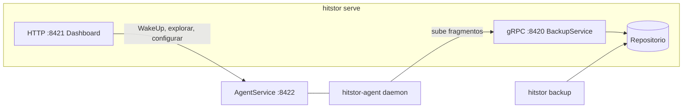

# Panorama del código fuente

Esta guía describe la estructura del repositorio de HitStor para los desarrolladores que se incorporan al proyecto o que actualizan la documentación. Refleja el árbol actual, no el contenido histórico del README.

## Qué es HitStor { #what-hitstor-is }

HitStor es una plataforma de respaldo cifrado y con deduplicación escrita en Go (`CGO_ENABLED=0`). Admite:

- **Respaldos locales con la CLI**: `hitstor backup` contra un repositorio local, S3 o de plugin
- **Respaldos centralizados servidor/agente**: diseño de agente grueso (thick agent) sobre gRPC/TLS
- **Restauración bare-metal**: medios de recuperación basados en ReaR para equipos Linux
- **Dashboard integrado**: monitoreo, programación y restauración

HitStor solo respalda sistemas de archivos (Windows y Linux). Los respaldos de M365, Google Workspace, bases de datos y máquinas virtuales en la nube/VMware se eliminaron definitivamente en la v2.0.0; consulte la [Hoja de ruta](../admin-guide/roadmap.md#permanently-removed-v200).

## Estructura de directorios { #directory-layout }

```
cmd/                          # Binarios (puntos de entrada)
  hitstor/                    # CLI principal + hitstor serve
  hitstor-agent/              # Agente de respaldo remoto
  hitstor-backend-memory/     # Plugin de almacenamiento de ejemplo
  hitstor-notifier-log/       # Plugin notificador de ejemplo
  hitstor-hook-log/           # Plugin hook de ejemplo
  hitstor-scanner-builtin/    # Plugin escáner de sistema de archivos integrado (incluido con el agente)

internal/                     # Bibliotecas principales (no importables desde fuera)
  archiver/                   # Pipeline de respaldo local
  restorer/                   # Pipeline de restauración
  repository/                 # Almacén direccionable por contenido
  server/                     # BackupService gRPC, sesiones, multi-repositorio
  agent/                      # Cliente de respaldo remoto + AgentService
  dashboard/                  # Interfaz web integrada + API HTTP
  discovery/                  # Descubrimiento automático de agentes en la LAN
  bmr/                        # Restauración bare-metal (medios de recuperación ReaR)
  sentinel/                   # Telemetría de ransomware + análisis con Gemini
  config/                     # Configuración YAML + repositories[] multi-repositorio
  plugin/                     # Gestor de go-plugin de HashiCorp
  ...                         # chunker, crypto, retention, metrics, etc.

api/proto/hitstor/plugin/v1/  # Definiciones gRPC públicas de plugins
internal/proto/hitstor/v1/    # Protos de respaldo servidor/agente (backup.proto, agent.proto)

packaging/                    # systemd, nfpm, NSIS, instaladores
docs/                         # Sitio MkDocs (esta documentación)
specs/                        # Especificaciones de funciones (solo locales: en .gitignore, no forman parte del repositorio publicado)
```

## Binarios { #binaries }

| Salida | Target del Makefile | Función |
|--------|---------------------|---------|
| `bin/hitstor` | `make build` | CLI + `serve` |
| `bin/hitstor-agent` | `make agent` | Agente remoto |
| `bin/hitstor-backend-memory` | `make plugin-memory` | Ejemplo de plugin de almacenamiento |
| `bin/hitstor-notifier-log` | `make notifier-log` | Ejemplo de plugin notificador |
| `bin/hitstor-hook-log` | `make hook-log` | Ejemplo de plugin hook |
| `bin/hitstor-scanner-builtin` | `make scanner-builtin` | Plugin escáner de sistema de archivos integrado (incluido con el agente) |

Compilar todos los plugins: `make plugins`

## Arquitectura en tiempo de ejecución { #runtime-architecture }



### Flujo de respaldo local { #local-backup-flow }

`hitstor backup` → escaneo (`internal/fs` o plugin escáner) → FastCDC → deduplicación (sesión + caché SQLite + índice) → cifrado → empaquetado → instantánea (snapshot).

### Flujo de respaldo del agente { #agent-backup-flow }

El agente escanea, fragmenta y comprime localmente → `CheckBlobs` / `UploadChunks` por gRPC → el servidor cifra, empaqueta y crea la instantánea. La detección incremental usa los **metadatos de la instantánea anterior** obtenidos de `BeginSession` (sin SQLite del lado del agente).

## Madurez de las funciones { #feature-maturity }

| Función | Estado | Notas |
|---------|--------|-------|
| Respaldo de sistemas de archivos (CLI + agente) | Estable | Motor principal |
| Servidor remoto + dashboard | Estable | gRPC + HTTP |
| Tareas de respaldo + programación | Estable | Cron, intervalo, zona horaria; `job_type` siempre es `files` |
| Restauración bare-metal | En desarrollo | Medios de recuperación basados en ReaR (Linux); consulte la [Hoja de ruta](../admin-guide/roadmap.md) |
| Descubrimiento automático de agentes | Estable | Dashboard + `/api/discover/*` |
| Ransomware Sentinel | Estable | Opcional; Gemini mediante Configuración o `HITSTOR_SENTINEL_API_KEY` |

Los respaldos de M365, Google Workspace, bases de datos y máquinas virtuales en la nube/VMware, junto con el tipo de plugin recolector de cargas de trabajo (workload collector) que los atendía, se eliminaron definitivamente en la v2.0.0. Consulte la [Hoja de ruta](../admin-guide/roadmap.md#permanently-removed-v200).

## Fuente de verdad { #source-of-truth }

Al actualizar la documentación, prefiera estos archivos antes que el texto del README:

| Tema | Archivo |
|------|---------|
| Claves de configuración | `internal/config/config.go` (`Registry`, `RepoConfig`) |
| Rutas HTTP del dashboard | `internal/dashboard/dashboard.go` (mux de `Handler()`) |
| gRPC de respaldo | `internal/proto/hitstor/v1/backup.proto` |
| gRPC de administración de agentes | `internal/proto/hitstor/v1/agent.proto` |
| API de plugins | `api/proto/hitstor/plugin/v1/*.proto` |
| Targets del Makefile | `Makefile` |

## Convenciones { #conventions }

- **Pruebas primero**: pruebas basadas en tablas en cada paquete
- **Encapsulamiento de errores**: `fmt.Errorf("package: action: %w", err)`
- **Registro**: `log/slog`
- **Sin `utils/`**: solo paquetes específicos del dominio

## Ver también { #see-also }

- [Entorno de desarrollo](dev-environment.md)
- [Compilación y empaquetado](build-and-packaging.md)
- [Funcionamiento interno](../reference/internals.md)
- [API gRPC](../reference/grpc-api.md)
- [API HTTP del dashboard](../reference/dashboard-api.md)
