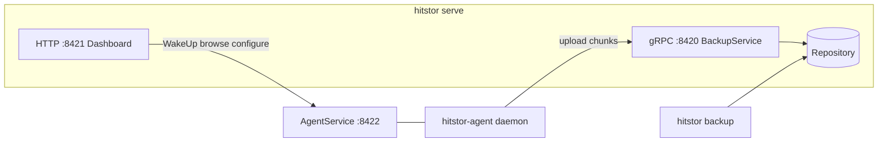

# Codebase Overview

This guide maps the HitStor repository for developers joining the project or updating documentation. It reflects the current tree, not historical README content.

## What HitStor Is

HitStor is an encrypted, deduplicated backup platform written in Go (`CGO_ENABLED=0`). It supports:

- **Local CLI backups** — `hitstor backup` against a local, S3, or plugin repository
- **Centralized server/agent backups** — thick-agent design over gRPC/TLS
- **Bare-metal restore** — ReaR-based recovery media for Linux hosts
- **Embedded dashboard** — monitoring, scheduling, restore

HitStor is filesystem-only (Windows and Linux). M365, Google Workspace, database, and cloud-VM/VMware backup were permanently removed in v2.0.0 — see [Roadmap](../admin-guide/roadmap.md#permanently-removed-v200).

## Directory Layout

```
cmd/                          # Binaries (entry points)
  hitstor/                    # Main CLI + hitstor serve
  hitstor-agent/              # Remote backup agent
  hitstor-backend-memory/     # Example storage plugin
  hitstor-notifier-log/       # Example notifier plugin
  hitstor-hook-log/           # Example hook plugin
  hitstor-scanner-builtin/    # Built-in filesystem scanner plugin (ships with core agent)

internal/                     # Core libraries (not importable externally)
  archiver/                   # Local backup pipeline
  restorer/                   # Restore pipeline
  repository/                 # Content-addressable store
  server/                     # gRPC BackupService, sessions, multi-repo
  agent/                      # Remote backup client + AgentService
  dashboard/                  # Embedded web UI + HTTP API
  discovery/                  # LAN agent auto-discovery
  bmr/                        # Bare-metal restore (ReaR recovery media)
  sentinel/                   # Ransomware telemetry + Gemini analysis
  config/                     # YAML config + multi-repo repositories[]
  plugin/                     # HashiCorp go-plugin manager
  ...                         # chunker, crypto, retention, metrics, etc.

api/proto/hitstor/plugin/v1/  # Public plugin gRPC definitions
internal/proto/hitstor/v1/    # Server/agent backup protos (backup.proto, agent.proto)

packaging/                    # systemd, nfpm, NSIS, installers
docs/                         # MkDocs site (this documentation)
specs/                        # Feature specs (local only — gitignored, not part of the published repo)
```

## Binaries

| Output | Makefile target | Role |
|--------|-----------------|------|
| `bin/hitstor` | `make build` | CLI + `serve` |
| `bin/hitstor-agent` | `make agent` | Remote agent |
| `bin/hitstor-backend-memory` | `make plugin-memory` | Storage plugin example |
| `bin/hitstor-notifier-log` | `make notifier-log` | Notifier plugin example |
| `bin/hitstor-hook-log` | `make hook-log` | Hook plugin example |
| `bin/hitstor-scanner-builtin` | `make scanner-builtin` | Built-in FS scanner plugin (ships with agent) |

Build all plugins: `make plugins`

## Runtime Architecture



### Local backup flow

`hitstor backup` → scan (`internal/fs` or scanner plugin) → FastCDC → dedup (session + SQLite cache + index) → encrypt → pack → snapshot.

### Agent backup flow

Agent scans/chunks/compresses locally → `CheckBlobs` / `UploadChunks` over gRPC → server encrypts, packs, snapshots. Incremental detection uses **previous snapshot metadata** from `BeginSession` (no agent-side SQLite).

## Feature Maturity

| Feature | Status | Notes |
|---------|--------|-------|
| Filesystem backup (CLI + agent) | Stable | Core engine |
| Remote server + dashboard | Stable | gRPC + HTTP |
| Backup jobs + scheduling | Stable | Cron, interval, timezone; `job_type` is always `files` |
| Bare-metal restore | In progress | ReaR-based recovery media (Linux); see [Roadmap](../admin-guide/roadmap.md) |
| Agent auto-discovery | Stable | Dashboard + `/api/discover/*` |
| Ransomware Sentinel | Stable | Optional; Gemini via Settings or `HITSTOR_SENTINEL_API_KEY` |

M365, Google Workspace, database, and cloud-VM/VMware backup — along with the workload collector plugin type that served them — were permanently removed in v2.0.0. See [Roadmap](../admin-guide/roadmap.md#permanently-removed-v200).

## Source of Truth

When updating docs, prefer these files over README prose:

| Topic | File |
|-------|------|
| Config keys | `internal/config/config.go` (`Registry`, `RepoConfig`) |
| Dashboard HTTP routes | `internal/dashboard/dashboard.go` (`Handler()` mux) |
| Backup gRPC | `internal/proto/hitstor/v1/backup.proto` |
| Agent management gRPC | `internal/proto/hitstor/v1/agent.proto` |
| Plugin APIs | `api/proto/hitstor/plugin/v1/*.proto` |
| Makefile targets | `Makefile` |

## Conventions

- **Test-first** — table-driven tests in each package
- **Error wrapping** — `fmt.Errorf("package: action: %w", err)`
- **Logging** — `log/slog`
- **No `utils/`** — domain-specific packages only

## See Also

- [Dev Environment](dev-environment.md)
- [Build & Packaging](build-and-packaging.md)
- [Internals](../reference/internals.md)
- [gRPC API](../reference/grpc-api.md)
- [Dashboard HTTP API](../reference/dashboard-api.md)