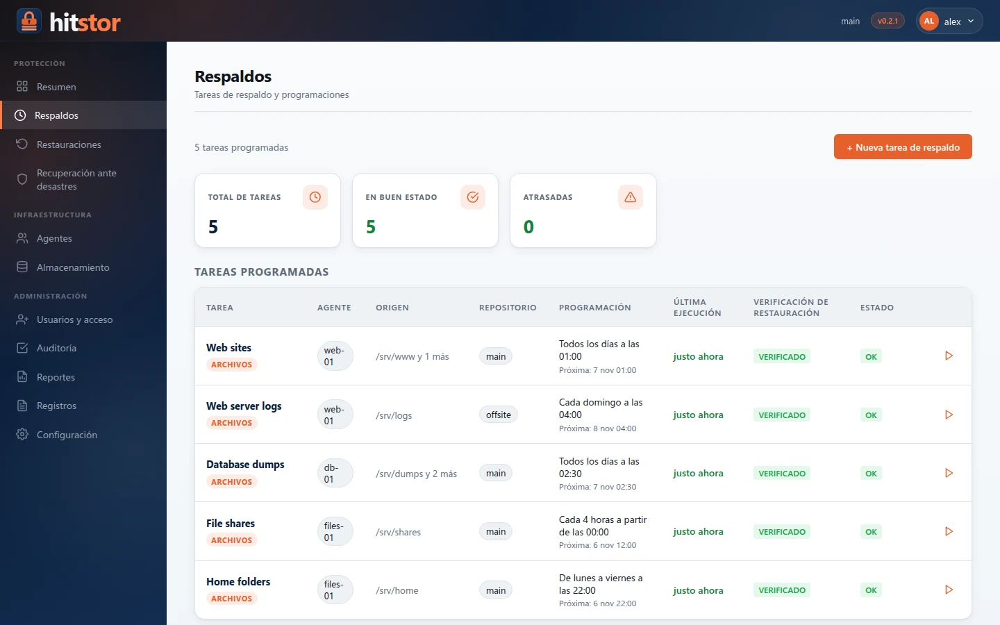
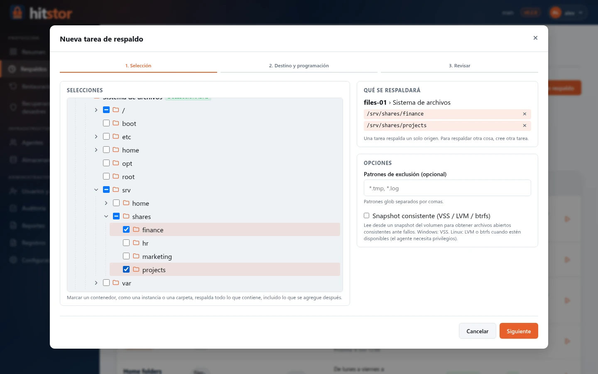
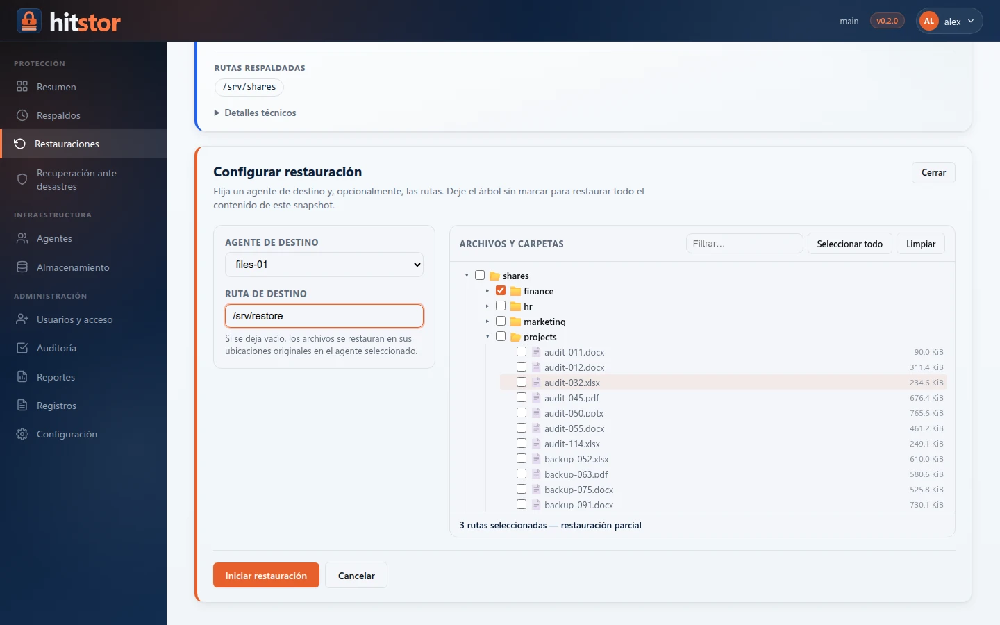
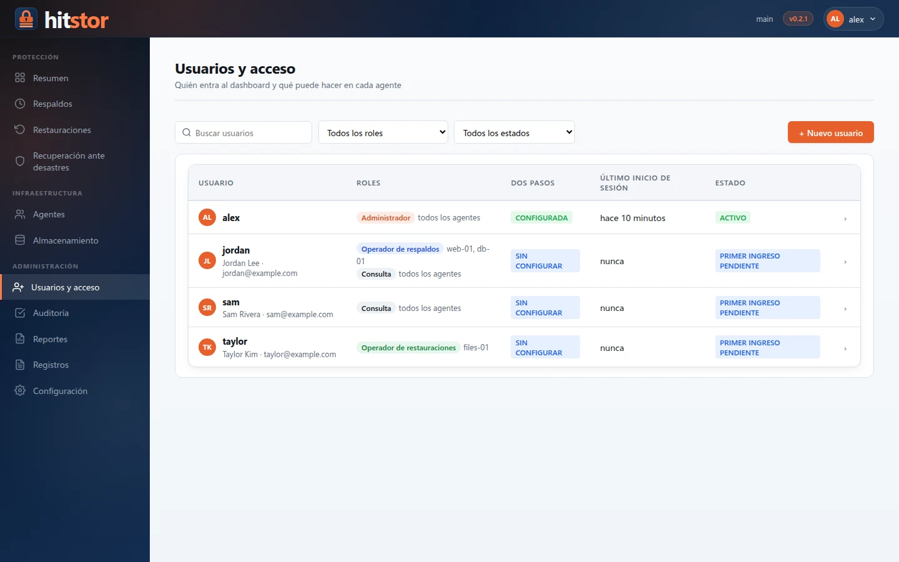
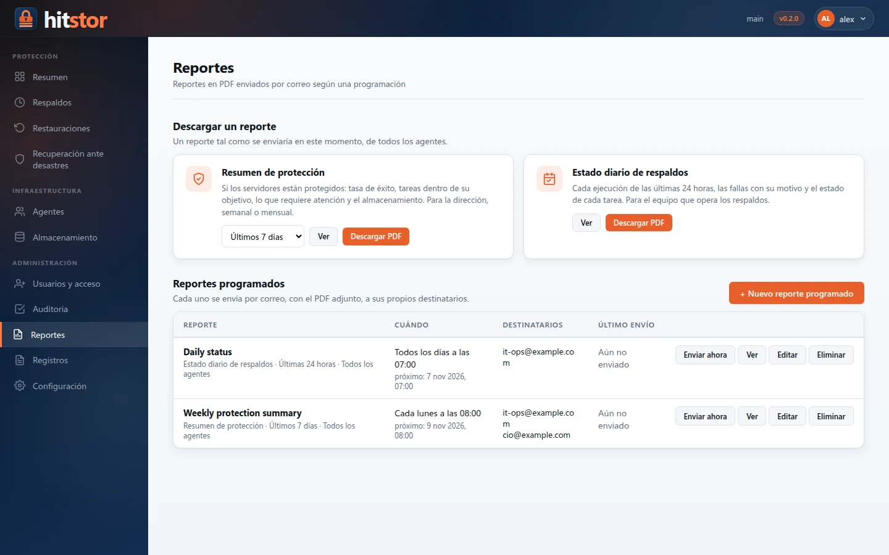
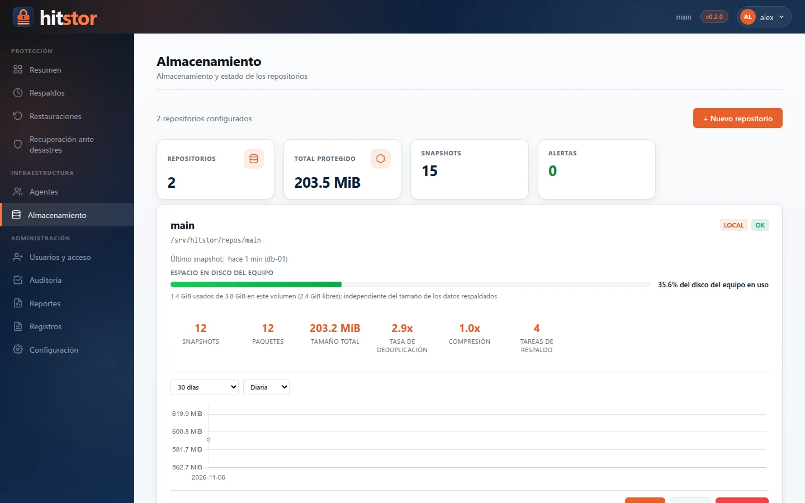

---
hide:
  - navigation
---

# HitStor { .md-visually-hidden }

{ .hero-logo }
{ .hero-logo }

Respaldos cifrados y deduplicados para Windows y Linux: servidor, agentes y dashboard web.

[Inicio rápido](installation/quickstart.md){ .md-button .md-button--primary }
[Descargas](https://github.com/hooperits/hitstor/releases/latest){ .md-button }
[Novedades](https://github.com/hooperits/hitstor/blob/master/CHANGELOG.md){ .md-button }

{ .screenshot }

HitStor respalda archivos y aplicaciones de sus equipos Windows y Linux en un
repositorio que usted controla: un disco local o cualquier bucket compatible
con S3. Un **servidor** central programa el trabajo, los **agentes** de cada
equipo hacen los respaldos y las restauraciones, y un **dashboard web** le
permite a su equipo operarlo todo desde el navegador. Los datos se deduplican
entre todos los equipos, se comprimen con Zstd y se cifran con AES-256-GCM antes
de escribirse.

## Características { #features }

-   :material-lock-outline:{ .lg .middle } **Cifrado y deduplicación**

    ---

    Fragmentación FastCDC (256 KiB–4 MiB), deduplicación entre equipos,
    compresión Zstd y AES-256-GCM. Repositorios locales y compatibles con S3.

    [:octicons-arrow-right-24: Cómo funciona](reference/internals.md)

-   :material-server-network:{ .lg .middle } **Servidor y agentes**

    ---

    Un servidor y agentes para Linux (amd64, arm64) y Windows que corren como
    servicios, se comunican por gRPC sobre TLS y solo envían datos nuevos.

    [:octicons-arrow-right-24: Desplegar agentes](admin-guide/agent-deployment.md)

-   :material-calendar-clock:{ .lg .middle } **Respaldos programados y verificados**

    ---

    Programación cron con zonas horarias, instantáneas consistentes (VSS, LVM,
    btrfs) y una verificación de restauración automática después de cada
    respaldo.

    [:octicons-arrow-right-24: Tareas de respaldo](admin-guide/backup-jobs.md)

-   :material-backup-restore:{ .lg .middle } **Restauración y recuperación ante desastres**

    ---

    Explore instantáneas, restaure archivos donde los necesite o reconstruya un
    equipo completo con el asistente de recuperación ante desastres.

    [:octicons-arrow-right-24: Restauración](user-guide/restore.md)

-   :material-database-cog-outline:{ .lg .middle } **SQL Server y plugins**

    ---

    Plugins de carga de trabajo firmados e instalados por agente. El plugin de
    SQL Server hace respaldos completos, diferenciales y de log mediante VDI,
    con restauración a un punto en el tiempo.

    [:octicons-arrow-right-24: SQL Server](user-guide/sql-server.md)

-   :material-account-lock-outline:{ .lg .middle } **Usuarios, roles y auditoría**

    ---

    Cuentas con roles por agente, verificación en dos pasos obligatoria y un
    registro de auditoría a prueba de alteraciones.

    [:octicons-arrow-right-24: Usuarios y acceso](admin-guide/users.md)

-   :material-file-chart-outline:{ .lg .middle } **Reportes PDF por correo**

    ---

    Resúmenes de protección y reportes de estado diario, enviados por correo
    según una programación mediante SMTP o Microsoft 365.

    [:octicons-arrow-right-24: Reportes](admin-guide/reports.md)

-   :material-package-variant-closed:{ .lg .middle } **Fácil de instalar**

    ---

    Instaladores de Windows, paquetes `.deb`/`.rpm`, instaladores
    autoextraíbles para Linux y una imagen de Docker. Dashboard en inglés y
    español.

    [:octicons-arrow-right-24: Instalación](installation/index.md)

## Un vistazo al dashboard { #a-look-at-the-dashboard }

=== "Nueva tarea de respaldo"

    { .screenshot }

=== "Restauración"

    { .screenshot }

=== "Usuarios y acceso"

    { .screenshot }

=== "Reportes"

    { .screenshot }

=== "Almacenamiento"

    { .screenshot }

## Por dónde empezar { #where-to-start }

| Quiero… | Lea |
|---|---|
| Probar HitStor en pocos minutos | [Inicio rápido](installation/quickstart.md) |
| Instalar el servidor en Windows | [Windows Server](installation/windows-server.md) |
| Instalar el servidor en Linux | [Instalación rápida en Linux](installation/linux-installer.md) o [Paquetes de Linux](installation/linux-packages.md) |
| Proteger un equipo | [Agente de Windows](installation/windows-agent.md) · [Despliegue de agentes](admin-guide/agent-deployment.md) |
| Respaldar SQL Server | [SQL Server](user-guide/sql-server.md) |
| Dar acceso a mi equipo | [Usuarios y acceso](admin-guide/users.md) |
| Actualizar desde la 0.1 | [Actualización](installation/upgrading.md) |

## Secciones de la documentación { #documentation-sections }

| Sección | Qué encontrará |
|---------|-------------|
| [Instalación](installation/index.md) | Docker, paquetes e instaladores de Linux, servidor y agente de Windows, actualizaciones |
| [Guía del usuario](user-guide/index.md) | Respaldos, restauraciones, instantáneas, retención, plugins, SQL Server, recuperación ante desastres |
| [Administración](admin-guide/index.md) | Puesta en marcha, TLS, usuarios y acceso, tareas, programación, reportes, monitoreo, seguridad |
| [Referencia](reference/index.md) | Comandos, configuración, variables de entorno, APIs gRPC y HTTP del dashboard, funcionamiento interno |
| [Guía de desarrollo](dev-guide/index.md) | Organización del código, arquitectura de plugins, compilación y empaquetado, pruebas, versiones |
