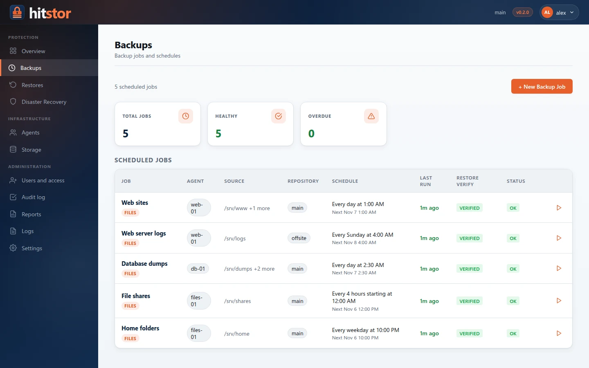
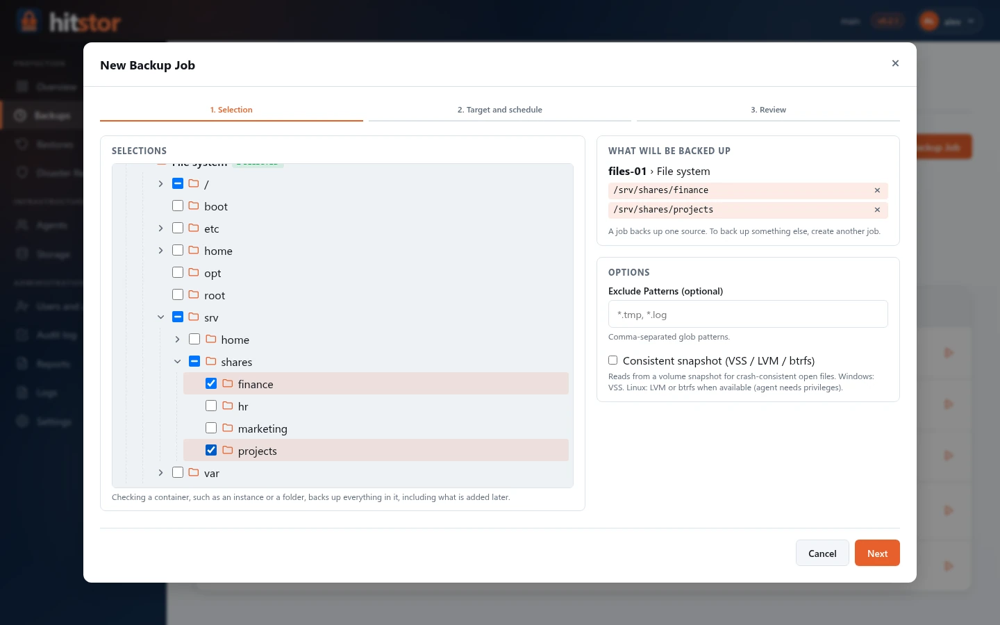
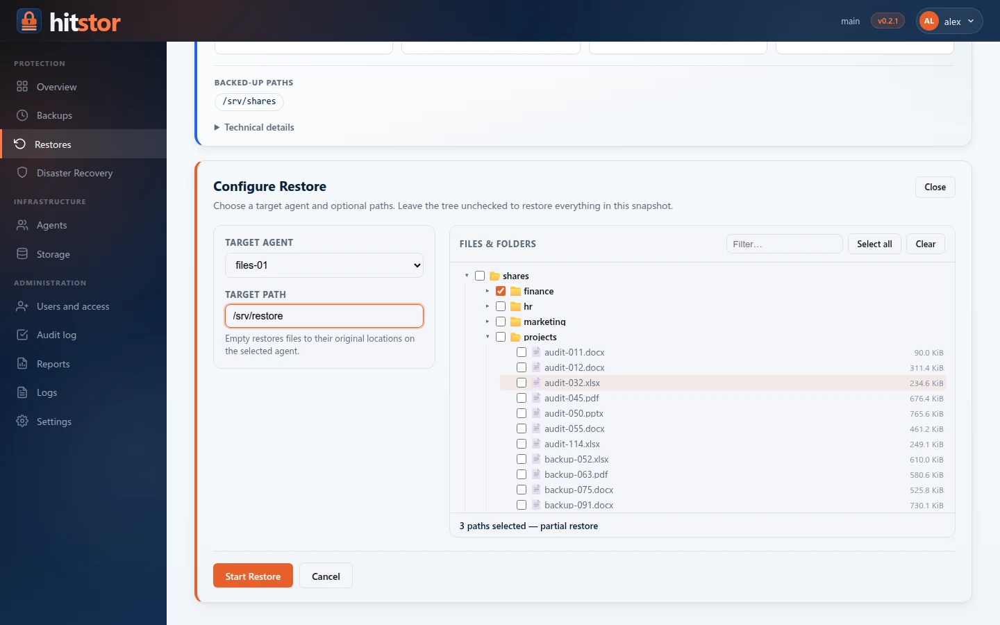
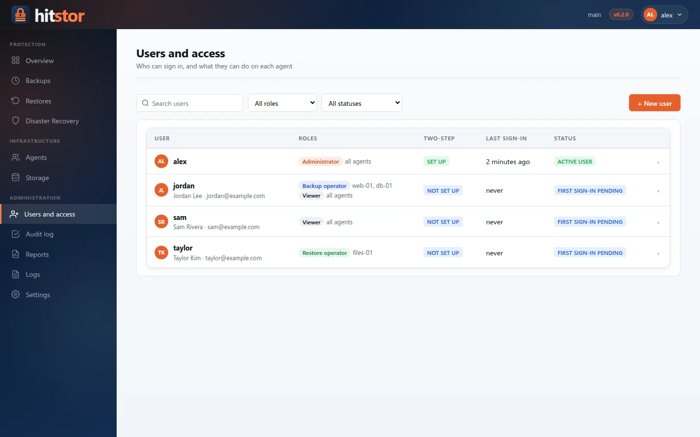
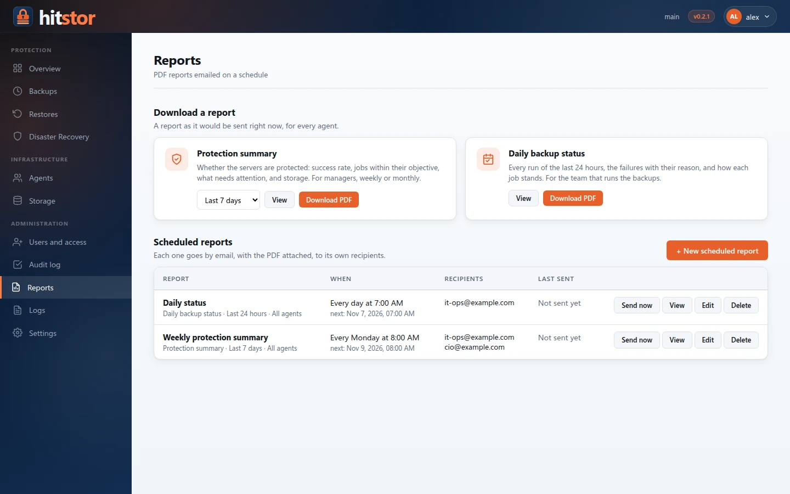
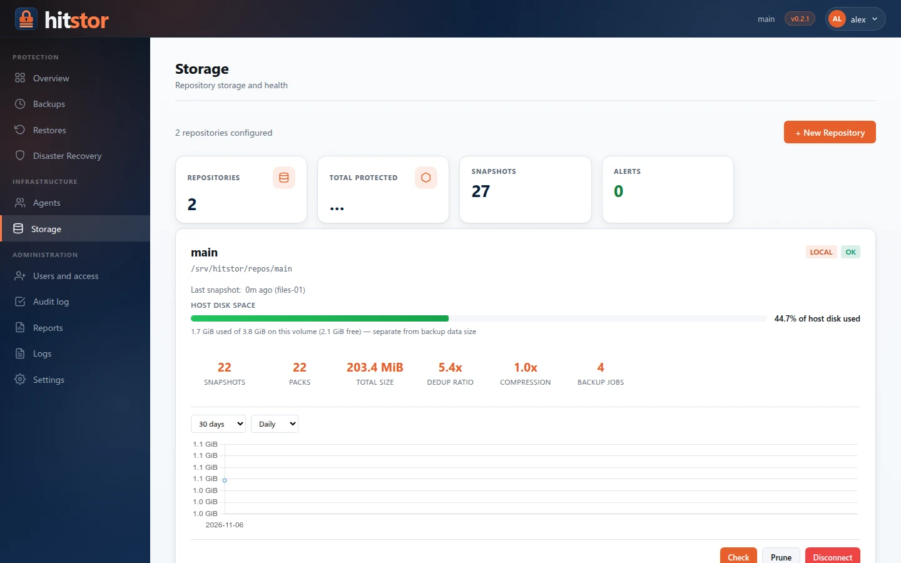

---
hide:
  - navigation
---

# HitStor { .md-visually-hidden }

{ .hero-logo }
{ .hero-logo }

Encrypted, deduplicated backups for Windows and Linux — server, agents and web dashboard.

[Quick start](installation/quickstart.md){ .md-button .md-button--primary }
[Download](https://github.com/hooperits/hitstor/releases/latest){ .md-button }
[What's new in 0.2.0](https://github.com/hooperits/hitstor/blob/master/CHANGELOG.md){ .md-button }

{ .screenshot }

HitStor backs up files and applications on your Windows and Linux machines to a
repository you control — a local disk or any S3-compatible bucket. A central
**server** schedules the work, **agents** on each machine do the backups and
restores, and a **web dashboard** lets your team run everything from a browser.
Data is deduplicated across every machine, compressed with Zstd and encrypted
with AES-256-GCM before it is written.

## Features

-   :material-lock-outline:{ .lg .middle } **Encrypted and deduplicated**

    ---

    FastCDC chunking (256 KiB–4 MiB), deduplication across hosts, Zstd
    compression and AES-256-GCM. Local and S3-compatible repositories.

    [:octicons-arrow-right-24: How it works](reference/internals.md)

-   :material-server-network:{ .lg .middle } **Server and agents**

    ---

    One server, agents on Linux (amd64, arm64) and Windows that run as
    services, talk gRPC over TLS and only send new data.

    [:octicons-arrow-right-24: Deploy agents](admin-guide/agent-deployment.md)

-   :material-calendar-clock:{ .lg .middle } **Scheduled, verified backups**

    ---

    Cron schedules with time zones, consistent snapshots (VSS, LVM, btrfs),
    and an automatic restore check after each backup.

    [:octicons-arrow-right-24: Backup jobs](admin-guide/backup-jobs.md)

-   :material-backup-restore:{ .lg .middle } **Restores and disaster recovery**

    ---

    Browse snapshots, restore files anywhere, or rebuild a whole host with the
    guided disaster recovery wizard.

    [:octicons-arrow-right-24: Restore](user-guide/restore.md)

-   :material-database-cog-outline:{ .lg .middle } **SQL Server and plugins**

    ---

    Signed workload plugins installed per agent. The SQL Server plugin does
    full, differential and log backups through VDI, with point-in-time restore.

    [:octicons-arrow-right-24: SQL Server](user-guide/sql-server.md)

-   :material-account-lock-outline:{ .lg .middle } **Users, roles and audit**

    ---

    Accounts with roles per agent, mandatory two-step verification, and a
    tamper-evident audit log.

    [:octicons-arrow-right-24: Users and access](admin-guide/users.md)

-   :material-file-chart-outline:{ .lg .middle } **PDF reports by email**

    ---

    Protection summaries and daily status reports, emailed on a schedule
    through SMTP or Microsoft 365.

    [:octicons-arrow-right-24: Reports](admin-guide/reports.md)

-   :material-package-variant-closed:{ .lg .middle } **Easy to install**

    ---

    Windows installers, `.deb`/`.rpm` packages, self-extracting Linux
    installers and a Docker image. Dashboard in English and Spanish.

    [:octicons-arrow-right-24: Installation](installation/index.md)

## A look at the dashboard

=== "New backup job"

    { .screenshot }

=== "Restore"

    { .screenshot }

=== "Users and access"

    { .screenshot }

=== "Reports"

    { .screenshot }

=== "Storage"

    { .screenshot }

## Where to start

| I want to… | Read |
|---|---|
| Try HitStor in a few minutes | [Quick start](installation/quickstart.md) |
| Install the server on Windows | [Windows server](installation/windows-server.md) |
| Install the server on Linux | [Linux quick install](installation/linux-installer.md) or [Linux packages](installation/linux-packages.md) |
| Protect a machine | [Windows agent](installation/windows-agent.md) · [Agent deployment](admin-guide/agent-deployment.md) |
| Back up SQL Server | [SQL Server](user-guide/sql-server.md) |
| Give my team access | [Users and access](admin-guide/users.md) |
| Upgrade from 0.1 | [Upgrading](installation/upgrading.md) |

## Documentation sections

| Section | What you will find |
|---------|-------------|
| [Installation](installation/index.md) | Docker, Linux packages and installers, Windows server and agent, upgrades |
| [User guide](user-guide/index.md) | Backups, restores, snapshots, retention, plugins, SQL Server, disaster recovery |
| [Administration](admin-guide/index.md) | Server setup, TLS, users and access, jobs, scheduling, reports, monitoring, security |
| [Reference](reference/index.md) | Commands, configuration, environment variables, gRPC and dashboard HTTP APIs, internals |
| [Dev guide](dev-guide/index.md) | Code layout, plugin architecture, build and packaging, testing, releases |
