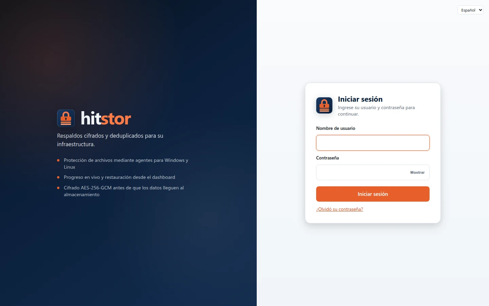

# Inicio rápido

Ponga HitStor en marcha en unos 15 minutos. Esta guía cubre las cuatro rutas recomendadas para los primeros usuarios:

1. **Docker**: la forma más rápida de ejecutar el servidor (desarrolladores y homelab)
2. **Instalador para VM Linux**: servidor estilo producción en una sola máquina
3. **Instalador para Windows Server**: servidor como servicio de Windows
4. **Solo agente**: conecte laptops y servidores a un servidor de HitStor existente

Los agentes son siempre binarios nativos instalados en cada máquina que desee respaldar. El servidor puede ejecutarse en Docker o en una VM.

## Ruta A: Docker (recomendada) { #path-a-docker-recommended }

### Requisitos previos { #prerequisites }

- Docker 20.10+ y Docker Compose v2
- 2 GB de RAM y algunos GB de disco libre para el volumen del repositorio

### 1. Configurar el entorno { #1-configure-environment }

```bash
git clone https://github.com/hooperits/hitstor.git
cd hitstor
cp .env.example .env
```

Edite `.env` y defina un `HITSTOR_PASSWORD` robusto (cifrado del repositorio) y un `HITSTOR_DASHBOARD_PASSWORD` (la contraseña de configuración inicial que usará una sola vez para crear el primer administrador del dashboard). Si deja `HITSTOR_DASHBOARD_PASSWORD` vacío, el servidor genera una nueva aleatoria cada vez que se inicia el contenedor; consulte [Contraseña del dashboard y primer administrador](#dashboard-password).

### 2. Iniciar el servidor { #2-start-the-server }

```bash
docker compose -f docker-compose.quickstart.yml up -d
```

En el primer inicio, el contenedor ejecuta automáticamente `hitstor init` y luego `hitstor serve`.

### 3. Abrir el dashboard { #3-open-the-dashboard }

Vaya a [https://localhost:8421](https://localhost:8421) (el certificado es autofirmado, por lo que el navegador muestra una advertencia la primera vez). El dashboard se abre en **Cree el primer administrador**: ingrese `HITSTOR_DASHBOARD_PASSWORD` (o la contraseña generada), elija su nombre de usuario y contraseña, y configure una app de autenticación. Consulte [Contraseña del dashboard y primer administrador](#dashboard-password).

{ .screenshot }

| Puerto | Servicio |
|------|---------|
| 8421 | Dashboard web |
| 8420 | gRPC (aquí se conectan los agentes) |

### 4. Instalar un agente { #4-install-an-agent }

En cada máquina que vaya a respaldar, instale el binario del agente. Consulte la [Ruta D](#path-d-agent-only) más abajo.

### Opcional: almacenamiento S3 con MinIO { #optional-s3-storage-with-minio }

Para guardar los respaldos en almacenamiento compatible con S3 en lugar de un volumen local de Docker:

```bash
docker compose -f docker-compose.quickstart.yml --profile s3 up -d
```

Esto inicia HitStor con `s3:http://minio:9000/hitstor-backups` y una instancia de MinIO incluida. La consola de MinIO está en [http://localhost:9001](http://localhost:9001) (`minioadmin` / `minioadmin`).

!!! warning "Solo para desarrollo"
    Las credenciales de MinIO incluidas son para pruebas locales. No exponga este stack a internet sin cambiar las credenciales y habilitar TLS.

### Descargar una imagen precompilada { #pull-a-pre-built-image }

Las imágenes de cada versión se publican en GHCR (`ghcr.io/hooperits/hitstor`, con la etiqueta de la versión y `latest`):

```bash
export HITSTOR_IMAGE=ghcr.io/hooperits/hitstor
export HITSTOR_VERSION=latest
docker compose -f docker-compose.quickstart.yml up -d
```

O bien, compile localmente:

```bash
docker compose -f docker-compose.quickstart.yml build
docker compose -f docker-compose.quickstart.yml up -d
```

### Detener y eliminar { #stop-and-remove }

```bash
docker compose -f docker-compose.quickstart.yml down
# Agregue -v para eliminar los volúmenes de datos del repositorio
```

---

## Ruta B: instalador para VM Linux { #path-b-linux-vm-installer }

Use esta ruta si prefiere una instalación nativa del servidor sin Docker, lo habitual en una VM dedicada a respaldos.

### 1. Descargar el instalador del servidor { #1-download-the-server-installer }

Desde [GitHub Releases](https://github.com/hooperits/hitstor/releases):

```bash
wget https://github.com/hooperits/hitstor/releases/download/vX.Y.Z/hitstor-server-X.Y.Z-linux-amd64.run
chmod +x hitstor-server-*.run
sudo ./hitstor-server-*.run
```

El asistente interactivo pide el directorio de datos, una contraseña opcional de configuración inicial del dashboard, los puertos y la dirección que usan los agentes para llegar al servidor; luego configura systemd e inicia el servidor. No crea un repositorio: eso se hace desde el dashboard.

### 2. Abrir el dashboard { #2-open-the-dashboard }

Abra `http://<server-ip>:8421` e inicie sesión con la contraseña del dashboard que ingresó en el asistente (si la dejó vacía, consulte [Contraseña del dashboard y primer administrador](#dashboard-password)). Mientras no exista un repositorio, el servidor funciona en modo de configuración inicial por HTTP sin cifrar. Cree un repositorio desde la página **Almacenamiento** y reinicie el servicio (`sudo systemctl restart hitstor-server`): el dashboard pasa a HTTPS (`https://<server-ip>:8421`, autofirmado de forma predeterminada) y se abre en **Cree el primer administrador**.

Consulte [Instalación rápida para Linux](linux-installer.md) para conocer los detalles del asistente y [Configuración del servidor](../admin-guide/server-setup.md) para el endurecimiento en producción.

### 3. Instalar agentes { #3-install-agents }

Continúe con la [Ruta D](#path-d-agent-only).

---

## Ruta C: instalador para Windows Server { #path-c-windows-server-installer }

Use esta ruta para ejecutar el servidor en Windows Server 2016+ (o Windows 10 1809+) como servicio de Windows.

### 1. Ejecutar el instalador { #1-run-the-installer }

Descargue `hitstor-X.Y.Z-windows-amd64-setup.exe` desde [GitHub Releases](https://github.com/hooperits/hitstor/releases) y ejecútelo como Administrador, o instálelo de forma desatendida desde un PowerShell con privilegios elevados:

```powershell
.\hitstor-X.Y.Z-windows-amd64-setup.exe /S
```

El instalador copia `hitstor.exe` a `C:\Program Files\HitStor`, crea `C:\ProgramData\HitStor\config.yaml`, agrega reglas de firewall para los puertos 8420 y 8421, y registra e inicia el servicio `HitStor`. Si ejecuta un instalador más reciente de la misma forma, la instalación se actualiza en el mismo lugar.

### 2. Obtener la contraseña del dashboard { #2-get-the-dashboard-password }

El servidor genera una contraseña aleatoria de configuración inicial del dashboard en el primer inicio. Léala en el servidor como se describe en [Contraseña del dashboard y primer administrador](#dashboard-password).

### 3. Abrir el dashboard { #3-open-the-dashboard_1 }

Abra `http://<server-ip>:8421`, inicie sesión con esa contraseña y cree un repositorio desde la página **Almacenamiento**. Mientras no exista un repositorio, el servidor funciona en modo de configuración inicial y sirve el dashboard por HTTP sin cifrar; HTTPS (autofirmado de forma predeterminada) se habilita después de configurar un repositorio y reiniciar el servicio (`Restart-Service HitStor`). Después del reinicio, abra `https://<server-ip>:8421` y cree el primer administrador (consulte [Contraseña del dashboard y primer administrador](#dashboard-password)).

Consulte [Windows Server](windows-server.md) para la gestión del servicio y los detalles del firewall.

### 4. Instalar agentes { #4-install-agents }

Continúe con la [Ruta D](#path-d-agent-only).

---

## Ruta D: solo agente { #path-d-agent-only }

Instale `hitstor-agent` en cada máquina cuyos datos desee tener en el repositorio.

### Linux { #linux }

```bash
wget https://github.com/hooperits/hitstor/releases/download/vX.Y.Z/hitstor-agent-X.Y.Z-linux-amd64.run
chmod +x hitstor-agent-*.run
sudo ./hitstor-agent-*.run
```

El asistente solo pide el puerto de escucha del agente (de forma predeterminada, **8422**), instala el servicio y muestra el token del agente. En el dashboard de HitStor:

1. Vaya a **Agentes** → **Agregar agente**
2. Ingrese la dirección IP del agente, su puerto de escucha y el token
3. Cree una tarea de respaldo en **Respaldos**

Para instalaciones mediante scripts:

```bash
curl -fsSL https://raw.githubusercontent.com/hooperits/hitstor/master/scripts/install-agent.sh | sudo bash
```

Consulte [Despliegue de agentes](../admin-guide/agent-deployment.md) para el modo daemon y Windows, y [SQL Server](../user-guide/sql-server.md) para los respaldos de bases de datos mediante el plugin de carga de trabajo `mssql`.

### Windows { #windows }

Descargue `hitstor-agent-X.Y.Z-windows-amd64-setup.exe` desde Releases y ejecute el instalador. Consulte [Agente de Windows](windows-agent.md).

### Verificar la conectividad { #verify-connectivity }

Desde el host del agente, el puerto gRPC del servidor debe ser accesible (de forma predeterminada, **8420**). Los agentes consultan periódicamente al servidor para obtener las programaciones de respaldo; también puede iniciar un respaldo con **Respaldar ahora** desde el dashboard.

---

## Contraseña del dashboard y primer administrador { #dashboard-password }

El dashboard usa cuentas personales, cada una con su propia contraseña, sus roles y verificación en dos pasos obligatoria (consulte [Usuarios y acceso](../admin-guide/users.md)). Un servidor nuevo todavía no tiene cuentas, así que arranca con una única **contraseña del dashboard** (el parámetro `serve_dashboard_password`) que solo sirve para llegar al primer administrador:

1. **Todavía sin repositorio** (modo de configuración inicial): inicie sesión con la contraseña del dashboard, cree un repositorio en **Almacenamiento** y reinicie el servidor. Las cuentas se guardan junto al primer repositorio, por lo que solo pueden existir cuando este existe.
2. **Con repositorio y sin cuentas**: todas las páginas llevan a **Cree el primer administrador** (`/setup`). Ingrese la contraseña actual del dashboard, elija el nombre de usuario y la contraseña del administrador (al menos 12 caracteres), escanee el código QR con una app de autenticación y guarde los códigos de recuperación.
3. **Con cuentas**: cada persona inicia sesión con su propio nombre de usuario, contraseña y un código. La contraseña del dashboard ya no permite iniciar sesión. Agregue más usuarios en **Usuarios y acceso**.

HitStor **no tiene una contraseña predeterminada del dashboard**. La contraseña proviene de:

| Ruta de instalación | Origen |
|--------------|--------|
| Docker | `HITSTOR_DASHBOARD_PASSWORD` en `.env` |
| Instalador para VM Linux | La contraseña ingresada en el asistente |
| Instalador para Windows | Se genera en el primer inicio |

Cuando el archivo de configuración no tiene contraseña del dashboard, `hitstor serve` genera una aleatoria al iniciar, guarda su hash en el archivo de configuración (si el servidor tiene uno; si no, se genera una contraseña nueva en cada inicio) y escribe el texto plano **una sola vez** en el registro del servidor, en una entrada que contiene `no dashboard password configured; generated one`. No necesita acceso al dashboard para leerla: lea el registro en el servidor.

### Leer la contraseña generada { #read-the-generated-password }

**Windows** (PowerShell como Administrador; el registro solo pueden leerlo los Administradores y SYSTEM):

```powershell
Select-String -Path C:\ProgramData\HitStor\logs\server.log -Pattern 'generated one' |
  Select-Object -Last 1 |
  ForEach-Object { ($_.Line | ConvertFrom-Json).fields.password }
```

**Linux:**

```bash
sudo grep 'generated one' /var/log/hitstor/server.log | tail -1
# o bien
sudo journalctl -u hitstor-server | grep 'generated one' | tail -1
```

**Docker:**

```bash
docker compose -f docker-compose.quickstart.yml logs hitstor | grep 'generated one' | tail -1
```

Copie y pegue el valor en lugar de escribirlo: las contraseñas generadas mezclan caracteres que se parecen (`l`/`I`, `O`/`0`).

Úsela para iniciar sesión mientras el servidor no tiene repositorio y para crear el primer administrador. El registro conserva la entrada original, por lo que si cambia la contraseña en **Configuración** antes de eso, el valor registrado deja de funcionar.

### Crear el primer administrador desde la consola { #first-administrator-console }

En lugar de la página `/setup`, puede crear el primer administrador en el servidor con [`hitstor serve user add`](../admin-guide/users.md#cli). Ejecútelo con la misma configuración que el servicio: usa el repositorio donde el servidor guarda sus usuarios (el primero por nombre) y muestra una contraseña temporal y, en el primer inicio de sesión, el usuario elige su propia contraseña y configura la app de autenticación:

```bash
# Linux
sudo -u hitstor hitstor --config /etc/hitstor/config.yaml serve user add admin --grant admin

# Inicio rápido con Docker (el contenedor ya tiene HITSTOR_REPO y HITSTOR_PASSWORD)
docker compose -f docker-compose.quickstart.yml exec hitstor hitstor serve user add admin --grant admin
```

La misma familia de comandos restablece una contraseña (`serve user passwd`) o la verificación en dos pasos (`serve user reset-2fa`) cuando ningún administrador puede iniciar sesión.

### Restablecer una contraseña perdida { #reset-a-lost-password }

Esto se aplica a la contraseña del dashboard, antes de que exista el primer administrador. Cuando ya hay cuentas, restablezca la contraseña de un usuario con `hitstor serve user passwd <nombre>` (consulte [Usuarios y acceso](../admin-guide/users.md#cli)).

Elimine la contraseña almacenada del archivo de configuración y reinicie el servidor; se genera una contraseña nueva y se registra como se indicó arriba.

**Windows:**

```powershell
Stop-Service HitStor
$cfg = 'C:\ProgramData\HitStor\config.yaml'
(Get-Content $cfg) -notmatch '^serve_dashboard_password:' | Set-Content $cfg -Encoding ascii
Start-Service HitStor
```

**Linux:**

```bash
sudo sed -i '/^serve_dashboard_password:/d' /etc/hitstor/config.yaml
sudo systemctl restart hitstor-server
```

**Docker:** defina un nuevo `HITSTOR_DASHBOARD_PASSWORD` en `.env` y vuelva a crear el contenedor (`docker compose -f docker-compose.quickstart.yml up -d --force-recreate`).

---

## Lista de verificación del primer respaldo { #first-backup-checklist }

Una vez conectados el servidor y al menos un agente:

1. **Almacenamiento**: confirme que existe un repositorio (el inicio rápido con Docker crea uno automáticamente; con los instaladores para VM y Windows se crea desde el dashboard)
2. **Agentes**: el agente aparece como conectado en el dashboard
3. **Respaldos**: cree una tarea y asígnela al agente: un respaldo de archivos o una tarea de carga de trabajo como [SQL Server](../user-guide/sql-server.md), con un plan de respaldo con programaciones completa, diferencial y de log
4. **Ejecutar**: haga clic en **Respaldar ahora** o espere a la programación
5. **Restaurar**: pruebe una restauración desde el dashboard o la CLI

## Próximos pasos { #next-steps }

- [Primeros pasos](../user-guide/getting-started.md): respaldo, restauración, retención
- [Despliegue con Docker](docker.md): compose para producción, detalles de la imagen, exportación sin conexión
- [Despliegue de agentes](../admin-guide/agent-deployment.md): configuración de agentes para producción
- [Configuración](../user-guide/configuration.md): referencia del archivo de configuración
