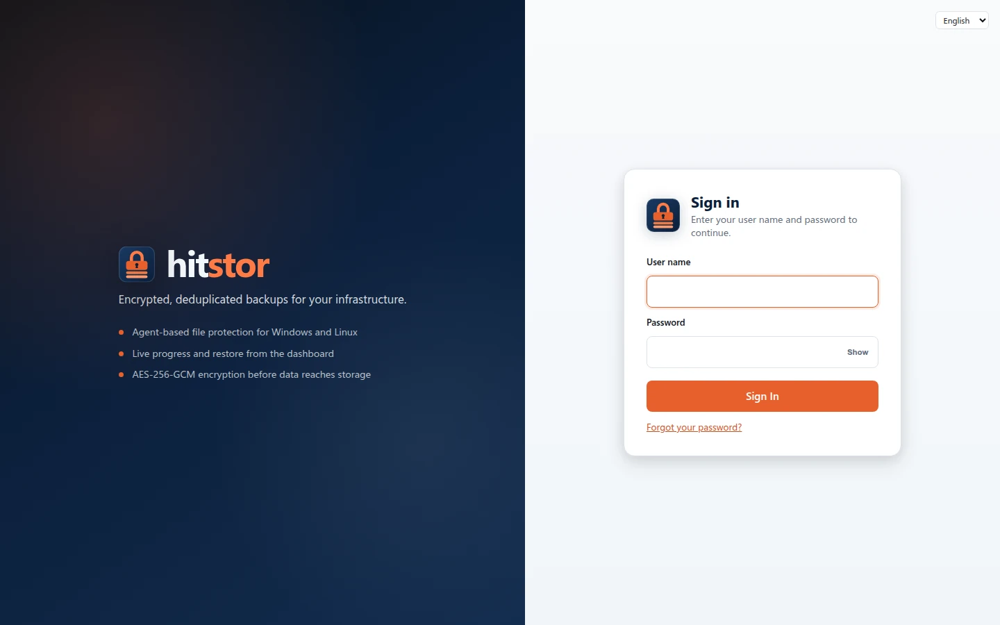

# Quick Start

Get HitStor running in about 15 minutes. This guide covers the four recommended paths for early adopters:

1. **Docker** — fastest way to run the server (developers and homelab)
2. **Linux VM installer** — production-style server on a single machine
3. **Windows Server installer** — server as a Windows Service
4. **Agent only** — connect laptops and servers to an existing HitStor server

Agents are always native binaries installed on each machine you want to back up. The server can run in Docker or on a VM.

## Path A: Docker (Recommended)

### Prerequisites

- Docker 20.10+ and Docker Compose v2
- 2 GB RAM and a few GB of free disk for the repository volume

### 1. Configure environment

```bash
git clone https://github.com/hooperits/hitstor.git
cd hitstor
cp .env.example .env
```

Edit `.env` and set a strong `HITSTOR_PASSWORD` (repository encryption) and `HITSTOR_DASHBOARD_PASSWORD` (the setup password you use once to create the first dashboard administrator). If you leave `HITSTOR_DASHBOARD_PASSWORD` empty, the server generates a new random one on every container start — see [Dashboard Password and First Administrator](#dashboard-password).

### 2. Start the server

```bash
docker compose -f docker-compose.quickstart.yml up -d
```

On first start, the container automatically runs `hitstor init` and then `hitstor serve`.

### 3. Open the dashboard

Navigate to [https://localhost:8421](https://localhost:8421) (the certificate is self-signed, so the browser warns the first time). The dashboard opens at **Create the first administrator**: enter `HITSTOR_DASHBOARD_PASSWORD` (or the generated password), choose your user name and password, and set up an authenticator app. See [Dashboard Password and First Administrator](#dashboard-password).

{ .screenshot }

| Port | Service |
|------|---------|
| 8421 | Web dashboard |
| 8420 | gRPC (agents connect here) |

### 4. Install an agent

On each machine to back up, install the agent binary. See [Path D](#path-d-agent-only) below.

### Optional: S3 storage with MinIO

To store backups in S3-compatible storage instead of a local Docker volume:

```bash
docker compose -f docker-compose.quickstart.yml --profile s3 up -d
```

This starts HitStor with `s3:http://minio:9000/hitstor-backups` and a bundled MinIO instance. The MinIO console is at [http://localhost:9001](http://localhost:9001) (`minioadmin` / `minioadmin`).

!!! warning "Development only"
    The bundled MinIO credentials are for local testing. Do not expose this stack to the internet without changing credentials and enabling TLS.

### Pull a pre-built image

Release images are published to GHCR (`ghcr.io/hooperits/hitstor`, tagged with the release version and `latest`):

```bash
export HITSTOR_IMAGE=ghcr.io/hooperits/hitstor
export HITSTOR_VERSION=latest
docker compose -f docker-compose.quickstart.yml up -d
```

Build locally instead:

```bash
docker compose -f docker-compose.quickstart.yml build
docker compose -f docker-compose.quickstart.yml up -d
```

### Stop and remove

```bash
docker compose -f docker-compose.quickstart.yml down
# Add -v to delete repository data volumes
```

---

## Path B: Linux VM Installer

Use this when you prefer a native server install without Docker — typical for a dedicated backup VM.

### 1. Download the server installer

From [GitHub Releases](https://github.com/hooperits/hitstor/releases):

```bash
wget https://github.com/hooperits/hitstor/releases/download/vX.Y.Z/hitstor-server-X.Y.Z-linux-amd64.run
chmod +x hitstor-server-*.run
sudo ./hitstor-server-*.run
```

The interactive wizard asks for the data directory, an optional dashboard setup password, the ports, and the address agents use to reach the server; it then configures systemd and starts the server. It does not create a repository: you do that from the dashboard.

### 2. Open the dashboard

Open `http://<server-ip>:8421` and sign in with the dashboard password you entered in the wizard (if you left it empty, see [Dashboard Password and First Administrator](#dashboard-password)). Until a repository exists the server runs in setup mode over plain HTTP. Create a repository from the **Storage** page and restart the service (`sudo systemctl restart hitstor-server`): the dashboard then switches to HTTPS (`https://<server-ip>:8421`, self-signed by default) and opens at **Create the first administrator**.

See [Linux Quick Install](linux-installer.md) for wizard details and [Server Setup](../admin-guide/server-setup.md) for production hardening.

### 3. Install agents

Continue with [Path D](#path-d-agent-only).

---

## Path C: Windows Server Installer

Use this to run the server on Windows Server 2016+ (or Windows 10 1809+) as a Windows Service.

### 1. Run the installer

Download `hitstor-X.Y.Z-windows-amd64-setup.exe` from [GitHub Releases](https://github.com/hooperits/hitstor/releases) and run it as Administrator, or install unattended from an elevated PowerShell:

```powershell
.\hitstor-X.Y.Z-windows-amd64-setup.exe /S
```

The installer copies `hitstor.exe` to `C:\Program Files\HitStor`, creates `C:\ProgramData\HitStor\config.yaml`, adds firewall rules for ports 8420 and 8421, and registers and starts the `HitStor` service. Running a newer installer the same way upgrades in place.

### 2. Get the dashboard password

The server generates a random dashboard setup password on first start. Read it on the server as described in [Dashboard Password and First Administrator](#dashboard-password).

### 3. Open the dashboard

Open `http://<server-ip>:8421`, sign in with that password, and create a repository from the **Storage** page. Until a repository exists the server runs in setup mode and serves the dashboard over plain HTTP; HTTPS (self-signed by default) is enabled after a repository is configured and the service restarts (`Restart-Service HitStor`). After the restart, open `https://<server-ip>:8421` and create the first administrator (see [Dashboard Password and First Administrator](#dashboard-password)).

See [Windows Server](windows-server.md) for service management and firewall details.

### 4. Install agents

Continue with [Path D](#path-d-agent-only).

---

## Path D: Agent Only

Install `hitstor-agent` on every machine whose data you want in the repository.

### Linux

```bash
wget https://github.com/hooperits/hitstor/releases/download/vX.Y.Z/hitstor-agent-X.Y.Z-linux-amd64.run
chmod +x hitstor-agent-*.run
sudo ./hitstor-agent-*.run
```

The wizard asks only for the agent's listen port (default **8422**), installs the service, and prints the agent token. In the HitStor dashboard:

1. Go to **Agents** → **Add Agent**
2. Enter the agent's IP address, its listen port, and the token
3. Create a backup job under **Backups**

For scripted installs:

```bash
curl -fsSL https://raw.githubusercontent.com/hooperits/hitstor/master/scripts/install-agent.sh | sudo bash
```

See [Agent Deployment](../admin-guide/agent-deployment.md) for daemon mode and Windows, and [SQL Server](../user-guide/sql-server.md) for database backups through the `mssql` workload plugin.

### Windows

Download `hitstor-agent-X.Y.Z-windows-amd64-setup.exe` from Releases and run the installer. See [Windows Agent](windows-agent.md).

### Verify connectivity

From the agent host, the server gRPC port must be reachable (default **8420**). Agents poll the server for backup schedules; you can also trigger **Backup Now** from the dashboard.

---

## Dashboard Password and First Administrator { #dashboard-password }

The dashboard uses personal accounts, each with its own password, roles, and mandatory two-step verification (see [Users and Access](../admin-guide/users.md)). A new server has no accounts yet, so it starts with a single **dashboard password** (the `serve_dashboard_password` setting) that is only used to get to the first administrator:

1. **No repository yet** (setup mode): sign in with the dashboard password and create a repository under **Storage**, then restart the server. Accounts are stored next to the first repository, so they can only exist once it does.
2. **Repository, no accounts**: every page leads to **Create the first administrator** (`/setup`). Enter the current dashboard password, choose the administrator's user name and password (at least 12 characters), then scan the QR code with an authenticator app and save the recovery codes.
3. **Accounts exist**: everyone signs in with their own user name, password, and a code. The dashboard password no longer signs in. Add more users under **Users and access**.

HitStor has **no default dashboard password**. The password comes from:

| Install path | Source |
|--------------|--------|
| Docker | `HITSTOR_DASHBOARD_PASSWORD` in `.env` |
| Linux VM installer | The password entered in the wizard |
| Windows installer | Generated on first start |

When the config file has no dashboard password, `hitstor serve` generates a random one at startup, saves its hash to the config file (when the server has one; otherwise a new password is generated at every start), and writes the plaintext **once** to the server log, in an entry that contains `no dashboard password configured; generated one`. You do not need dashboard access to read it — read the log on the server.

### Read the generated password

**Windows** (PowerShell as Administrator; the log is readable only by Administrators and SYSTEM):

```powershell
Select-String -Path C:\ProgramData\HitStor\logs\server.log -Pattern 'generated one' |
  Select-Object -Last 1 |
  ForEach-Object { ($_.Line | ConvertFrom-Json).fields.password }
```

**Linux:**

```bash
sudo grep 'generated one' /var/log/hitstor/server.log | tail -1
# or
sudo journalctl -u hitstor-server | grep 'generated one' | tail -1
```

**Docker:**

```bash
docker compose -f docker-compose.quickstart.yml logs hitstor | grep 'generated one' | tail -1
```

Copy and paste the value rather than typing it — generated passwords mix characters that look alike (`l`/`I`, `O`/`0`).

Use it to sign in while the server has no repository, and to create the first administrator. The log keeps the original entry, so if you change the password under **Settings** before that, the logged value no longer works.

### Create the first administrator from the console { #first-administrator-console }

Instead of the `/setup` page, you can create the first administrator on the server with [`hitstor serve user add`](../admin-guide/users.md#cli). Run it with the same configuration as the service: it uses the repository where the server keeps its users (the first one by name) and prints a temporary password, and at the first sign-in the user chooses their own password and sets up the authenticator:

```bash
# Linux
sudo -u hitstor hitstor --config /etc/hitstor/config.yaml serve user add admin --grant admin

# Docker quick start (the container already has HITSTOR_REPO and HITSTOR_PASSWORD)
docker compose -f docker-compose.quickstart.yml exec hitstor hitstor serve user add admin --grant admin
```

The same command family resets a password (`serve user passwd`) or two-step verification (`serve user reset-2fa`) when no administrator can sign in.

### Reset a lost password

This applies to the dashboard password, before the first administrator exists. Once there are accounts, reset a user's password with `hitstor serve user passwd <name>` (see [Users and Access](../admin-guide/users.md#cli)).

Remove the stored password from the config file and restart the server; a new password is generated and logged as above.

**Windows:**

```powershell
Stop-Service HitStor
$cfg = 'C:\ProgramData\HitStor\config.yaml'
(Get-Content $cfg) -notmatch '^serve_dashboard_password:' | Set-Content $cfg -Encoding ascii
Start-Service HitStor
```

**Linux:**

```bash
sudo sed -i '/^serve_dashboard_password:/d' /etc/hitstor/config.yaml
sudo systemctl restart hitstor-server
```

**Docker:** set a new `HITSTOR_DASHBOARD_PASSWORD` in `.env` and recreate the container (`docker compose -f docker-compose.quickstart.yml up -d --force-recreate`).

---

## First Backup Checklist

After server and at least one agent are connected:

1. **Storage** — confirm a repository exists (Docker quickstart creates one automatically; with the VM and Windows installers you create it from the dashboard)
2. **Agents** — agent shows as connected in the dashboard
3. **Backups** — create a job and assign it to the agent: a file backup, or a workload job such as [SQL Server](../user-guide/sql-server.md) with a backup plan of full, differential, and log schedules
4. **Run** — click **Backup Now** or wait for the schedule
5. **Restore** — test a restore from the dashboard or CLI

## Next Steps

- [Getting Started](../user-guide/getting-started.md) — backup, restore, retention
- [Docker Deployment](docker.md) — production compose, image details, offline export
- [Agent Deployment](../admin-guide/agent-deployment.md) — production agent setup
- [Configuration](../user-guide/configuration.md) — config file reference