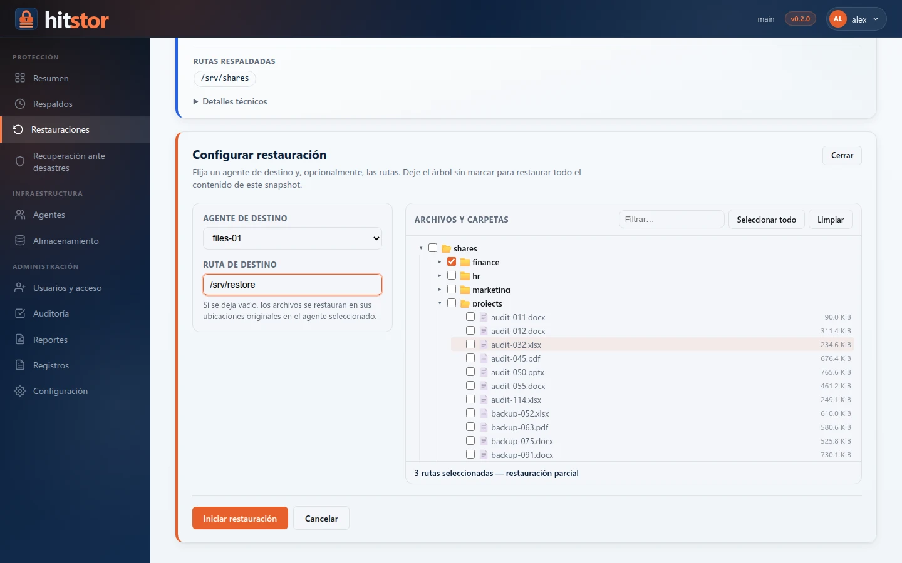

# Restauración

El comando `hitstor restore` extrae archivos de una instantánea (snapshot) y los escribe en un directorio de destino. Puede restaurar una instantánea completa o seleccionar archivos y directorios individuales.

{ .screenshot }

## Uso básico { #basic-usage }

```console
hitstor restore --repo /path/to/repo --password "secret" SNAPSHOT_ID /target
```

Esto recrea en `/target` el árbol de directorios completo capturado en la instantánea indicada.

```console
hitstor restore --repo /path/to/repo --password "secret" abc12345 /restore/path
restoring snapshot abc12345 to /restore/path
✓ restored 1,247 files (512.0 MiB) in 6.3s
```

## Resolución del ID de instantánea { #snapshot-id-resolution }

HitStor admite tres formas de identificar la instantánea que desea restaurar.

### ID completo { #full-id }

El identificador hexadecimal completo de la instantánea, tal como lo muestra `hitstor snapshots`:

```console
hitstor restore --repo /path/to/repo --password "secret" \
    abc12345def67890abc12345def67890abc12345def67890abc12345def67890 /target
```

### Prefijo corto { #short-prefix }

Cualquier prefijo único del ID, como el ID de 8 caracteres que muestra `hitstor snapshots`:

```console
hitstor restore --repo /path/to/repo --password "secret" abc12345 /target
```

Si el prefijo coincide con más de una instantánea, HitStor informa un error (`snapshot prefix "abc1" is ambiguous (2 matches)`); indique un prefijo más largo.

### La palabra clave `latest` { #the-latest-keyword }

La palabra `latest` se resuelve en la instantánea más reciente del repositorio:

```console
hitstor restore --repo /path/to/repo --password "secret" latest /target
```

Cuando el repositorio contiene instantáneas de varios hosts o rutas, `latest` elige la instantánea más reciente sin importar el host ni la ruta. Combine antes `--host` o `--path` en el comando `snapshots` para identificar la instantánea exacta que necesita.

## Restauración selectiva con `--include` { #selective-restore-with-include }

Para restaurar solo una parte de una instantánea, use `--include` con una ruta dentro de la instantánea. La ruta es relativa a la raíz de la instantánea, que guarda cada directorio respaldado con su propio nombre (un respaldo de `/data` guarda `/data/reports` como `data/reports`). La ruta se compara de forma exacta, no como patrón glob: restaura ese archivo, o ese directorio con todo su contenido:

```console
hitstor restore --repo /path/to/repo --password "secret" \
    --include data/reports \
    abc12345 /target
```

Se pueden combinar varios flags `--include`. Un archivo se restaura si es **cualquiera** de las rutas o está dentro de ella (aquí, de un respaldo de `/home/user`):

```console
hitstor restore --repo /path/to/repo --password "secret" \
    --include user/documents \
    --include user/photos/2026 \
    abc12345 /target
```

En el destino solo se crean los archivos coincidentes y sus directorios padre.

## Restaurar en otra ubicación { #restoring-to-a-different-location }

La ruta de destino no tiene que coincidir con la ruta original del respaldo. Puede restaurar en cualquier directorio con permisos de escritura:

```console
hitstor restore --repo /path/to/repo --password "secret" \
    abc12345 /tmp/recovery
```

La estructura de directorios de la instantánea se recrea dentro del destino. Por ejemplo, si la instantánea contiene `/data/reports/q1.pdf`, el archivo restaurado aparece en `/tmp/recovery/data/reports/q1.pdf`.

## Propietario y permisos de los archivos { #file-ownership-and-permissions }

HitStor registra los metadatos POSIX de los archivos -- propietario (UID/GID), permisos y marcas de tiempo -- en cada instantánea.

Durante la restauración:

- Los **permisos** se aplican tal como se registraron. Si el usuario actual no tiene permiso para establecer un modo determinado, el archivo se crea con el umask predeterminado del usuario y se muestra una advertencia.
- El **propietario** solo se restaura cuando la restauración se ejecuta como root. Las restauraciones sin root asignan como propietario al usuario actual.
- Las **marcas de tiempo** (hora de modificación y hora de acceso) se restauran tanto para archivos como para directorios.

!!! note
    En sistemas de archivos que no admiten permisos POSIX (por ejemplo, FAT32), los metadatos de propietario y permisos se ignoran sin aviso.

## Indicador de progreso { #progress-display }

En una terminal, las operaciones de restauración muestran una barra de progreso en vivo con:

- Porcentaje completado
- Archivos restaurados del total
- Velocidad de transferencia
- Tiempo restante estimado

Ejemplo de salida durante una restauración:

```
[##############------]  73% | 912/1,247 files | 62.4 MiB/s | ETA 2s
```

Cuando la salida se redirige a un archivo o a una tubería (pipe), HitStor muestra en su lugar una línea `restored <ruta> (<tamaño>)` por archivo. En ambos casos termina con un resumen de los archivos y bytes restaurados.

## Verificar los datos restaurados { #verifying-restored-data }

Después de una restauración, es buena práctica verificar que el resultado coincida con el contenido de la instantánea. Estos son los enfoques disponibles.

### Usar `hitstor verify-restore` { #use-hitstor-verify-restore }

[`hitstor verify-restore`](../reference/commands/verify-restore.md) restaura una instantánea (o una muestra de sus archivos) en un directorio temporal, vuelve a fragmentar cada archivo y compara el resultado con la instantánea. Es la verificación más sólida de que una instantánea puede restaurarse:

```console
hitstor verify-restore --repo /path/to/repo --password "secret" latest
```

### Comparar la cantidad de archivos { #compare-file-counts }

Compare la cantidad de archivos registrada en la instantánea con el árbol restaurado:

```console
hitstor snapshots --repo /path/to/repo --password "secret" --json \
    | jq '.[] | select(.id == "abc12345") | .total_files'
1247

find /restore/path -type f | wc -l
1247
```

### Usar `hitstor check` { #use-hitstor-check }

El comando `check` verifica la integridad del repositorio a nivel de almacenamiento, lo que confirma que los datos que respaldan la instantánea no están dañados:

```console
hitstor check --repo /path/to/repo --password "secret"
```

### Verificación con sumas de comprobación { #checksum-verification }

Para restauraciones críticas, genere sumas de comprobación (checksums) de los archivos originales (antes o durante el respaldo) y compárelas con las copias restauradas:

```console
cd /restore/path && sha256sum -c /path/to/checksums.txt
```

!!! tip
    Si sospecha que hay datos dañados, ejecute primero `hitstor check`. Si el repositorio pasa todas las verificaciones, el resultado de la restauración es confiable.
