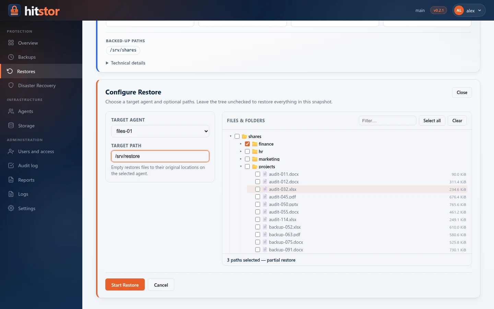

# Restore

The `hitstor restore` command extracts files from a snapshot and writes them to a target directory. You can restore an entire snapshot or select individual files and directories.

{ .screenshot }

## Basic Usage

```console
hitstor restore --repo /path/to/repo --password "secret" SNAPSHOT_ID /target
```

This recreates the full directory tree captured in the specified snapshot under `/target`.

```console
hitstor restore --repo /path/to/repo --password "secret" abc12345 /restore/path
restoring snapshot abc12345 to /restore/path
✓ restored 1,247 files (512.0 MiB) in 6.3s
```

## Snapshot ID Resolution

HitStor supports three ways to identify the snapshot you want to restore.

### Full ID

The complete hexadecimal snapshot identifier as shown by `hitstor snapshots`:

```console
hitstor restore --repo /path/to/repo --password "secret" \
    abc12345def67890abc12345def67890abc12345def67890abc12345def67890 /target
```

### Short Prefix

Any unique prefix of the ID, such as the 8-character ID that `hitstor snapshots` shows:

```console
hitstor restore --repo /path/to/repo --password "secret" abc12345 /target
```

If the prefix matches more than one snapshot, HitStor reports an error (`snapshot prefix "abc1" is ambiguous (2 matches)`); provide a longer prefix.

### The `latest` Keyword

The word `latest` resolves to the most recent snapshot in the repository:

```console
hitstor restore --repo /path/to/repo --password "secret" latest /target
```

When the repository contains snapshots from multiple hosts or paths, `latest` picks the single most recent snapshot regardless of host or path. Combine with `--host` or `--path` in the `snapshots` command first to identify the exact snapshot you need.

## Selective Restore with `--include`

To restore only part of a snapshot, use `--include` with a path inside the snapshot. The path is relative to the snapshot root, which holds each backed-up directory under its own name (a backup of `/data` stores `/data/reports` as `data/reports`). The path is matched exactly, not as a glob pattern: it restores that file, or that directory with everything under it:

```console
hitstor restore --repo /path/to/repo --password "secret" \
    --include data/reports \
    abc12345 /target
```

Multiple `--include` flags can be combined. A file is restored if it is, or is under, **any** of the paths (here from a backup of `/home/user`):

```console
hitstor restore --repo /path/to/repo --password "secret" \
    --include user/documents \
    --include user/photos/2026 \
    abc12345 /target
```

Only the matching files and their parent directories are created in the target.

## Restoring to a Different Location

The target path does not need to match the original backup path. You can restore to any writable directory:

```console
hitstor restore --repo /path/to/repo --password "secret" \
    abc12345 /tmp/recovery
```

The directory structure from the snapshot is recreated under the target. For example, if the snapshot contains `/data/reports/q1.pdf`, the restored file appears at `/tmp/recovery/data/reports/q1.pdf`.

## File Ownership and Permissions

HitStor records POSIX file metadata -- ownership (UID/GID), permissions, and timestamps -- in every snapshot.

During restore:

- **Permissions** are applied as recorded. If the current user does not have permission to set a given mode, the file is created with the user's default umask and a warning is printed.
- **Ownership** is restored only when the restore runs as root. Non-root restores set the owner to the current user.
- **Timestamps** (modification time and access time) are restored for both files and directories.

!!! note
    On filesystems that do not support POSIX permissions (for example, FAT32), ownership and permission metadata are silently ignored.

## Progress Display

On a terminal, restore operations display a live progress bar showing:

- Percentage done
- Files restored out of the total
- Throughput
- Estimated time remaining

Example output during a restore:

```
[##############------]  73% | 912/1,247 files | 62.4 MiB/s | ETA 2s
```

When output is redirected to a file or pipe, HitStor prints one `restored <path> (<size>)` line per file instead. Both end with a summary of files and bytes restored.

## Verifying Restored Data

After a restore it is good practice to verify that the output matches the snapshot contents. The following approaches are available.

### Use `hitstor verify-restore`

[`hitstor verify-restore`](../reference/commands/verify-restore.md) restores a snapshot (or a sample of its files) to a temporary directory, re-chunks every file, and compares the result with the snapshot. It is the strongest check that a snapshot is restorable:

```console
hitstor verify-restore --repo /path/to/repo --password "secret" latest
```

### Compare File Counts

Compare the number of files recorded in the snapshot with the restored tree:

```console
hitstor snapshots --repo /path/to/repo --password "secret" --json \
    | jq '.[] | select(.id == "abc12345") | .total_files'
1247

find /restore/path -type f | wc -l
1247
```

### Use `hitstor check`

The `check` command verifies repository integrity at the storage level, which confirms that the data backing the snapshot is not corrupted:

```console
hitstor check --repo /path/to/repo --password "secret"
```

### Checksum Verification

For critical restores, generate checksums of the original files (before or during backup) and compare them against the restored copies:

```console
cd /restore/path && sha256sum -c /path/to/checksums.txt
```

!!! tip
    If you suspect data corruption, run `hitstor check` first. If the repository passes all checks, the restore output is trustworthy.

